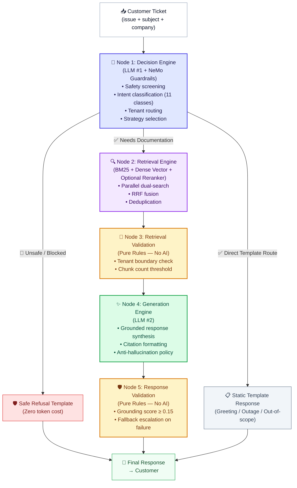
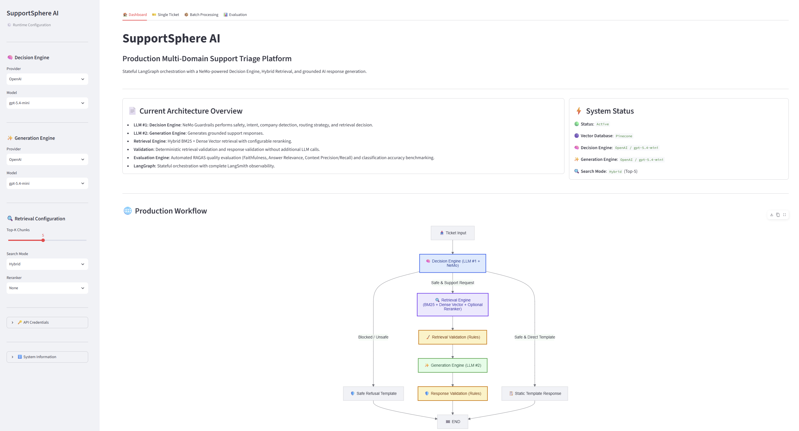
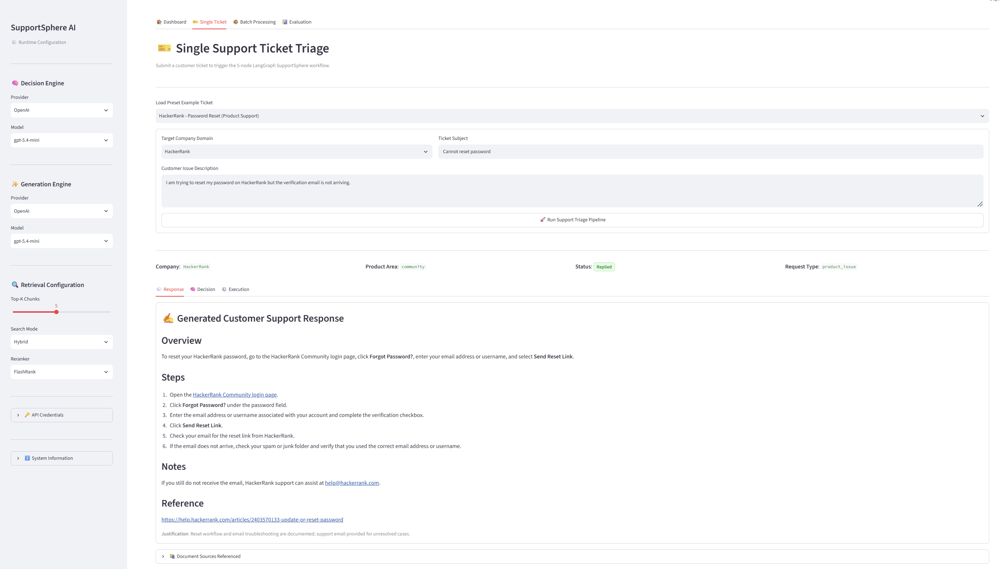
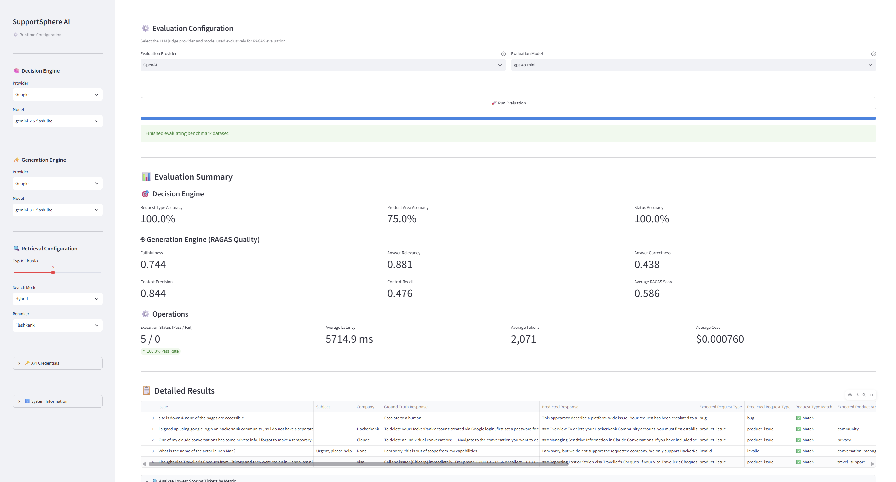

<div align="center">

# 🌐 SupportSphere AI

### Production-Grade Multi-Tenant Customer Support Automation Platform

*An intelligent AI agent that reads customer support tickets, figures out what the customer needs, searches through official product documentation, and writes accurate, grounded answers — all in under 3–8 seconds.*

---

[](https://python.org)
[](https://github.com/langchain-ai/langgraph)
[](https://github.com/langchain-ai/langchain)
[](https://streamlit.io)
[](https://pinecone.io)
[](https://github.com/NVIDIA/NeMo-Guardrails)
[](https://github.com/explodinggradients/ragas)
[](https://docker.com)
[](https://aws.amazon.com)
[](https://github.com/features/actions)
[](LICENSE)

</div>

---

## 📋 Table of Contents

- [What Is SupportSphere AI?](#-what-is-supportsphere-ai)
- [Why Was It Built?](#-why-was-it-built)
- [How It Works — Plain English](#-how-it-works--plain-english)
- [Key Features](#-key-features)
- [System Architecture](#-system-architecture)
- [Technology Stack](#-technology-stack)
- [Installation](#-installation)
- [Quick Start](#-quick-start)
- [Configuration Summary](#-configuration-summary)
- [Performance Summary](#-performance-summary--experiment-findings)
- [Project Structure](#-project-structure)
- [Documentation Index](#-documentation-index)
- [Screenshots](#-screenshots)
- [Roadmap](#-roadmap)
- [License](#-license)
- [Author & Acknowledgements](#-author--acknowledgements)

---

## 🌐 What Is SupportSphere AI?

**SupportSphere AI** is a production-ready, AI-powered **customer support automation platform**. It was built to handle support tickets for three different companies — **HackerRank**, **Claude (Anthropic)**, and **Visa** — all from a single system.

When a customer submits a support ticket, the system:
1. **Reads and understands** the ticket
2. **Decides** what kind of request it is (question, bug, complaint, greeting, etc.)
3. **Searches** the correct company's documentation
4. **Writes** a clear, accurate, cited answer
5. **Validates** the answer before sending it — never inventing facts

Think of it as a very careful AI agent that is trained to say *"I don't know"* rather than make things up.

---

## 🤔 Why Was It Built?

### The Problem

Enterprise customer support desks face three major pain points:

| Problem | Impact |
|---|---|
| **High ticket volume** | Human agents cannot scale cost-effectively |
| **Domain misrouting** | Wrong team handles ticket → slow resolution |
| **AI hallucinations** | Generic chatbots make up answers → customer distrust |

Standard AI chatbots have an additional critical flaw: if you ask them about HackerRank but they accidentally read Visa's documentation to answer, they'll mix up information from different companies — a serious problem for enterprise environments.

### The Solution

SupportSphere AI solves all three with:
- **Automated triage** that classifies tickets in milliseconds
- **Hard tenant isolation** that mathematically prevents cross-company documentation leaks
- **Grounding validation** that blocks any AI response not supported by retrieved documents

---

## 🧠 How It Works — Plain English

> **For Beginners:** Here's what happens when a customer submits a ticket, step by step.

```
Customer writes: "I signed up with Google on HackerRank, I don't have a password. 
                  Please delete my account."
```

### Step 1 — Decision Engine (LLM #1 + Safety Check)
The first AI model reads the ticket and answers several questions:
- *Is this safe to process?* → Yes (NVIDIA safety guardrails pass)
- *What kind of request is this?* → `product_issue`
- *Which company is this for?* → `HackerRank`
- *What part of the product?* → `community`
- *Does this need a documentation search?* → Yes

### Step 2 — Hybrid Retrieval (Search Engine)
The system now searches HackerRank's documentation using **two techniques simultaneously**:
- **BM25** — old-school keyword matching (like Google in the 90s)
- **Vector Search** — modern AI semantic search (understands meaning, not just words)

Both results are combined using a ranking algorithm. The best 5–10 document chunks are selected.

### Step 3 — Retrieval Validation (Rules Check, No AI)
A purely rule-based validator checks:
- Are all retrieved chunks actually from HackerRank? ✅
- Are there enough chunks to answer this? ✅

> **Zero AI tokens spent here** — this is pure Python code.

### Step 4 — Generation Engine (LLM #2)
A second AI model reads the retrieved documentation and writes a structured answer:
```
### Overview
You can delete your HackerRank Community account...

### Steps
1. Log in using your Google account
2. Go to Settings → Delete Account
...

### Reference
https://help.hackerrank.com/articles/5618101592-delete-an-account
```

### Step 5 — Response Validation (Grounding Check, No AI)
One final rule checks: does the answer actually use words from the retrieved documents?
- Grounding score ≥ 0.15 → ✅ Send to customer
- Grounding score < 0.15 → ❌ Blocked — escalate instead

---

## ✨ Key Features

### 🧠 AI Orchestration
- **LangGraph 5-Node State Machine**: The workflow is a directed graph — `decision_engine` → `retrieval` → `retrieval_validation` → `generation` → `response_validation` — with smart conditional routing.
- **Dual-LLM Architecture**: Two completely separate AI models handle different jobs. LLM #1 reasons and routes; LLM #2 generates responses. This separation gives precise cost control.
- **Multi-Provider Support**: Works with OpenAI, Google Gemini, and Groq. You can mix-and-match providers for the two LLMs (e.g., Gemini for decisions, Groq for generation).

### 🔍 Hybrid Retrieval & Reranking
- **BM25 + Vector Search**: Parallel keyword search and semantic vector search, fused via Reciprocal Rank Fusion (RRF).
- **Plug-and-Play Rerankers**: Choose from FlashRank (fast, local ONNX model), CrossEncoder (precise, HuggingFace), LLM-based reranking, or No-Op passthrough.
- **Deduplication & URL Capping**: Eliminates duplicate chunk texts and enforces a per-URL chunk cap (`MAX_CHUNKS_PER_URL = 2`) to ensure diverse context.

### 🛡️ Guardrails & Safety
- **NVIDIA NeMo Guardrails**: Colang 2.0 policy engine screens every incoming ticket for prompt injection, jailbreaks, PII leakage, and abusive language.
- **Custom Python Actions**: `verify_company` (blocks cross-tenant chunks), `filter_duplicate_chunks`, and `calculate_grounding_score` (word-overlap gate ≥ 0.15).
- **Zero-Token Fallbacks**: Platform outages, greetings, and out-of-scope requests receive instant static template responses — no AI model invoked, no token cost.

### 📊 Observability & Billing
- **Node-Attributed Logging**: Every node writes to dedicated log files (`application.log`, `pipeline.log`, `errors.log`) with node context tags (`[Node 1: Decision Engine]`).
- **Audit Summary Block**: A 55-line formatted execution summary is printed after every ticket.
- **Versioned Billing Catalog**: Per-model, per-stage token and cost tracking using pricing snapshots (`2026-07-18`).

### 🖥️ Administration Dashboard
- **4-Tab Streamlit UI**: Overview Dashboard, Single Ticket Debugger, Batch CSV Triage, and RAGAS Benchmark Evaluator.
- **Live Sidebar Configuration**: Change providers, models, search strategy, rerankers, and Top-K in real-time without restarting.

---

## 🏗️ System Architecture

The system is a **directed acyclic state machine** managed by LangGraph. Every ticket travels through up to 5 nodes:



---

## 🛠️ Technology Stack

| Category | Technology | Version | What It Does |
|---|---|---|---|
| **Language** | Python | 3.12 | Core programming language |
| **Workflow Engine** | LangGraph | 1.2+ | Manages the 5-node state machine — the brain of the orchestration |
| **LLM Framework** | LangChain | 1.3+ | Provides uniform abstractions to call OpenAI, Google, Groq APIs |
| **Safety** | NVIDIA NeMo Guardrails | 0.23+ | Colang 2.0 policy engine for content safety enforcement |
| **Vector Database** | Pinecone | 9.1+ | Stores and searches document embeddings in the cloud |
| **Keyword Search** | Rank-BM25 | 0.2+ | Classic TF-IDF keyword search that complements vector search |
| **Embeddings** | Google Gemini Embeddings | `gemini-embedding-001` | Converts text into 768-dimensional numeric vectors for semantic search |
| **Rerankers** | FlashRank / CrossEncoder | 0.2+ / 5.6+ | Re-scores retrieved documents to put the best ones first |
| **LLM Providers** | OpenAI, Google Gemini, Groq | — | The actual AI models that classify and generate responses |
| **Evaluation** | RAGAS | 0.4+ | Automated quality scoring: Faithfulness, Relevancy, Precision, Recall |
| **Web UI** | Streamlit | 1.59+ | Interactive admin dashboard and ticket debugger |
| **Charts** | Plotly / Pandas | 6.9+ / 3.0+ | Benchmark radar charts and data export |
| **Package Manager** | uv | — | Fast Python package installer and virtualenv manager |

---

## ⚡ Installation

### What You Need Before Starting
- **Python 3.12** (exactly — not 3.11 or 3.13)
- **`uv`** package manager (recommended)
- **A Pinecone account** with an index named `support-sphere-ai`
- **At least one API key**: OpenAI, Google AI Studio, or Groq

### Step 1 — Clone the Repository
```bash
git clone https://github.com/ChandraCherupally/SupportSphere-AI.git
cd SupportSphere-AI
```

### Step 2 — Create Virtual Environment
```bash
# Create virtual environment
uv venv

# Activate on Windows
.venv\Scripts\activate

# Activate on macOS/Linux
source .venv/bin/activate
```

### Step 3 — Install All Dependencies
```bash
uv sync
```
> This installs ~30 packages including LangGraph, NeMo Guardrails, Pinecone, RAGAS, and Streamlit.

### Step 4 — Set Up Your API Keys
Create a `.env` file in the project root:
```ini
# At least one LLM provider key is required
OPENAI_API_KEY=sk-...
GOOGLE_API_KEY=AIza...
GROQ_API_KEY=gsk_...

# Required: Pinecone vector database
PINECONE_API_KEY=pcsk_...
PINECONE_INDEX_NAME=support-sphere-ai
```

---

## 🚀 Quick Start

Launch the web dashboard locally with one command:

```bash
uv run streamlit run src/app.py
```

Open **http://localhost:8501** in your browser.

To run the automated test suite (18 unit tests):
```bash
uv run pytest
```

---

## 🐳 Production Deployment & CI/CD Pipeline (AWS EC2 + Docker)

> **For Beginners:** SupportSphere AI is fully containerized with **Docker** and automatically deployed to an **AWS EC2** instance using **GitHub Actions CI/CD workflows**.

```
[ Developer pushes code to GitHub main branch ]
                       │
                       ▼
    1. 🧪 GitHub Actions CI (.github/workflows/ci.yml)
       • Spins up Ubuntu runner
       • Installs Python 3.12 & uv
       • Runs 18 unit tests (pytest)
                       │
                       ▼ (Passes)
    2. 🐳 GitHub Actions CD (.github/workflows/cd.yml)
       • Builds production Docker image via Docker Buildx
       • Pushes image to Docker Hub (supportsphere-ai:latest)
       • Connects via SSH to AWS EC2 Instance (52.90.165.65)
       • Auto-prunes old containers, dangling images & build cache to free disk space
       • Generates runtime .env & docker-compose.yml from GitHub Secrets
       • Restarts container stack gracefully (docker compose up -d)
                       │
                       ▼
[ 🌐 Live Production Deployment: http://52.90.165.65:8501 ]
```

### Option A: Local Docker Execution (Zero Python Setup)

Run the application inside a container on your local machine using Docker Desktop:

```bash
# 1. Build and start the container in detached mode
docker compose up -d --build

# 2. View live running container logs
docker compose logs -f

# 3. Stop the container
docker compose down
```

### Option B: Deploying to Production AWS EC2 Instance

1. **Provision EC2 Instance**: Launch an Ubuntu 24.04 LTS instance (e.g. `t3.medium` or `t3.large`) with port `8501` open in the Security Group.
2. **Configure GitHub Secrets**: Add the following secrets in repository settings (`Settings -> Secrets and variables -> Actions`):
   - `AWS_HOST`: Public IP of your EC2 instance (e.g. `52.90.165.65`)
   - `AWS_USERNAME`: `ubuntu`
   - `SSH_PRIVATE_KEY`: Content of your EC2 `.pem` SSH private key
   - `DOCKERHUB_USERNAME` & `DOCKERHUB_TOKEN`: Docker Hub login credentials
   - Provider keys: `OPENAI_API_KEY`, `GOOGLE_API_KEY`, `GROQ_API_KEY`, `PINECONE_API_KEY`
3. **Automated Release**: Pushing any code update to `main` branch automatically builds, tests, prunes storage, and updates the live EC2 server in ~3 minutes.

---

## ⚙️ Configuration Summary

You can change these live from the Streamlit sidebar without restarting. Full details in [Configuration Guide](docs/CONFIGURATION.md).

| Variable | Default | What It Controls |
|---|---|---|
| `DECISION_PROVIDER` | `openai` | Which AI company provides LLM #1 (the "brain" that classifies tickets) |
| `DECISION_MODEL` | `gpt-5.4-mini` | The specific model for LLM #1 |
| `GENERATION_PROVIDER` | `openai` | Which AI company provides LLM #2 (the "writer" that generates answers) |
| `GENERATION_MODEL` | `gpt-5.4-mini` | The specific model for LLM #2 |
| `SEARCH_MODE` | `hybrid` | How to search docs: `hybrid` (BM25 + Vector), `vector` only, or `bm25` only |
| `FINAL_TOP_K` | `5` | How many document chunks to feed into the generation prompt |
| `DEFAULT_RERANKER` | `none` | Post-retrieval reranker: `none`, `flashrank`, `cross_encoder`, or `llm` |

---

## 📈 Performance Summary & Experiment Findings

> **About the Experiments**
> 
> Over **46 automated experiments** were run between July 25 – August 3, 2026, systematically testing different combinations of:
> - LLM providers (OpenAI, Google Gemini, Groq)
> - Retrieval strategies (Hybrid, Vector-only, BM25-only)
> - Rerankers (None, FlashRank, Cross-Encoder)
> - Top-K context window sizes (5, 6, 7, 8, 10)
> - Dataset sizes (1, 5, 7, and 10 tickets)
>
> All RAGAS metrics are scored **0.0 to 1.0** (higher is better). Costs are in **USD per ticket**.

---

### 📊 What the Metrics Mean (For Beginners)

| Metric | What It Measures | Good Score |
|---|---|---|
| **Faithfulness** | Does the AI answer stick *only* to what the documents say? (No made-up facts) | ≥ 0.80 |
| **Answer Relevancy** | Is the answer actually on-topic with the customer's question? | ≥ 0.80 |
| **Context Precision** | Of all retrieved doc chunks, were the *right* ones actually used? | ≥ 0.70 |
| **Context Recall** | Did the retrieval find *all* the relevant information needed to answer? | ≥ 0.50 |
| **Answer Correctness** | How close is the AI's answer to the human expert's reference answer? | ≥ 0.65 |
| **Avg RAGAS Score** | Overall composite quality score across all 5 metrics above | ≥ 0.75 |
| **Intent Accuracy** | Did it correctly classify the ticket type (bug, feature request, etc.)? | ≥ 0.95 |
| **Product Area Accuracy** | Did it correctly identify which product the customer is asking about? | ≥ 0.85 |

---

### 🏆 Overall Performance Snapshot (All 46 Experiments)

| Metric | Best Observed | Worst Observed | Typical Range |
|---|---|---|---|
| **Avg RAGAS Score** | **0.842** | 0.493 | 0.70 – 0.82 |
| **Faithfulness** | **0.963** | 0.530 | 0.71 – 0.88 |
| **Answer Relevancy** | **0.899** | 0.499 | 0.74 – 0.89 |
| **Context Precision** | **1.000** | 0.395 | 0.64 – 0.93 |
| **Context Recall** | **0.718** | 0.319 | 0.40 – 0.62 |
| **Answer Correctness** | **0.769** | 0.410 | 0.58 – 0.75 |
| **Intent Accuracy** | **100%** | 80% | 95% – 100% |
| **Product Area Accuracy** | **100%** | 50% | 75% – 90% |
| **Status Accuracy** | **100%** | 85.7% | 100% (usually) |
| **Avg Latency** | **~3.8s** | ~22s | 4s – 13s |
| **Avg Cost/Ticket** | **$0.000619** | $0.039078 | $0.0007 – $0.007 |

---

### 🥇 Top 5 Best Performing Experiments

| Rank | Experiment | Config | Avg RAGAS | Faithfulness | Latency | Cost/Ticket |
|---|---|---|---|---|---|---|
| **🥇 1st** | exp_20260729_100146 | Gemini-2.5-Flash-Lite + Gemini-3.1-Flash-Lite · Vector + Cross-Encoder · Top-5 | **0.842** | 0.798 | 3.83s | $0.00078 |
| **🥈 2nd** | exp_20260729_095307 | Gemini-2.5-Flash-Lite + Gemini-3.1-Flash-Lite · Hybrid + Cross-Encoder · Top-5 | **0.840** | 0.861 | 4.05s | $0.00080 |
| **🥉 3rd** | exp_20260727_115012 | GPT-5.4-mini + Gemini-3.1-Flash-Lite · Hybrid + FlashRank · Top-7 | **0.826** | 0.816 | 6.36s | $0.00292 |
| **4th** | exp_20260725_125702 | Llama-3.3-70B + GPT-5.4-mini · Hybrid · Top-5 · No Reranker | **0.824** | 0.938 | 7.79s | $0.00769 |
| **5th** | exp_20260728_213834 | Gemini-2.5-Flash-Lite + GPT-5.4 · BM25 + FlashRank · Top-10 | **0.818** | 0.853 | 5.95s | $0.01929 |

---

### 🔴 Worst 5 Performing Experiments

| Rank | Experiment | Config | Avg RAGAS | What Went Wrong |
|---|---|---|---|---|
| **Worst** | exp_20260725_113958 | Llama-3.3-70B + Gemini-3.1-Flash-Lite · Hybrid + FlashRank · Top-5 | **0.493** | Lowest RAGAS overall; FlashRank hurt this combination |
| **2nd Worst** | exp_20260803_145620 | GPT-5-mini + GPT-5.4-mini · Hybrid · Top-5 · No Reranker | **0.545** | Poor answer correctness (0.41); relevancy collapsed to 0.60 |
| **3rd Worst** | exp_20260728_201724 | Gemini-2.5-Flash-Lite + Gemini-3.1-Flash-Lite · Hybrid + FlashRank · Top-5 | **0.586** | Smaller 5-ticket dataset; correctness only 0.438 |
| **4th Worst** | exp_20260725_165255 | GPT-5.4-mini + GPT-5.4 · Hybrid + FlashRank · Top-6 | **0.597** | All-OpenAI full-size models; very high cost ($0.023/ticket), poor precision |
| **5th Worst** | exp_20260725_104241 | GPT-5-mini + Gemini-3.1-Flash-Lite · Hybrid · Top-5 | **0.615** | Decent faithfulness but context precision only 0.641 |

---

### 🔬 Key Findings by Configuration Dimension

#### 1. Retrieval Strategy — Hybrid vs. Vector vs. BM25

| Strategy | Avg RAGAS (typical) | Notes |
|---|---|---|
| **Hybrid (BM25 + Vector)** | 0.73 – 0.82 | Most consistent; best balance of precision and recall |
| **Vector Only** | 0.77 – **0.842** | Achieved highest single-experiment RAGAS; fastest retrieval (~3.8s) |
| **BM25 Only** | ~0.818 (one test) | Surprisingly strong with FlashRank; limited testing |

> **Finding:** Hybrid search was the most reliable choice overall. However, **Vector + Cross-Encoder** produced the single highest RAGAS score. Pure BM25 can work well if paired with a strong reranker, but lacks semantic understanding.

---

#### 2. Reranker Comparison

| Reranker | Avg RAGAS Observed | Latency Impact | Cost Impact |
|---|---|---|---|
| **None** | 0.615 – 0.824 | Fastest | None |
| **FlashRank** | 0.586 – 0.826 | +500ms–1s | None (local model) |
| **Cross-Encoder** | 0.737 – **0.842** | +300ms–2s | None (local model) |

> **Finding:** The **Cross-Encoder reranker** consistently produced the best quality results, especially for context precision. FlashRank was fast but inconsistent — in some configurations it *hurt* performance (see exp_20260725_113958). Skipping the reranker entirely was sometimes the best option when using strong embedding models.

---

#### 3. LLM Provider Comparison for Generation

| Generation Model | Avg RAGAS | Avg Latency | Avg Cost/Ticket | Best For |
|---|---|---|---|---|
| **Gemini-3.1-Flash-Lite (Google)** | 0.74 – **0.842** | **3.8s – 7.0s** | **$0.0006 – $0.0013** | ✅ Best value overall — fast, cheap, very high quality |
| **GPT-5.4-mini (OpenAI)** | 0.74 – 0.826 | 6s – 15s | $0.003 – $0.008 | Good balance; more expensive than Gemini-Flash |
| **GPT-5.4 (OpenAI)** | 0.597 – 0.818 | 10s – 22s | $0.018 – $0.039 | Highest individual answer quality but very expensive |
| **GPT-5 (OpenAI)** | 0.766 | 22s | $0.039 | Slow and most expensive; not recommended |
| **Gemini-3.5-Flash (Google)** | 0.714 – 0.741 | 10s – 12s | $0.018 | Mid-tier; not worth the extra cost vs. 3.1-Flash-Lite |
| **Gemini-2.5-Flash-Lite (Google)** | 0.691 (limited) | — | — | Best as decision engine, not generation |
| **Groq GPT-OSS-120B** | 0.690 – 0.748 | 10s | $0.001 – $0.015 | Fast inference but lower faithfulness |

> **Finding:** **Google Gemini-3.1-Flash-Lite** was the clear winner for generation — it achieved the best RAGAS scores (0.842) at a fraction of the cost of OpenAI's larger models. The full GPT-5.4 model delivered the highest per-ticket cost ($0.039) while not consistently beating the cheaper alternatives.

---

#### 4. Decision Engine Provider Comparison

| Decision Model | Intent Acc. | Product Area Acc. | Avg Latency |
|---|---|---|---|
| **Gemini-2.5-Flash-Lite (Google)** | 100% | 75% – 87.5% | Fast |
| **GPT-5.4-mini / GPT-5-mini (OpenAI)** | 100% | 87.5% – 100% | Moderate |
| **Llama-3.3-70B (Groq)** | 100% | 75% – 100% | Fast |
| **GPT-4o-mini (OpenAI)** | 100% | 75% | Moderate |

> **Finding:** **Intent classification was 100% accurate across nearly all experiments** — the system never once misclassified the type of support request. Product area accuracy was the variable dimension, ranging from 75%–100%. The single worst result (80% intent accuracy, 50% product area) came from using `gemini-2.5-flash-lite` as decision engine with `gpt-4o-mini` for generation (exp_20260727_165932).

---

#### 5. Top-K Context Window Impact

| Top-K Setting | Typical Avg RAGAS | Notes |
|---|---|---|
| **5 chunks** | 0.765 – 0.842 | **Best precision**; tighter context forces better focus |
| **6 chunks** | 0.688 – 0.808 | Good middle ground |
| **7 chunks** | 0.737 – 0.826 | Comparable to 5; best for complex multi-part questions |
| **8 chunks** | 0.767 | Good context recall but slightly lower precision |
| **10 chunks** | 0.770 – 0.818 | More recall, but sometimes dilutes precision |

> **Finding:** **Top-K = 5 was the sweet spot for quality.** More chunks didn't reliably improve scores and sometimes hurt context precision. The winning experiments used Top-K = 5 with Cross-Encoder reranking.

---

### 💸 Cost Efficiency Analysis

| Configuration | Cost/Ticket | Quality | Verdict |
|---|---|---|---|
| Gemini-2.5-Flash-Lite + Gemini-3.1-Flash-Lite | $0.00062–$0.0013 | 🟢 Excellent | **Best Value** |
| Groq Llama-3.3-70B + Gemini-3.1-Flash-Lite | $0.0011–$0.0019 | 🟡 Good | Budget-friendly |
| GPT-5.4-mini + GPT-5.4-mini | $0.003–$0.008 | 🟢 Good | Reliable |
| Gemini-2.5-Flash-Lite + GPT-5.4 | $0.019 | 🟡 Good | Expensive for marginal gain |
| GPT-5.4-mini + GPT-5 | $0.039 | 🟡 Moderate | Not cost-justified |

> **Template Route Cost**: $0.00 (zero tokens spent for greetings, outage tickets, invalid requests)

---

### 🏆 Recommended Production Configuration

Based on 46 experiments, the **recommended production setup** is:

```
Decision Engine:  Google Gemini-2.5-Flash-Lite  (fast, cheap, accurate routing)
Generation Engine: Google Gemini-3.1-Flash-Lite  (best RAGAS, ultra low cost)
Search Mode:       Hybrid (BM25 + Vector)
Reranker:          Cross-Encoder
Top-K:             5
Avg RAGAS Score:   ~0.84
Avg Cost/Ticket:   ~$0.0008
Avg Latency:       ~4s
```

For higher answer correctness (at 15–20x more cost), swap the generation model to `gpt-5.4-mini`.

---

### 📉 Observed Failure Modes

| Failure Type | Frequency | Root Cause |
|---|---|---|
| **Low Context Recall** | Common | Claude/Anthropic docs had sparse coverage; retrieval found no chunks |
| **Low Answer Relevancy** | Occasional | Model hedged too much or gave overly generic responses |
| **Product Area Mismatch** | Moderate | Ambiguous tickets (no company name, vague product reference) |
| **High Latency Spikes** | Rare | Cross-Encoder on large Top-K (10) + slow provider |
| **Grounding Score < 0.15** | Rare | Triggered escalation fallback (correct safety behavior) |

> **Notable Edge Case:** Claude conversation-deletion tickets consistently showed `retrieved_context: []` — Claude's privacy documentation was not in the vector database at time of testing. The system correctly responded with an honest "I cannot confirm from available documentation" rather than hallucinating.

---

### 📊 Decision Engine Classification Accuracy (All Experiments)

| Metric | Observed | Notes |
|---|---|---|
| **Intent Classification Accuracy** | 95% – 100% (avg ~99%) | Across 11 intent classes |
| **Product Area Classification** | 75% – 100% (avg ~83%) | Hardest for ambiguous / no-company tickets |
| **Status Classification Accuracy** | 85.7% – 100% (avg ~99%) | Near-perfect |
| **Pipeline Success Rate** | 100% | Zero pipeline crashes across all 46 experiments |

---

## 📁 Project Structure

```text
SupportSphere-AI/
├── src/                                  # Primary application source code
│   ├── app.py                            # Streamlit entry point & tab manager
│   ├── config.py                         # Centralized configuration (all env vars)
│   ├── ai/                               # LLM client, response models, prompts
│   │   ├── client.py                     # Multi-provider LLM factory
│   │   ├── models.py                     # Pydantic schemas (SupportTicket, AgentResponse...)
│   │   └── prompt_builder.py             # Grounded prompt assembler v3
│   ├── billing/                          # Token cost calculator with versioned pricing
│   ├── evaluation/                       # RAGAS evaluator, experiment manager, metrics
│   ├── graph/                            # LangGraph state machine & 5 node implementations
│   │   ├── state.py                      # SupportState TypedDict (shared pipeline state)
│   │   ├── graph.py                      # Graph topology & conditional edges
│   │   ├── support_agent.py              # Public SupportAgent.invoke() entry point
│   │   └── nodes/                        # Individual node implementations
│   ├── guardrails/                       # NeMo Guardrails policies & custom Python actions
│   ├── logging/                          # Multi-handler structured logging setup
│   ├── responses/                        # Static template response library
│   ├── retrieval/                        # Hybrid search, reranker factory, RRF fusion
│   ├── runtime_config/                   # Dynamic runtime snapshot dataclass
│   └── streamlit/                        # UI tab components (dashboard, debugger, evaluator)
├── vectordb_ingestion/                   # One-time documentation ingestion pipeline
├── docs/                                 # Technical documentation (4 consolidated guides)
│   ├── ARCHITECTURE.md                   # System design, 5-node state machine, retrieval & guardrails
│   ├── DEPLOYMENT.md                     # Local setup, Docker containerization & AWS EC2 CI/CD
│   ├── EVALUATION.md                     # RAGAS benchmarks, 46 experiments summary & config specs
│   └── FAQ.md                            # Frequently asked questions, troubleshooting & recovery
├── data/
│   ├── experiments/                      # 46 saved experiment JSON files
│   ├── eval_dataset.csv                  # Master evaluation ground truth dataset
│   ├── support_tickets/                  # Ground truth ticket datasets (multiple versions)
│   ├── raw/                              # Raw ingested documentation
│   └── artifacts/                        # Generated evaluation artifacts
├── Notebooks/
│   └── _1_RAGAS_eval.ipynb              # Jupyter notebook for interactive RAGAS evaluation
├── logs/                                 # Output log files (application, pipeline, errors)
├── tests/                                # 18 automated unit tests
├── pyproject.toml                        # Project dependencies (uv/pip)
├── .env                                  # API keys (not committed to git)
└── README.md                             # This file
```

---

## 📚 Documentation Index

Comprehensive technical documentation is available in the [`docs/`](docs/) directory:

| Document | What It Covers | Target Audience |
|---|---|---|
| 🏗️ [**ARCHITECTURE.md**](docs/ARCHITECTURE.md) | LangGraph 5-node state machine, Hybrid Retrieval (BM25 + Pinecone), NVIDIA NeMo Guardrails, and logging telemetry | All Developers |
| 🚀 [**DEPLOYMENT.md**](docs/DEPLOYMENT.md) | Local `uv`/Python setup, Docker containerization, GitHub Actions CI/CD workflows, AWS EC2 server setup & automated storage pruning | DevOps & SREs |
| 📊 [**EVALUATION.md**](docs/EVALUATION.md) | RAGAS benchmark metrics (Faithfulness, Relevancy, Precision, Recall, Correctness), 46 logged experiments summary, top configs & environment variables | Data Scientists & QA |
| ❓ [**FAQ.md**](docs/FAQ.md) | Answers to common technical questions, error troubleshooting (disk space, permissions, API keys), and document re-ingestion instructions | All Users |

---

## 🖼️ Screenshots

<details>
<summary><strong>View Application Screenshots</strong></summary>

### Dashboard Tab


### Single Ticket Triage Debugger


### Evaluation & Benchmarks


</details>

---

## 🗺️ Roadmap

### ✅ Completed
- [x] Stateful 5-node LangGraph workflow orchestration
- [x] Dual-LLM architecture (Decision Engine + Generation Engine)
- [x] Hybrid Search (BM25 + Pinecone) with Reciprocal Rank Fusion
- [x] NVIDIA NeMo Guardrails integration with Colang 2.0 safety policies
- [x] Zero-token rules validation nodes (`verify_company`, `calculate_grounding_score`)
- [x] RAGAS evaluation framework with experiment manager (46 experiments logged)
- [x] 4-tab Streamlit dashboard with live runtime configuration
- [x] Multi-provider support (OpenAI, Google Gemini, Groq)
- [x] Versioned billing catalog with per-stage token cost tracking
- [x] 18-test automated unit test suite

### 🔜 Planned
- [ ] SSE streaming token generation in UI (real-time response display)
- [ ] Async document ingestion job queue with Celery/Redis
- [ ] LangSmith tracing integration for production observability
- [ ] Additional tenant support beyond HackerRank, Claude, Visa

---

## 📜 License

Distributed under the **MIT License**. See [LICENSE](LICENSE) for details.

---

## 👤 Author & Acknowledgements

**Chandra Cherupally**
- GitHub: [@ChandraCherupally](https://github.com/ChandraCherupally)

### Acknowledgements

| Tool | Contribution |
|---|---|
| **LangChain & LangGraph** | Stateful graph orchestration and LLM provider abstractions |
| **NVIDIA NeMo Guardrails** | Programmable AI safety rails and Colang policy engine |
| **Pinecone** | Serverless dense vector search database |
| **RAGAS** | RAG quality evaluation metrics and framework |
| **Streamlit** | Python-native web application framework |
| **HackerRank, Anthropic, Visa** | Source domains for documentation knowledge bases |
