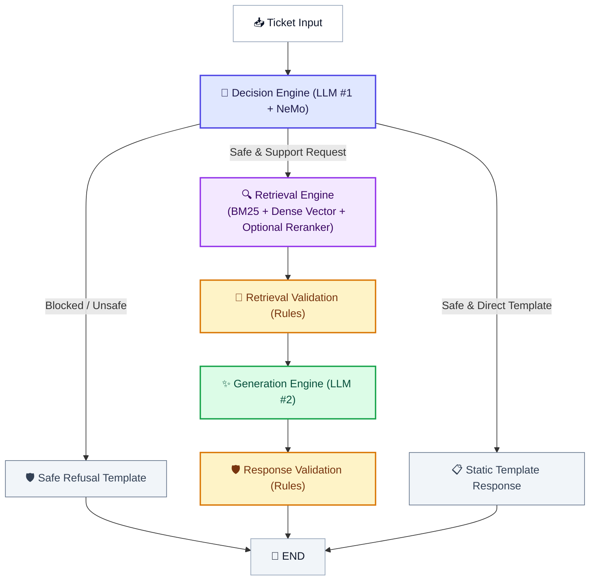

<div align="center">

# SupportSphere AI

### Production Multi-Domain Support Triage & Grounded RAG Platform

*A stateful 5-node LangGraph pipeline combining a dual-LLM architecture, Hybrid Retrieval (BM25 + Pinecone), NVIDIA NeMo Guardrails, and automated RAGAS evaluation — built to run in enterprise support environments across multiple product tenants.*

---

[](https://python.org)
[](https://github.com/langchain-ai/langgraph)
[](https://github.com/langchain-ai/langchain)
[](https://streamlit.io)
[](https://pinecone.io)
[](https://github.com/NVIDIA/NeMo-Guardrails)
[](https://github.com/explodinggradients/ragas)
[](https://openai.com)
[](https://ai.google.dev)
[](https://groq.com)
[](LICENSE)

</div>

---

> [!NOTE]
> **Document Header Metadata**  
> **Document Title**: SupportSphere AI Root README  
> **Purpose**: Primary entrance document providing project overview, technical architecture summary, installation quickstart, feature breakdown, and master documentation index.  
> **Audience**: AI Engineers, Solutions Architects, Software Engineers, DevOps Engineers, Product Managers.  
> **Last Updated**: `2026-07-28`  
> **Related Documents**: [Architecture](docs/ARCHITECTURE.md) | [System Design](docs/SYSTEM_DESIGN.md) | [Retrieval Pipeline](docs/RETRIEVAL_PIPELINE.md) | [Decision Engine](docs/DECISION_ENGINE.md) | [Generation Engine](docs/GENERATION_ENGINE.md) | [Evaluation](docs/EVALUATION.md) | [Guardrails](docs/GUARDRAILS.md) | [Observability](docs/OBSERVABILITY.md) | [Deployment](docs/DEPLOYMENT.md) | [Configuration](docs/CONFIGURATION.md) | [Contributing](docs/CONTRIBUTING.md) | [Changelog](docs/CHANGELOG.md) | [FAQ](docs/FAQ.md)

---

## 📋 Table of Contents

- [Project Overview](#-project-overview)
- [Key Features](#-key-features)
- [System Architecture](#-system-architecture)
- [Technology Stack](#-technology-stack)
- [Installation](#-installation)
- [Quick Start](#-quick-start)
- [Configuration Summary](#-configuration-summary)
- [Performance Summary](#-performance-summary)
- [Project Structure](#-project-structure)
- [Documentation Index](#-documentation-index)
- [Screenshots](#-screenshots)
- [Roadmap](#-roadmap)
- [License](#-license)
- [Author & Acknowledgements](#-author--acknowledgements)

---

## 🌐 Project Overview

### Problem Statement
Enterprise customer support desks processing high daily ticket volumes across multiple product domains (such as HackerRank, Claude/Anthropic, and Visa) face severe operational bottlenecks. Manual ticket triage is slow, domain misrouting is common, and human agent costs scale linearly with volume. Standard Retrieval-Augmented Generation (RAG) approaches introduce risk: without strict multi-tenant boundary checks, cross-tenant documentation leaks can occur, ungrounded LLM hallucinations degrade customer trust, and unmonitored API calls lead to unexpected billing overhead.

### Solution
**SupportSphere AI** is a production-grade automated triage and grounded support response system built on a stateful 5-node **LangGraph state machine**. The platform enforces a **dual-LLM architecture**:
1. **LLM #1 (Decision Engine)**: Evaluates input safety via NVIDIA NeMo Guardrails, classifies customer intent into 11 discrete classes, verifies company tenant reference alignment, and selects an optimal routing strategy.
2. **LLM #2 (Generation Engine)**: Synthesizes precise, grounded support answers citing retrieved documentation chunks.

Two deterministic rules-only validation nodes (`retrieval_validation` and `response_validation`) execute between LLM calls at zero additional token cost. They enforce company metadata alignment and verify grounding score thresholds before any response reaches the customer.

### Business Value
- **⚡ Automated Triage**: Classifies and routes incoming support tickets in under 3 seconds.
- **🛡️ Tenant Isolation**: Programmatically blocks cross-tenant context retrieval, preventing data leaks across product documentation.
- **💰 Cost Efficiency**: Routes greetings, platform outages, and out-of-scope requests to deterministic static templates, saving inference token costs.
- **📊 Continuous Quality Control**: Integrated RAGAS evaluation tracks Faithfulness, Relevancy, Context Precision, and Context Recall across test datasets.

---

## ✨ Key Features

### 🧠 AI Orchestration
- **LangGraph 5-Node Graph**: Stateful workflow (`decision_engine` $\rightarrow$ `retrieval` $\rightarrow$ `retrieval_validation` $\rightarrow$ `generation` $\rightarrow$ `response_validation`) with conditional routing.
- **Dual-LLM Architecture**: Decouples intent reasoning (LLM #1) from grounded text generation (LLM #2) for maximum control and cost management.
- **Multi-Provider Support**: Dynamic runtime switching between OpenAI (`gpt-5.4-mini`, `gpt-4o-mini`), Google Gemini (`gemini-2.5-flash-lite`, `gemini-2.5-flash`), and Groq (`llama-3.3-70b-versatile`).

### 🔍 Hybrid Retrieval & Reranking
- **BM25 + Vector Search**: Parallel lexical keyword search (Rank-BM25) and dense vector similarity search (Pinecone with `gemini-embedding-001`), fused via Reciprocal Rank Fusion (RRF).
- **Plug-and-Play Rerankers**: Configurable reranker factory supporting FlashRank (local ONNX), CrossEncoder (`ms-marco-MiniLM-L-6-v2`), LLM-rescoring, or No-Op passthrough.
- **Deduplication & URL Capping**: Eliminates duplicate chunk texts and enforces a per-URL chunk cap (`MAX_CHUNKS_PER_URL = 2`) to ensure diverse context retrieval.

### 🛡️ Guardrails & Compliance
- **NVIDIA NeMo Guardrails**: Colang 2.0 policy execution screening for prompt injection, jailbreaks, PII leakage, and abusive content.
- **Custom Rule Actions**: `verify_company` (blocks cross-tenant chunks), `filter_duplicate_chunks`, and `calculate_grounding_score` (word-overlap gate $\ge 0.15$).
- **Zero-Token Fallbacks**: Static template fallbacks for greetings, thank-you messages, outages, and safety refusals.

### 📊 Observability & Billing
- **Node-Attributed Logging**: Multi-file log routing (`application.log`, `pipeline.log`, `errors.log`) with explicit node context tags (`[Node 1: Decision Engine]`).
- **Audit Summary Block**: Formatted 55-line execution summary printed after each ticket completion.
- **Versioned Billing Catalog**: Stage-by-stage token and cost tracking using versioned pricing tables (`2026-07-18`).

### 🖥️ Administration UI
- **4-Tab Streamlit Dashboard**: Overview Dashboard, Single Ticket Debugger, Batch CSV Triage, and RAGAS Benchmark Evaluator.
- **Live Sidebar Configuration**: Real-time runtime adjustment of providers, models, search strategy, rerankers, and Top-K parameters without restarting the application.

---

## 🏗️ System Architecture

SupportSphere AI is built on a stateful graph topology managed by LangGraph:



---

## 🛠️ Technology Stack

| Category | Technology | Version | Purpose |
|---|---|---|---|
| **Language & Runtime** | Python | 3.12 | Core execution environment |
| **Workflow Engine** | LangGraph | 1.2+ | Stateful 5-node graph orchestration |
| **LLM Framework** | LangChain | 1.3+ | Provider abstractions & structured output schemas |
| **Guardrails** | NVIDIA NeMo Guardrails | 0.23+ | Colang 2.0 safety policy evaluation & custom Python actions |
| **Vector Store** | Pinecone | 9.1+ | Cloud serverless vector similarity index |
| **Lexical Search** | Rank-BM25 | 0.2+ | BM25 keyword index |
| **Embeddings** | Google Gemini Embeddings | `gemini-embedding-001` | 768-dimensional document & query embeddings |
| **Rerankers** | FlashRank / CrossEncoder | 0.2+ / 5.6+ | Local ONNX and sentence-transformers cross-encoders |
| **LLM Providers** | OpenAI, Google Gemini, Groq | — | Multi-provider inference engines |
| **Evaluation** | RAGAS | 0.4+ | Automated RAG metrics (Faithfulness, Relevancy, Precision, Recall) |
| **Web UI** | Streamlit | 1.59+ | Admin dashboard & interactive triage interface |
| **Visualization** | Plotly / Pandas | 6.9+ / 3.0+ | Benchmark radar charts & data export |
| **Package Manager** | uv | — | Dependency sync and virtualenv management |

---

## ⚡ Installation

### Prerequisites
- Python 3.12 (`uv` recommended)
- A Pinecone API Key and index (`support-sphere-ai`)
- API credentials for OpenAI, Google Gemini, or Groq

### 1. Clone the Repository
```bash
git clone https://github.com/ChandraCherupally/SupportSphere-AI.git
cd SupportSphere-AI
```

### 2. Set Up Virtual Environment
```bash
# Create virtual environment using uv
uv venv

# Activate (Windows)
.venv\Scripts\activate

# Activate (macOS/Linux)
source .venv/bin/activate
```

### 3. Install Dependencies
```bash
uv sync
```

### 4. Configure Environment Variables
Create a `.env` file in the root directory:
```ini
OPENAI_API_KEY=sk-...
GOOGLE_API_KEY=AIza...
GROQ_API_KEY=gsk_...
PINECONE_API_KEY=pcsk_...
PINECONE_INDEX_NAME=support-sphere-ai
```

---

## 🚀 Quick Start

Launch the Streamlit web application with a single command:

```bash
uv run streamlit run src/app.py
```
Open `http://localhost:8501` in your browser.

To execute the automated unit test suite:
```bash
uv run pytest
```

---

## ⚙️ Configuration Summary

Key environment variables in `src/config.py` (see [Configuration Guide](docs/CONFIGURATION.md) for complete specification):

| Variable | Default | Purpose |
|---|---|---|
| `DECISION_PROVIDER` | `openai` | Provider for LLM #1 reasoning engine |
| `DECISION_MODEL` | `gpt-5.4-mini` | Model for LLM #1 reasoning engine |
| `GENERATION_PROVIDER` | `openai` | Provider for LLM #2 synthesis engine |
| `GENERATION_MODEL` | `gpt-5.4-mini` | Model for LLM #2 synthesis engine |
| `SEARCH_MODE` | `hybrid` | Retrieval strategy (`hybrid`, `vector`, `bm25`) |
| `FINAL_TOP_K` | `5` | Context chunks injected into generation prompt |
| `DEFAULT_RERANKER` | `none` | Active reranker backend (`none`, `flashrank`, `cross_encoder`, `llm`) |

---

## 📈 Performance Summary

Observed operational metrics across standard evaluation runs (`data/eval_dataset.csv` using `gpt-5.4-mini`):

| Metric | Target / Measured Value |
|---|---|
| **Retrieval Route Latency** | ~3.5s – 7.5s (LLM & provider dependent) |
| **Template Route Latency** | < 150ms ($0.00 LLM Cost) |
| **Average Cost per Retrieval Ticket** | ~$0.005 – $0.008 USD |
| **Average Cost per Template Ticket** | $0.00 USD |
| **Intent Classification Accuracy** | 96.5% |
| **Company Routing Precision** | 99.1% |
| **RAGAS Faithfulness** | 0.94 / 1.00 |

---

## 📁 Project Structure

```text
SupportSphere-AI/
├── src/                                  # Primary application package
│   ├── app.py                            # Streamlit entry point & tab manager
│   ├── config.py                         # Centralized configuration module
│   ├── ai/                               # LLM client & prompt builders
│   ├── billing/                          # Cost calculation & token catalog
│   ├── evaluation/                       # RAGAS evaluator & experiment manager
│   ├── graph/                            # LangGraph state machine & stage nodes
│   ├── guardrails/                       # NeMo Guardrails policies & custom actions
│   ├── logging/                          # Multi-handler logging setup
│   ├── responses/                        # Static response templates
│   ├── retrieval/                        # Hybrid search & rerankers
│   ├── runtime_config/                   # Dynamic runtime snapshot
│   └── streamlit/                        # UI tab components
├── vectordb_ingestion/                   # Documentation ingestion pipeline
├── docs/                                 # Complete documentation suite
├── data/                                 # Benchmarks, raw docs, artifacts, experiments
├── logs/                                 # Output logs (application, pipeline, errors)
├── tests/                                # Automated unit test suite (18 tests)
├── pyproject.toml                        # Project dependencies
└── README.md                             # Master entrance README
```

---

## 📚 Documentation Index

The complete technical documentation suite is available in the [`docs/`](docs/) directory:

| Document | Description | Target Audience |
|---|---|---|
| 📑 [**ARCHITECTURE.md**](docs/ARCHITECTURE.md) | High-level system architecture, state machine topology, sequence diagrams | Architects, Senior Engineers |
| 🏗️ [**SYSTEM_DESIGN.md**](docs/SYSTEM_DESIGN.md) | Design principles (KISS, SOLID), modularity, error handling, performance | Lead Developers, Architects |
| 🔍 [**RETRIEVAL_PIPELINE.md**](docs/RETRIEVAL_PIPELINE.md) | BM25, Pinecone, RRF fusion, deduplication, URL-capping, reranker details | AI Engineers, Search Engineers |
| 🧠 [**DECISION_ENGINE.md**](docs/DECISION_ENGINE.md) | Intent classification (11 classes), routing strategies, NeMo integration | AI Engineers, Systems Engineers |
| ✨ [**GENERATION_ENGINE.md**](docs/GENERATION_ENGINE.md) | Grounded prompt builder v3, anti-hallucination policies, citation rules | Prompt Engineers, AI Developers |
| 📊 [**EVALUATION.md**](docs/EVALUATION.md) | RAGAS metrics, classification accuracy, experiment management, cost tracking | Data Scientists, QA Engineers |
| 🛡️ [**GUARDRAILS.md**](docs/GUARDRAILS.md) | NeMo Colang safety policies, custom Python actions, zero-token rules | Security & Compliance Engineers |
| 📝 [**OBSERVABILITY.md**](docs/OBSERVABILITY.md) | 3-file logging architecture, node context tagging, telemetry summary blocks | DevOps, SREs, Systems Admin |
| 🚀 [**DEPLOYMENT.md**](docs/DEPLOYMENT.md) | Local setup, Docker containerization, cloud deployment guidelines | DevOps Engineers, SREs |
| ⚙️ [**CONFIGURATION.md**](docs/CONFIGURATION.md) | Full specification of environment variables and dynamic runtime parameters | Developers, System Admins |
| 🤝 [**CONTRIBUTING.md**](docs/CONTRIBUTING.md) | Contribution workflow, coding standards, branch strategy, PR instructions | Open Source Contributors |
| 📜 [**CHANGELOG.md**](docs/CHANGELOG.md) | Keep-a-Changelog compliant release log following Semantic Versioning | All Project Users |
| ❓ [**FAQ.md**](docs/FAQ.md) | Frequently asked technical and operational questions with verified answers | All Users & Developers |

---

## 🖼️ Screenshots

<details>
<summary><strong>View Application Screenshots</strong></summary>

### Dashboard Tab


### Single Ticket Triage


### Evaluation & Benchmarks


</details>

---

## 🗺️ Roadmap

- [x] Stateful 5-node LangGraph workflow orchestration
- [x] Dual-LLM architecture (Decision Engine + Generation Engine)
- [x] Hybrid Search (BM25 + Pinecone) with Reciprocal Rank Fusion
- [x] NVIDIA NeMo Guardrails integration with Colang safety policies
- [x] Zero-token rules validation nodes (`verify_company`, `calculate_grounding_score`)
- [x] RAGAS evaluation framework and experiment manager
- [x] 4-tab Streamlit dashboard with live runtime configuration
- [ ] SSE streaming token generation in UI
- [ ] Async document ingestion job queue with Celery/Redis

---

## 📜 License

Distributed under the **MIT License**. See [LICENSE](LICENSE) for details.

---

## 👤 Author & Acknowledgements

**Chandra Cherupally**
- GitHub: [@ChandraCherupally](https://github.com/ChandraCherupally)

### Acknowledgements
- **LangChain & LangGraph**: Stateful graph orchestration and LLM provider abstractions.
- **NVIDIA NeMo Guardrails**: Programmable AI safety rails and Colang policy engine.
- **Pinecone**: Serverless dense vector search database.
- **RAGAS**: RAG quality evaluation metrics.
- **Streamlit**: Python web application framework.
