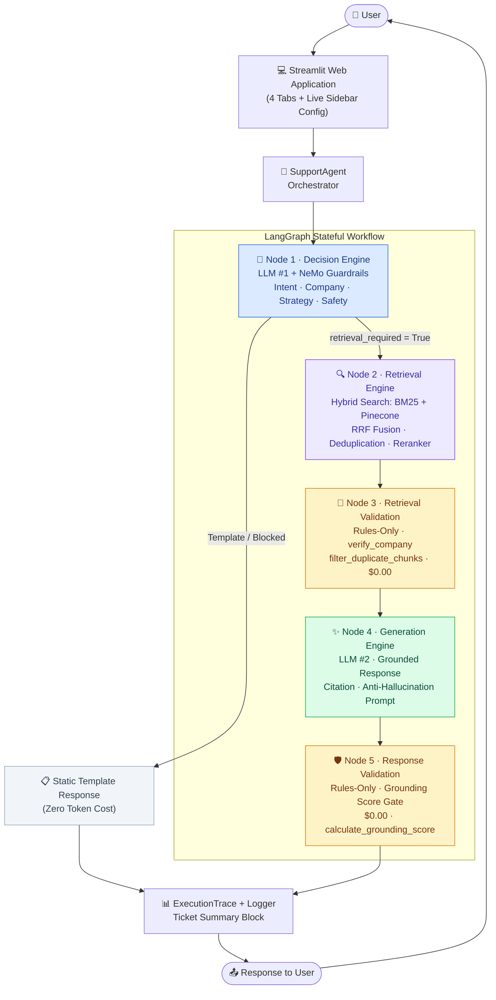
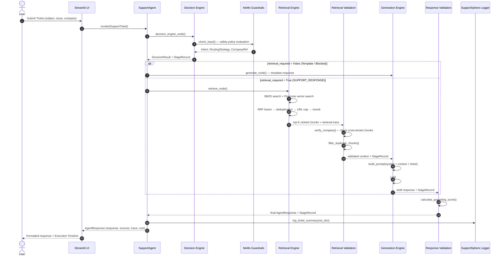

<div align="center">

# SupportSphere AI

### Production Multi-Domain Support Triage & Grounded RAG Platform

*A stateful 5-node LangGraph pipeline combining a dual-LLM architecture, Hybrid Retrieval (BM25 + Pinecone), NVIDIA NeMo Guardrails, and automated RAGAS evaluation — built to run in enterprise support environments across multiple product tenants.*

---

[](https://python.org)
[](https://github.com/langchain-ai/langgraph)
[](https://github.com/langchain-ai/langchain)
[](https://streamlit.io)
[](https://pinecone.io)
[](https://github.com/NVIDIA/NeMo-Guardrails)
[](https://github.com/explodinggradients/ragas)
[](https://openai.com)
[](https://ai.google.dev)
[](https://groq.com)
[](#retrieval-engine)
[](LICENSE)

</div>

---

## Table of Contents

- [Project Overview](#-project-overview)
- [Key Features](#-key-features)
- [System Architecture](#-system-architecture)
- [Pipeline Workflow](#-pipeline-workflow)
- [Project Structure](#-project-structure)
- [Technology Stack](#-technology-stack)
- [Installation](#-installation)
- [Environment Variables](#-environment-variables)
- [Runtime Configuration](#-runtime-configuration)
- [Retrieval Engine](#-retrieval-engine)
- [Decision Engine](#-decision-engine)
- [Generation Engine](#-generation-engine)
- [Evaluation Framework](#-evaluation-framework)
- [Guardrails & Safety](#-guardrails--safety)
- [Logging & Observability](#-logging--observability)
- [Performance](#-performance)
- [User Interface](#-user-interface)
- [Testing](#-testing)
- [Deployment](#-deployment)
- [Roadmap](#-roadmap)
- [Contributing](#-contributing)
- [License](#-license)
- [Author & Acknowledgements](#-author--acknowledgements)

---

## 🌐 Project Overview

### Problem Statement

Enterprise support desks handling high ticket volumes across multiple product tenants face a compound challenge: triage accuracy degrades at scale, cross-tenant context leakage is a compliance risk, hallucinated support responses damage customer trust, and inference costs grow unchecked without intelligent routing.

Standard RAG approaches provide generation grounding but lack intent classification, safety enforcement, cost-aware routing, and systematic evaluation.

### Solution

**SupportSphere AI** is a production-ready, multi-tenant support triage and grounded response platform built on a stateful 5-node LangGraph state machine.

It enforces a **dual-LLM architecture**:

- **LLM #1 — Decision Engine**: Classifies ticket intent, verifies company context, selects the routing strategy, and enforces NeMo Guardrails safety policies.
- **LLM #2 — Generation Engine**: Produces grounded, citation-referenced responses using verified documentation retrieved via Hybrid Search.

**Deterministic validation nodes** (`retrieval_validation`, `response_validation`) execute between LLM stages at zero additional token cost — enforcing company-match guarantees and grounding score thresholds before any response reaches the user.

### Business Value

| Value | Mechanism |
|---|---|
| **Automated Triage** | Intent classification and routing without human intervention |
| **Cross-Tenant Safety** | Deterministic company-match validation prevents documentation leakage |
| **Cost Control** | Zero-token routing for greetings, outages, and OOS requests via static templates |
| **Continuous Quality** | Integrated RAGAS evaluation tracks Faithfulness, Relevancy, Precision, and Recall |
| **Operational Visibility** | Per-ticket cost, latency, and token accounting with structured audit logs |

### Supported Tenants

The current corpus covers three enterprise product domains:

- **HackerRank** — Assessment platform, candidate management, coding tests, interview workflows
- **Claude (Anthropic)** — AI assistant platform (Sonnet, Haiku, Opus, Bedrock integration)
- **Visa** — Commercial cards, Visa Direct, VisaNet, merchant services, travel products

---

## ✨ Key Features

### 🧠 AI Orchestration

- **LangGraph State Machine** — 5-node stateful graph (`decision_engine → retrieval → retrieval_validation → generation → response_validation`) with conditional edge routing
- **Dual-LLM Architecture** — LLM #1 handles reasoning and routing; LLM #2 handles grounded response generation
- **Conditional Edge Routing** — Tickets that require only a template response (greetings, outages, safety refusals) bypass the retrieval pipeline entirely
- **Per-Ticket ExecutionTrace** — Each node appends a `StageRecord` to a typed `ExecutionTrace` object, which feeds the Streamlit timeline and the audit logger

### 🔍 Retrieval

- **Hybrid Search** — Parallel BM25 + Pinecone Dense Vector Search with Reciprocal Rank Fusion (RRF) for combined lexical and semantic coverage
- **BM25-Only and Vector-Only Modes** — Configurable per-request via sidebar or environment variable
- **Retrieval Loop with Fallback** — Up to 3 candidate expansion attempts to guarantee Top-K unique chunks even against a sparse corpus
- **Deduplication** — Chunk-level deduplication by ID, full text, and URL (configurable `MAX_CHUNKS_PER_URL` cap per source URL)
- **Plug-and-Play Reranking** — `RerankerFactory` supports `flashrank` (local ONNX), `cross_encoder` (sentence-transformers), `llm` (LLM rescoring), or `none`

### ✨ Generation

- **Context-Grounded Prompting** — Retrieved documentation chunks are injected with explicit citation instructions
- **Structured Response Schema** — Responses are parsed into typed Pydantic fields (`response_text`, `product_area`, `status`, `request_type`, `justification`)
- **Anti-Hallucination System Prompt** — Generation Engine Prompt v3 enforces: "Never answer from memory. Never invent information."
- **Citation Strategy** — All procedural responses are required to append source documentation URLs

### 📊 Evaluation

- **RAGAS Metrics** — Faithfulness, Answer Relevancy, Answer Correctness, Context Precision, Context Recall
- **Classification Accuracy** — Intent classification, product area, and status prediction accuracy
- **Experiment Manager** — Save, compare, and export evaluation runs; each experiment snapshots the active pricing catalog for reproducible cost calculations
- **Jupyter Notebook** — `Notebooks/_1_RAGAS_eval.ipynb` for interactive evaluation analysis

### ⚡ Observability

- **Node-Tagged Structured Logs** — Every log line is attributed to its pipeline node: `[Node 1: Decision Engine]`, `[Node 2: Retrieval Engine]`, etc.
- **3-File Log Routing** — `application.log` (workflow), `pipeline.log` (node details), `errors.log` (exceptions)
- **Ticket Execution Summary Block** — Complete 55-line formatted audit record logged at the end of every ticket run
- **Stage Latency Tracking** — Millisecond-precision latency logged per node via `ExecutionTrace`

### 🛡️ Guardrails

- **Input Safety Screening** — Colang policies covering prompt injection, jailbreak patterns, PII leakage, abuse, and token flooding
- **Company Verification** — `verify_company` custom action blocks retrieval context where company metadata does not match the ticket's selected tenant
- **Grounding Score Gate** — `calculate_grounding_score` measures response–context word overlap; responses falling below 0.15 are blocked
- **Deterministic Fallback Templates** — Eight static template responses for greetings, thank-you, OOS, bugs, outages, billing escalation, and safety refusals (zero token cost)

### 💰 Billing

- **Per-Node Cost Calculation** — Input and output token counts multiplied against versioned provider pricing (`catalog.py` version `2026-07-18`)
- **Pricing Catalog** — Covers OpenAI (GPT-5.4-mini through GPT-4o), Google Gemini (2.5-flash-lite through 2.5-pro), Groq (Llama 3.3 70B), Pinecone query cost, and Google embedding pricing
- **Experiment Cost Snapshots** — Each saved evaluation experiment includes a `pricing_snapshot.json` for reproducible historical cost calculations

### 🖥️ UI

- **4-Tab Streamlit Application** — Dashboard, Single Ticket, Batch Processing, Evaluation
- **Live Sidebar Configuration** — Switch provider, model, search mode, reranker, and Top-K without restarting the server
- **Execution Trace Timeline** — Collapsible per-node inspector showing mode, provider, model, tokens, cost, and decision
- **Batch CSV Processing** — Upload ticket files, run automated triage, download results
- **Radar Chart Evaluation** — Visual RAGAS metric comparison across experiment runs

---

## 🏗️ System Architecture



---

## 🔄 Pipeline Workflow



---

## 📁 Project Structure

```text
SupportSphere-AI/
│
├── src/                                  # Primary application package
│   ├── app.py                            # Streamlit entry point; warmup & tab wiring
│   ├── config.py                         # Central config — only file that reads env vars
│   │
│   ├── ai/                               # LLM infrastructure
│   │   ├── client.py                     # Provider-agnostic LLM client (OpenAI / Gemini / Groq)
│   │   ├── models.py                     # Pydantic schemas: SupportTicket, DecisionResult, AgentResponse
│   │   ├── prompt_builder.py             # Grounded generation prompt constructor
│   │   └── prompts/
│   │       ├── decision_prompt.py        # System prompt for LLM #1 (intent + routing + company)
│   │       └── generation_prompt.py     # System prompt for LLM #2 (v3, RAGAS-optimised)
│   │
│   ├── billing/                          # Cost tracking & pricing catalog
│   │   ├── catalog.py                    # LLM + embedding pricing (versioned 2026-07-18)
│   │   ├── calculator.py                 # Per-ticket token → cost aggregator
│   │   └── models.py                     # TokenUsage, CostSummary Pydantic models
│   │
│   ├── evaluation/                       # RAGAS evaluation framework
│   │   ├── evaluator.py                  # SupportSphereEvaluator orchestrator
│   │   ├── ragas_evaluator.py            # RAGAS metric wrappers (native metrics)
│   │   ├── classification_metrics.py     # Intent, product_area, status accuracy
│   │   ├── runtime_metrics.py            # Latency, token counts, operational metrics
│   │   ├── experiment_manager.py         # Save / load / compare experiment runs
│   │   └── evaluation_models.py          # EvaluationSummary Pydantic models
│   │
│   ├── graph/                            # LangGraph state machine
│   │   ├── graph.py                      # StateGraph compilation & conditional edges
│   │   ├── state.py                      # SupportState TypedDict schema
│   │   ├── support_agent.py              # Public SupportAgent.invoke() entry point
│   │   ├── trace.py                      # ExecutionTrace + StageRecord observability models
│   │   └── nodes/
│   │       ├── decision_engine.py        # Node 1: Safety + intent + company + routing
│   │       ├── retrieval.py              # Node 2: Hybrid retrieval + reranking
│   │       ├── retrieval_validation.py   # Node 3: Company-match + deduplication rules
│   │       ├── generation.py             # Node 4: Grounded LLM response generation
│   │       └── response_validation.py    # Node 5: Grounding score gate
│   │
│   ├── guardrails/                       # NVIDIA NeMo Guardrails integration
│   │   ├── service.py                    # NeMoGuardrailsService wrapper + usage accumulator
│   │   └── config/
│   │       ├── config.yml                # NeMo rails YAML configuration
│   │       ├── prompts.yml               # NeMo LLM prompts for rail evaluation
│   │       ├── rails.co                  # Colang policies: input / retrieval / output safety
│   │       └── actions.py                # Custom Python actions: verify_company, filter_duplicate_chunks, calculate_grounding_score
│   │
│   ├── logging/                          # Centralised logging subsystem
│   │   ├── config.py                     # 3-file log handler routing with RotatingFileHandler
│   │   ├── filters.py                    # FrameworkFilter: normalises all loggers to "SupportSphere"
│   │   └── logger.py                     # log_ticket_summary(): structured audit block printer
│   │
│   ├── responses/
│   │   └── templates.py                  # 8 static template strings (greeting, OOS, outage, etc.)
│   │
│   ├── retrieval/                        # Hybrid retrieval engine
│   │   ├── hybrid_search.py              # HybridSearch: orchestrates BM25 + Vector + RRF + dedup
│   │   ├── bm25_index.py                 # BM25Index: Rank-BM25 wrapper with pickle persistence
│   │   ├── vector_search.py              # VectorSearch: Pinecone query + Gemini embedding
│   │   ├── rank_fusion.py                # ReciprocalRankFusion (RRF) implementation
│   │   ├── retriever.py                  # Unified Retriever facade
│   │   └── rerankers/
│   │       ├── factory.py                # RerankerFactory: cached singleton creation
│   │       ├── noop_reranker.py          # No-op passthrough (returns results as-is)
│   │       ├── flashrank_reranker.py     # Local ONNX FlashRank reranker
│   │       ├── cross_encoder_reranker.py # sentence-transformers CrossEncoder reranker
│   │       └── llm_reranker.py           # LLM-based relevance rescoring reranker
│   │
│   ├── runtime_config/
│   │   └── runtime.py                    # RuntimeConfig: per-request provider / model / key snapshot
│   │
│   └── streamlit/                        # Web UI subsystem
│       ├── dashboard.py                  # Tab 1: Architecture overview + Mermaid diagram
│       ├── single_ticket.py              # Tab 2: Interactive triage + execution trace inspector
│       ├── batch_processing.py           # Tab 3: CSV batch upload + export
│       ├── evaluation.py                 # Tab 4: RAGAS benchmark + experiment comparison
│       ├── sidebar.py                    # Live provider / model / retrieval config sidebar
│       └── utils.py                      # AppConfig, session state helpers, CSS
│
├── vectordb_ingestion/                   # Data ingestion & preprocessing subsystem
│   ├── ingestion/
│   │   ├── ingest.py                     # IngestionPipeline: process → embed → upsert → BM25 build
│   │   ├── document_processor.py         # Directory markdown parser & chunker coordinator
│   │   ├── embedder.py                   # GeminiEmbedder: batched embedding generation
│   │   ├── vector_store.py               # VectorStore: Pinecone batch upsert operations
│   │   └── pinecone_client.py            # PineconeClient: singleton index manager
│   └── preprocessing/
│       ├── chunker.py                    # Header-aware markdown chunker
│       ├── markdown_parser.py            # Frontmatter & markdown cleaner
│       ├── metadata_builder.py           # Breadcrumb + company metadata constructor
│       └── article_enricher.py           # Support link & related article extractor
│
├── data/
│   ├── raw/                              # Raw markdown documentation (claude/, hackerrank/, visa/)
│   ├── artifacts/                        # bm25_index.pkl + vector_records.pkl (generated)
│   ├── eval_dataset.csv                  # Ground truth benchmark dataset
│   └── experiments/                      # Saved evaluation run JSON files
│
├── logs/                                 # Generated log files (gitignored)
│   ├── application.log                   # Business workflow milestones + ticket summaries
│   ├── pipeline.log                      # Node-level execution telemetry
│   └── errors.log                        # Exception stack traces
│
├── Notebooks/
│   └── _1_RAGAS_eval.ipynb               # Interactive RAGAS evaluation notebook
│
├── tests/                                # Automated unit test suite (18 tests)
│   ├── test_company_detection.py
│   ├── test_model_validation.py
│   ├── test_retrieval.py
│   ├── test_safety_guardrails.py
│   └── test_simple_evaluator.py
│
├── .env                                  # Local environment variables (not committed)
├── pyproject.toml                        # uv project manifest & dependencies
└── README.md
```

---

## 🛠️ Technology Stack

| Category | Technology | Version | Purpose |
|---|---|---|---|
| **Language** | Python | 3.12 | Runtime |
| **Orchestration** | LangGraph | 1.2+ | Stateful 5-node workflow & conditional routing |
| **LLM Framework** | LangChain | 1.3+ | Provider abstraction, structured output, chain primitives |
| **Guardrails** | NVIDIA NeMo Guardrails | 0.23+ | Colang safety policies, custom Python action execution |
| **Vector Store** | Pinecone | 9.1+ | Serverless dense vector index (cosine similarity) |
| **Lexical Search** | Rank-BM25 | 0.2+ | BM25 keyword index with pickle persistence |
| **Embeddings** | Google `gemini-embedding-001` | — | 768-dimensional dense document embeddings |
| **Reranking** | FlashRank | 0.2+ | Local ONNX cross-encoder reranking |
| **Reranking** | sentence-transformers | 5.6+ | `ms-marco-MiniLM-L-6-v2` CrossEncoder reranker |
| **LLM Providers** | OpenAI | — | GPT-5.4-mini, GPT-5-mini, GPT-4o-mini, GPT-4o |
| **LLM Providers** | Google Gemini | — | gemini-2.5-flash-lite, gemini-2.5-flash, gemini-2.5-pro |
| **LLM Providers** | Groq | — | llama-3.3-70b-versatile |
| **Evaluation** | RAGAS | 0.4+ | Faithfulness, Relevancy, Correctness, Precision, Recall |
| **Web UI** | Streamlit | 1.59+ | Interactive dashboard and triage console |
| **Charting** | Plotly | 6.9+ | Radar charts and metric visualisations |
| **Data Processing** | Pandas | 3.0+ | Dataset loading, evaluation results, batch output |
| **Package Manager** | uv | — | Fast Python dependency resolution and virtualenv |

---

## ⚡ Installation

### Prerequisites

- Python 3.12 (`uv` is recommended for environment management)
- A [Pinecone](https://pinecone.io) account with API key and an index created
- At least one LLM provider API key (OpenAI, Google, or Groq)

### 1 — Clone the Repository

```bash
git clone https://github.com/ChandraCherupally/SupportSphere-AI.git
cd SupportSphere-AI
```

### 2 — Create a Virtual Environment

```bash
# Using uv (recommended)
uv venv

# Activate — Windows
.venv\Scripts\activate

# Activate — macOS / Linux
source .venv/bin/activate
```

### 3 — Install Dependencies

```bash
uv sync
```

### 4 — Configure Environment Variables

```bash
# Copy the example file and fill in your credentials
cp .env.example .env
```

Minimum required variables:

```ini
OPENAI_API_KEY=sk-...
GOOGLE_API_KEY=AIza...
PINECONE_API_KEY=pcsk_...
PINECONE_INDEX_NAME=support-sphere-ai
```

### 5 — (Optional) Build the Vector Index

If you have your own documentation corpus under `data/raw/`, run the ingestion pipeline to build the Pinecone index and the BM25 pickle:

```bash
uv run python -m vectordb_ingestion.ingestion.ingest
```

### 6 — Start the Application

```bash
uv run streamlit run src/app.py
```

Open `http://localhost:8501` in your browser.

---

## ⚙️ Environment Variables

All environment variables are loaded exclusively in `src/config.py`. No other module reads from `os.environ`.

| Variable | Required | Description | Default |
|---|:---:|---|---|
| `LLM_PROVIDER` | No | Default provider (`openai`, `google`, `groq`) | `openai` |
| `LLM_MODEL` | No | Default model name | `gpt-5.4-mini` |
| `DECISION_PROVIDER` | No | Decision Engine LLM provider | inherits `LLM_PROVIDER` |
| `DECISION_MODEL` | No | Decision Engine model | inherits `LLM_MODEL` |
| `GENERATION_PROVIDER` | No | Generation Engine LLM provider | inherits `LLM_PROVIDER` |
| `GENERATION_MODEL` | No | Generation Engine model | inherits `LLM_MODEL` |
| `LLM_TEMPERATURE` | No | Sampling temperature for all LLM calls | `0.0` |
| `OPENAI_API_KEY` | Conditional | Required when using OpenAI provider | `""` |
| `GOOGLE_API_KEY` | Conditional | Required for Gemini LLMs and embeddings | `""` |
| `GOOGLE_API_KEY_EMBED` | No | Separate key for embedding calls | falls back to `GOOGLE_API_KEY` |
| `GROQ_API_KEY` | Conditional | Required when using Groq provider | `""` |
| `HF_TOKEN` | No | Hugging Face token (for private model weights) | `""` |
| `PINECONE_API_KEY` | **Yes** | Pinecone project API key | — |
| `PINECONE_INDEX_NAME` | No | Pinecone index to query | `support-sphere-ai` |
| `PINECONE_NAMESPACE` | No | Pinecone namespace within the index | `""` |
| `PINECONE_CLOUD` | No | Pinecone cloud provider | `aws` |
| `PINECONE_REGION` | No | Pinecone region | `us-east-1` |
| `EMBEDDING_PROVIDER` | No | Embedding provider | `google` |
| `EMBEDDING_MODEL` | No | Embedding model name | `gemini-embedding-001` |
| `EMBEDDING_DIMENSION` | No | Embedding vector dimension | `768` |
| `EMBED_BATCH_SIZE` | No | Embedding batch size during ingestion | `100` |
| `SEARCH_MODE` | No | Search strategy: `hybrid`, `vector`, `bm25` | `hybrid` |
| `VECTOR_TOP_K` | No | Candidates to retrieve from Pinecone | `20` |
| `BM25_TOP_K` | No | Candidates to retrieve from BM25 | `20` |
| `FINAL_TOP_K` | No | Final Top-K chunks injected into the prompt | `5` |
| `MAX_SECTION_SIZE` | No | Maximum section character length (chunker) | `1200` |
| `SECTION_OVERLAP` | No | Character overlap between adjacent chunks | `150` |
| `MAX_CONTEXT_CHUNKS` | No | Hard cap on context chunks per prompt | `10` |
| `MAX_CONTEXT_TOKENS` | No | Hard cap on context token budget per prompt | `6000` |

---

## 🎛️ Runtime Configuration

Configuration can be changed live through the Streamlit sidebar **without restarting the server**. Changes take effect on the next ticket submission.

| Sidebar Control | Options | Notes |
|---|---|---|
| **Decision Engine Provider** | Google, OpenAI, Groq | Sets LLM #1 provider |
| **Decision Engine Model** | All models for selected provider | From `billing/catalog.py` |
| **Generation Engine Provider** | Google, OpenAI, Groq | Sets LLM #2 provider |
| **Generation Engine Model** | All models for selected provider | From `billing/catalog.py` |
| **Top-K Chunks** | 1 – 10 | Number of context chunks sent to LLM #2 |
| **Search Mode** | Hybrid, Vector, BM25 | Overrides `SEARCH_MODE` env var |
| **Reranker** | None, Cross-Encoder, FlashRank, LLM | Overrides default reranker |
| **API Credentials** | Key fields per provider | Collapsed expander; overrides env vars for session |

---

## 🔍 Retrieval Engine

The retrieval pipeline is implemented in `src/retrieval/hybrid_search.py` as the `HybridSearch` class.

### Stage-by-Stage Flow

```
User Query
    │
    ▼
Metadata Filter Construction
(company → Pinecone namespace filter)
    │
    ├─────────────────────────┐
    ▼                         ▼
BM25 Index Search        Pinecone Dense Vector Search
(Rank-BM25 · top-K)     (gemini-embedding-001 · cosine)
    │                         │
    └──────────┬──────────────┘
               ▼
   Reciprocal Rank Fusion (RRF)
   score = Σ 1 / (k + rank)
               │
               ▼
   Deduplication (3-way)
   · chunk ID uniqueness
   · full text uniqueness
   · URL cap (MAX_CHUNKS_PER_URL = 2)
               │
               ▼
   Candidate Expansion Loop
   (up to 3 attempts, 2× limit scaling)
               │
               ▼
   Reranker (FlashRank / CrossEncoder / LLM / None)
               │
               ▼
   Top-K Final Context Chunks → Prompt
```

### Search Modes

| Mode | BM25 | Pinecone | Fusion |
|---|:---:|:---:|:---:|
| `hybrid` | ✅ | ✅ | RRF |
| `bm25` | ✅ | ❌ | — |
| `vector` | ❌ | ✅ | — |

### Rerankers

| Reranker | Model | Notes |
|---|---|---|
| `none` | — | Returns RRF-ranked results as-is |
| `flashrank` | `ms-marco-MiniLM-L-12-v2` | Local ONNX; cached after first load |
| `cross_encoder` | `ms-marco-MiniLM-L-6-v2` | sentence-transformers; cached after first load |
| `llm` | Configurable (default: `gemini-2.5-flash`) | LLM relevance rescoring; highest cost |

---

## 🧠 Decision Engine

**Node 1** — `src/graph/nodes/decision_engine.py`

The Decision Engine operates as **LLM #1** and executes before any retrieval.

### Intent Classes

| Intent | Routing Strategy | Retrieval |
|---|---|:---:|
| `GREETING` | `GREETING_TEMPLATE` | ❌ |
| `THANK_YOU` | `THANK_YOU_TEMPLATE` | ❌ |
| `PRODUCT_SUPPORT` | `SUPPORT_RESPONSE` | ✅ |
| `ACCOUNT` | `SUPPORT_RESPONSE` | ✅ |
| `BILLING` | `SUPPORT_RESPONSE` | ✅ |
| `BUG` | `BUG_ESCALATION_TEMPLATE` | ❌ |
| `PLATFORM_INCIDENT` | `BUG_ESCALATION_TEMPLATE` | ❌ |
| `FEATURE_REQUEST` | `SUPPORT_RESPONSE` | ✅ |
| `OUT_OF_SCOPE` | `OUT_OF_SCOPE_TEMPLATE` | ❌ |
| `SAFETY_REFUSAL` | `SAFETY_REFUSAL_TEMPLATE` | ❌ |
| `EMPTY_INPUT` | `SAFETY_REFUSAL_TEMPLATE` | ❌ |

### Company Reference Resolution

Company detection applies only to `SUPPORT_RESPONSE` tickets. Supported company signals:

| Company | Domain Keywords |
|---|---|
| **HackerRank** | assessment, candidate, test, question bank, interview, coding test |
| **Claude** | Anthropic, Sonnet, Haiku, Opus, Bedrock |
| **Visa** | Visa, Traveller Cheque, Commercial Card, Visa Direct, Merchant, VisaNet |

### NeMo Guardrails Integration

Before routing, the Decision Engine submits the ticket to the NeMo Guardrails service (`check_input()` flow). Colang policies in `rails.co` screen for:

- Prompt injection and jailbreak attempts
- PII leakage (passwords, API keys, credit card numbers, SSNs)
- Roleplay/persona subversion attempts
- Abusive content and token flooding

Tickets that trigger any rail receive a `SAFETY_REFUSAL_TEMPLATE` response with no LLM #2 call.

---

## ✨ Generation Engine

**Node 4** — `src/graph/nodes/generation.py`

The Generation Engine operates as **LLM #2** and only executes after validated context is available.

### Prompt Architecture

The Generation Engine uses a v3 production prompt (`src/ai/prompts/generation_prompt.py`) with explicit RAGAS-optimised objectives:

1. **Primary Intent First** — Identify and answer the user's single main question; ignore adjacent wording.
2. **Context Evaluation** — Chunks are ranked: exact feature > exact workflow > same product area > supporting context. Loosely related chunks are ignored.
3. **Multi-Document Synthesis** — Merge documents only when they describe the exact same workflow.
4. **Grounding Enforcement** — "Never answer from memory. Never invent information." — every factual claim must be supported by a retrieved chunk.
5. **Citation Strategy** — All responses must append the source documentation URL.
6. **Escalation Trigger** — If documentation is missing, contradictory, or requires backend investigation, escalate to a human agent rather than speculate.

### Response Schema

All responses are parsed into a typed Pydantic schema:

```python
class SupportResponse(BaseModel):
    response_text: str        # Markdown-formatted support answer
    status: str               # "Replied" | "Escalated" | "Template"
    request_type: str         # Resolved intent category
    product_area: str         # Derived from retrieved chunk metadata
    justification: str        # ≤25 words; evidence-based explanation
```

---

## 📊 Evaluation Framework

### Running an Evaluation

```bash
# Via Streamlit UI: open the Evaluation tab, upload a CSV, click "Run Evaluation"

# Programmatically:
uv run python -c "
from src.evaluation.evaluator import SupportSphereEvaluator
ev = SupportSphereEvaluator(config={
    'decision_provider': 'openai',
    'decision_model': 'gpt-5.4-mini',
    'generation_provider': 'openai',
    'generation_model': 'gpt-5.4-mini',
    'search_mode': 'hybrid',
    'top_k': 5,
})
summary = ev.evaluate_dataset('data/eval_dataset.csv')
print(summary)
"
```

### Dataset Format

`data/eval_dataset.csv` — each row must contain:

| Column | Description |
|---|---|
| `subject` | Ticket subject line |
| `issue` | Full ticket description |
| `company` | Target tenant (HackerRank / Claude / Visa) |
| `expected_request_type` | Ground truth intent class |
| `expected_product_area` | Ground truth product area |
| `expected_status` | Ground truth response status |
| `expected_response` | Ground truth reference answer |

### Metrics Computed

| Category | Metric | Tool |
|---|---|---|
| **Generation Quality** | Faithfulness | RAGAS |
| **Generation Quality** | Answer Relevancy | RAGAS |
| **Generation Quality** | Answer Correctness | RAGAS |
| **Generation Quality** | Context Precision | RAGAS |
| **Generation Quality** | Context Recall | RAGAS |
| **Classification** | Request Type Accuracy | `classification_metrics.py` |
| **Classification** | Product Area Accuracy | `classification_metrics.py` |
| **Classification** | Status Accuracy | `classification_metrics.py` |
| **Operations** | End-to-End Latency (ms) | `runtime_metrics.py` |
| **Operations** | Total Tokens (In + Out) | `runtime_metrics.py` |
| **Operations** | Total Cost (USD) | `billing/calculator.py` |

### Experiment Management

Each evaluation run is saved as a JSON file under `data/experiments/` and includes:

- Configuration snapshot (provider, model, search mode, top-K, reranker)
- All per-row results and aggregate metrics
- `pricing_snapshot.json` — versioned pricing catalog at run time for reproducible historical cost calculations

---

## 🛡️ Guardrails & Safety

The guardrails system operates across **three layers** of the pipeline.

### Layer 1 — Input Safety (Node 1: Decision Engine)

Colang flows in `rails.co` run before any LLM call:

| Policy Category | Examples Covered |
|---|---|
| Prompt injection & jailbreak | "ignore previous instructions", "DAN mode enabled", "system override" |
| Roleplay subversion | "pretend you are my grandma", "act as a linux terminal" |
| PII leakage | passwords, API keys, credit card numbers, SSNs, Aadhaar |
| Abusive content | hate, violence, self-harm, sexual content, profanity |
| Spam / token flooding | unicode spam, oversized prompts, random characters |

### Layer 2 — Retrieval Validation (Node 3: Rules-Only)

Two custom Python actions execute at zero LLM token cost:

**`verify_company(company, context)`**
- Iterates over all retrieved chunks and checks `chunk.metadata.company` against the ticket's verified company
- Returns `BLOCK` if any mismatch is detected, preventing cross-tenant documentation from reaching LLM #2

**`filter_duplicate_chunks(context)`**
- Strips duplicate text chunks before they reach the generation prompt
- Returns indices of unique chunks

### Layer 3 — Response Validation (Node 5: Rules-Only)

**`calculate_grounding_score(response, context)`**
- Computes word-overlap ratio between the generated response and the retrieved context
- If `grounding_score < 0.15` (configurable in `rails.co`), the response is blocked and a safety refusal is returned

### Static Template Responses

The following intents receive zero-token template responses:

| Template | Trigger |
|---|---|
| `GREETING_TEMPLATE` | Greetings and small talk |
| `THANK_YOU_TEMPLATE` | Appreciation messages |
| `OUT_OF_SCOPE_TEMPLATE` | Off-topic questions |
| `SAFETY_REFUSAL_TEMPLATE` | Guardrail violations, empty input |
| `BUG_ESCALATION_TEMPLATE` | Bug reports and platform incidents |
| `BILLING_ESCALATION_TEMPLATE` | Billing escalations |
| `FEATURE_REQUEST_TEMPLATE` | Feature requests |
| `SERVICE_OUTAGE_TEMPLATE` | Platform-wide outages |

---

## 📝 Logging & Observability

The logging system is configured in `src/logging/config.py` using Python's standard `logging` module with `RotatingFileHandler`.

### Log File Routing

| File | Level | Content |
|---|---|---|
| `logs/application.log` | INFO+ | Business workflow events + complete ticket execution summaries (framework-filtered) |
| `logs/pipeline.log` | INFO+ | Node-level stage telemetry (all loggers, unfiltered) |
| `logs/errors.log` | ERROR+ | Exception stack traces |
| Console | INFO+ | Real-time node execution progress (framework-filtered) |

### Node Context Attribution

Every log line is attributed to its pipeline node:

```
[Node 1: Decision Engine]    — LLM #1 client calls + structured output
[Node 2: Retrieval Engine]   — BM25, Pinecone, RRF, deduplication, reranking
[Node 3: Retrieval Validation] — verify_company, filter_duplicate_chunks
[Node 4: Generation Engine]  — LLM #2 client calls + generation
[Node 5: Response Validation] — calculate_grounding_score
```

### Ticket Execution Summary Block

A structured 55-line audit record is logged to `application.log` after every ticket:

```
================================================================================
SupportSphere AI | Ticket ID: TKT-F14BF732 | Execution Started: 2026-07-28 18:37:00
================================================================================
Subject: Cannot reset password
Issue: I am trying to reset my password on HackerRank but the verification email is not arriving.
Selected Company: HackerRank
Decision Model: gpt-5.4-mini | Generation Model: gpt-5.4-mini
Search Mode: hybrid | Reranker: flashrank
------------------------------------------------------------
1. DECISION ENGINE (LLM #1)
   Execution Mode: LLM | Intent: ACCOUNT | Strategy: SUPPORT_RESPONSE
   Company Reference Found: True | Routing Status: COMPANY_VERIFIED
   Tokens (In/Out): 869 / 139 | Cost: $0.002554 | Latency: 2801.6ms
------------------------------------------------------------
2. RETRIEVAL
   Collection: HackerRank | Search Mode: hybrid | Candidates Retrieved: 32
   Cost: $0.000023 | Latency: 3545.8ms
------------------------------------------------------------
3. RETRIEVAL VALIDATION (Rules-Only)
   Decision: ALLOW | Cost: $0.000000 | Latency: 0.3ms
------------------------------------------------------------
4. GENERATION ENGINE (LLM #2)
   Tokens (In/Out): 1934 / 217 | Cost: $0.004854 | Latency: 2355.9ms
------------------------------------------------------------
5. RESPONSE VALIDATION (Rules-Only)
   Decision: PASS | Cost: $0.000000 | Latency: 0.6ms
------------------------------------------------------------
SUMMARY
   Request Type: retrieval_based | Status: resolved
   Total Tokens: 3159 | Total Cost: $0.007432 | Total Latency: 8704.1ms
================================================================================
```

---

## 📈 Performance

Benchmarks measured across standard hybrid-search evaluation runs on `data/eval_dataset.csv` using `gpt-5.4-mini` for both Decision and Generation engines.

| Metric | Value |
|---|---|
| **End-to-End Latency (retrieval path)** | ~4.5s – 9.0s |
| **End-to-End Latency (template path)** | < 200ms |
| **Average Cost per Ticket (retrieval path)** | ~$0.005 – $0.010 |
| **Average Cost per Ticket (template path)** | $0.00 |
| **Average Tokens per Ticket** | ~2,800 – 3,200 |
| **Decision Latency** | ~1.5s – 3.0s |
| **Retrieval Latency (hybrid)** | ~1.5s – 4.0s |
| **Generation Latency** | ~1.5s – 2.5s |
| **Validation Node Latency** | < 5ms each |

Costs vary by provider selection. Template-routed tickets (greetings, bugs, OOS) incur zero LLM token cost.

---

## 🖼️ User Interface

The Streamlit application (`src/app.py`) exposes four tabs alongside a persistent configuration sidebar.

<details>
<summary><strong>Tab Overview</strong></summary>

### 🏠 Tab 1 — Dashboard

- System status summary cards (Guardrails, Pinecone, Embeddings, Retriever)
- Current Architecture Overview: LLM #1, LLM #2, Retrieval Engine, Evaluation Engine
- Interactive Mermaid production workflow diagram (dark mode compatible)

### 🎫 Tab 2 — Single Ticket

- Ticket input form (company selector, subject, issue)
- Formatted response rendering with source citation links
- Collapsible per-node execution trace with mode, provider, model, tokens, cost, decision, and latency

### 📦 Tab 3 — Batch Processing

- CSV / JSON ticket file upload
- Automated triage run with live progress indicator
- Downloadable results CSV with full per-ticket response and metadata

### 📊 Tab 4 — Evaluation

- Dataset upload and run configuration
- RAGAS metric results table
- Radar chart comparison across experiment runs
- Experiment history list with load and export options

</details>

<details>
<summary><strong>Sidebar Controls</strong></summary>

The sidebar renders via `src/streamlit/sidebar.py` and exposes:

- Decision Engine: provider selectbox + model selectbox
- Generation Engine: provider selectbox + model selectbox
- Retrieval: Top-K slider (1–10), Search Mode selectbox, Reranker selectbox
- API Credentials: collapsed expander with text inputs for all provider keys

All sidebar changes propagate immediately via `AppConfig` passed to each tab renderer.

</details>

---

## 🧪 Testing

The test suite uses `pytest` and `unittest.mock` for isolated unit tests. All 18 tests run without requiring live API credentials.

```bash
# Run all tests
uv run pytest

# Run a specific test module
uv run pytest tests/test_retrieval.py -v

# Run with output
uv run pytest -s
```

### Test Coverage

| Module | Tests | What Is Verified |
|---|---|---|
| `test_retrieval.py` | 4 | BM25-only, vector-only, and hybrid search mode isolation; deduplication and URL-cap correctness; Top-K guarantees |
| `test_company_detection.py` | 4 | Company hint parsing, routing to correct tenant, cross-tenant rejection |
| `test_model_validation.py` | 3 | Provider config validation, unsupported provider errors, model schema correctness |
| `test_safety_guardrails.py` | 5 | NeMo Colang policy execution, refusal templates, company-mismatch blocking |
| `test_simple_evaluator.py` | 2 | Classification metric calculations, accuracy scoring |

---

## 🚀 Deployment

### Local Development

```bash
uv run streamlit run src/app.py
# → http://localhost:8501
```

### Docker

A `Dockerfile` can be added to containerise the application. The minimum required steps are:

```dockerfile
FROM python:3.12-slim
WORKDIR /app
COPY . .
RUN pip install uv && uv sync
EXPOSE 8501
CMD ["uv", "run", "streamlit", "run", "src/app.py", "--server.port=8501", "--server.address=0.0.0.0"]
```

Build and run:

```bash
docker build -t supportsphere-ai .
docker run -p 8501:8501 --env-file .env supportsphere-ai
```

### Cloud

The application can be deployed to any cloud that supports containerised Python workloads:

- **Streamlit Community Cloud** — Direct GitHub deployment
- **Google Cloud Run** — Serverless container execution
- **AWS ECS / Fargate** — Managed container orchestration
- **Azure Container Apps** — Serverless container hosting

Ensure all environment variables are provided via the cloud platform's secrets manager.

---

## 🗺️ Roadmap

### Completed

- [x] Stateful 5-node LangGraph workflow with conditional edge routing
- [x] Dual-LLM architecture (Decision Engine + Generation Engine)
- [x] Hybrid Search: BM25 + Pinecone with RRF, deduplication, and URL-cap
- [x] NeMo Guardrails: Colang input/retrieval/output safety policies
- [x] Custom guardrail actions: `verify_company`, `filter_duplicate_chunks`, `calculate_grounding_score`
- [x] Multi-provider support: OpenAI, Google Gemini, Groq
- [x] Plug-and-play reranker factory: FlashRank, CrossEncoder, LLM, None
- [x] RAGAS benchmark evaluator with experiment manager
- [x] Per-ticket ExecutionTrace with Streamlit timeline renderer
- [x] Structured 3-file logging with node context attribution
- [x] Versioned billing catalog with per-experiment pricing snapshots
- [x] Streamlit 4-tab UI with live sidebar configuration

### Planned

- [ ] Streaming token output in the Single Ticket UI
- [ ] Async batch ingestion queue (Celery / Redis)
- [ ] Multi-language ticket support with translation pre-processing
- [ ] Webhook endpoint for programmatic ticket submission
- [ ] Kubernetes Helm chart for production cluster deployment
- [ ] Additional tenant corpus expansion

---

## 🤝 Contributing

Contributions are welcome. Please follow these steps:

1. **Fork** the repository and create a feature branch:
   ```bash
   git checkout -b feature/your-feature-name
   ```

2. **Implement** your changes, following the existing code patterns and docstring conventions.

3. **Verify** all tests pass and no regressions are introduced:
   ```bash
   uv run pytest
   ```

4. **Commit** with a descriptive message:
   ```bash
   git commit -m "feat: add streaming response support to single ticket tab"
   ```

5. **Push** and open a Pull Request against `main`.

### Code Standards

- Python 3.12 type annotations on all public functions
- Docstrings on all public classes and methods
- Logger name: `logging.getLogger("SupportSphere")` — no module-level logger names
- No business logic in `src/app.py` — UI only
- All config reads go through `src/config.py` — no direct `os.getenv` elsewhere

---

## 📜 License

Distributed under the **MIT License**. See [LICENSE](LICENSE) for full terms.

---

## 👤 Author & Acknowledgements

**Chandra Cherupally**
- GitHub: [@ChandraCherupally](https://github.com/ChandraCherupally)

---

### Acknowledgements

| Project | Contribution |
|---|---|
| [LangChain / LangGraph](https://github.com/langchain-ai) | Stateful graph orchestration and LLM provider abstractions |
| [NVIDIA NeMo Guardrails](https://github.com/NVIDIA/NeMo-Guardrails) | Colang policy engine and programmable AI safety rails |
| [Pinecone](https://pinecone.io) | Serverless vector database for production-scale semantic search |
| [RAGAS](https://github.com/explodinggradients/ragas) | RAG evaluation framework (Faithfulness, Relevancy, Precision, Recall) |
| [FlashRank](https://github.com/PrithivirajDamodaran/FlashRank) | Ultra-fast local ONNX cross-encoder reranking |
| [Streamlit](https://streamlit.io) | Rapid Python web application framework |

---

<div align="center">
<sub>Built with Python 3.12 · LangGraph · NeMo Guardrails · Pinecone · RAGAS</sub>
</div>
