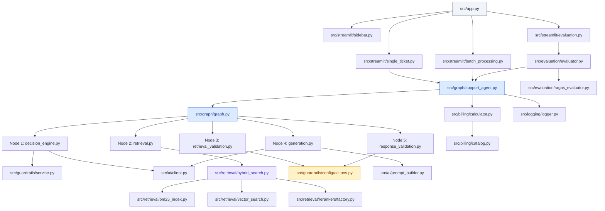
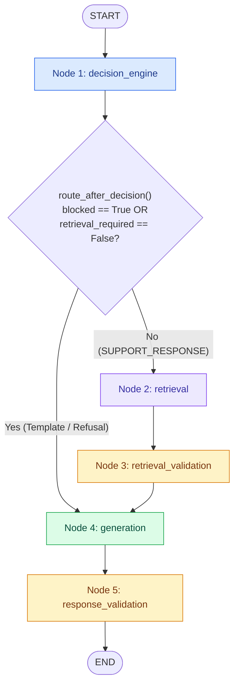
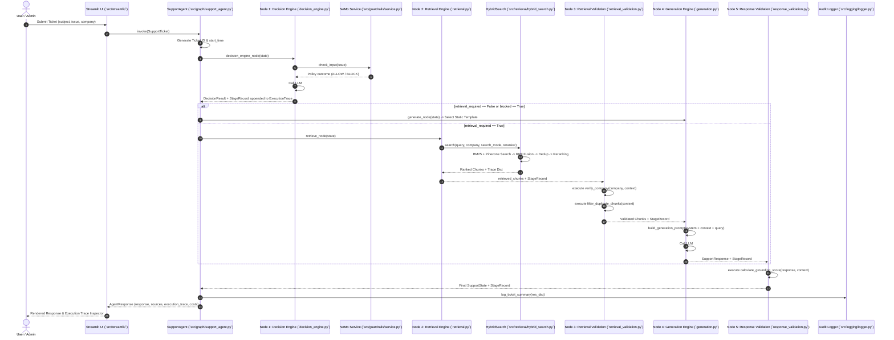

# System Architecture Guide — SupportSphere AI

> [!NOTE]
> **Document Header Metadata**  
> **Document Title**: SupportSphere AI Architecture Guide  
> **Purpose**: Serves as the authoritative, end-to-end technical reference for SupportSphere AI's stateful LangGraph 5-node topology, component responsibilities, dependency graphs, data lifecycle, design trade-offs, and extension patterns.  
> **Audience**: Principal Architects, Lead AI Engineers, Systems Engineers, DevOps/SRE Leads, Security Analysts.  
> **Last Updated**: `2026-07-28`  
> **Related Documents**: [README](../README.md) | [System Design](SYSTEM_DESIGN.md) | [Retrieval Pipeline](RETRIEVAL_PIPELINE.md) | [Decision Engine](DECISION_ENGINE.md) | [Generation Engine](GENERATION_ENGINE.md) | [Evaluation](EVALUATION.md) | [Guardrails](GUARDRAILS.md) | [Observability](OBSERVABILITY.md) | [Deployment](DEPLOYMENT.md) | [Configuration](CONFIGURATION.md) | [Contributing](CONTRIBUTING.md) | [FAQ](FAQ.md)

---

## Table of Contents

- [1. Executive Architecture Summary](#1-executive-architecture-summary)
- [2. System Layers & Subsystem Boundaries](#2-system-layers--subsystem-boundaries)
- [3. Component Responsibilities & Module Matrix](#3-component-responsibilities--module-matrix)
- [4. System Dependency Graph](#4-system-dependency-graph)
- [5. LangGraph Stateful Workflow Architecture](#5-langgraph-stateful-workflow-architecture)
  - [5.1 Topological Node Graph](#51-topological-node-graph)
  - [5.2 State Object Specification (`SupportState`)](#52-state-object-specification-supportstate)
  - [5.3 Node Communication & Edge Routing Logic](#53-node-communication--edge-routing-logic)
- [6. End-to-End Sequence Diagram](#6-end-to-end-sequence-diagram)
- [7. Complete Request Lifecycle](#7-complete-request-lifecycle)
- [8. Deployment Architecture Diagram](#8-deployment-architecture-diagram)
- [9. Architectural Design Decisions & Trade-Offs](#9-architectural-design-decisions--trade-offs)
- [10. Failure Modes, Resilience & Mitigation Strategies](#10-failure-modes-resilience--mitigation-strategies)
- [11. Scalability Architecture & Bottleneck Analysis](#11-scalability-architecture--bottleneck-analysis)
- [12. Extension Points & Customization Guide](#12-extension-points--customization-guide)
- [13. Architectural Best Practices & Coding Standards](#13-architectural-best-practices--coding-standards)
- [Related Reading](#related-reading)
- [References](#references)
- [Future Improvements](#future-improvements)

---

## 1. Executive Architecture Summary

SupportSphere AI is built to resolve the fundamental structural deficiencies of single-prompt Retrieval-Augmented Generation (RAG) applications in multi-tenant enterprise support environments:

1. **Uncontrolled Inference Overhead**: Traditional systems query vector databases and invoke high-parameter LLMs for every incoming message, including simple greetings, out-of-scope questions, and platform outage alerts.
2. **Cross-Tenant Context Contamination**: In multi-product organizations (e.g., managing support for HackerRank, Claude, and Visa), naive similarity search risks returning documentation from one tenant to answer a query for another.
3. **Ungrounded Hallucinations**: Single-stage generation models often invent procedural steps when documentation is missing or ambiguous.
4. **Lack of Deterministic Auditability**: Opaque LLM chains lack structured per-node telemetry tracking tokens, latency, cost, and decision gates.

SupportSphere AI addresses these challenges through a **Dual-LLM, 5-Node Stateful LangGraph Machine**:

- **Reasoning vs. Synthesis Decoupling**: **LLM #1 (Decision Engine)** evaluates safety, intent, tenant alignment, and routing strategy. **LLM #2 (Generation Engine)** synthesizes grounded responses exclusively from verified retrieval context.
- **Zero-Token Validation Nodes**: Programmatic Python rules (`retrieval_validation` and `response_validation`) execute at `$0.00` LLM cost between graph steps, enforcing tenant matching and word-overlap grounding thresholds.
- **Hybrid Retrieval**: Combines Rank-BM25 keyword search with Pinecone dense vector similarity (`gemini-embedding-001`), Reciprocal Rank Fusion (RRF), and plug-and-play reranking (FlashRank, CrossEncoder, or LLM).

---

## 2. System Layers & Subsystem Boundaries

The system is organized into six strictly segregated architectural layers:

```
┌──────────────────────────────────────────────────────────────────────────────────────────────┐
│ 1. Presentation & Interface Layer (Streamlit App)                                           │
│    • `src/app.py` • `src/streamlit/dashboard.py` • `src/streamlit/single_ticket.py`           │
│    • `src/streamlit/batch_processing.py` • `src/streamlit/evaluation.py`                     │
└──────────────────────────────────────────────┬───────────────────────────────────────────────┘
                                               │ (SupportTicket, AppConfig)
                                               ▼
┌──────────────────────────────────────────────────────────────────────────────────────────────┐
│ 2. Orchestration Layer (LangGraph State Machine)                                             │
│    • `src/graph/support_agent.py` • `src/graph/graph.py` • `src/graph/state.py`              │
│    • `src/graph/trace.py` • `src/runtime_config/runtime.py`                                  │
└──────────────────────────────────────────────┬───────────────────────────────────────────────┘
                                               │ (SupportState)
                                               ▼
┌──────────────────────────────────────────────────────────────────────────────────────────────┐
│ 3. Safety, Reasoning & Generation Layer (AI Engine & NeMo Guardrails)                       │
│    • `src/graph/nodes/decision_engine.py` • `src/graph/nodes/generation.py`                  │
│    • `src/ai/client.py` • `src/ai/prompt_builder.py` • `src/guardrails/service.py`            │
└──────────────────────────────────────────────┬───────────────────────────────────────────────┘
                                               │ (Query, Metadata Filters)
                                               ▼
┌──────────────────────────────────────────────────────────────────────────────────────────────┐
│ 4. Retrieval & Knowledge Layer (Hybrid Search & Vector DB)                                   │
│    • `src/graph/nodes/retrieval.py` • `src/retrieval/hybrid_search.py`                       │
│    • `src/retrieval/bm25_index.py` • `src/retrieval/vector_search.py`                        │
│    • `src/retrieval/rank_fusion.py` • `src/retrieval/rerankers/factory.py`                   │
└──────────────────────────────────────────────┬───────────────────────────────────────────────┘
                                               │ (Retrieved Chunks)
                                               ▼
┌──────────────────────────────────────────────────────────────────────────────────────────────┐
│ 5. Validation & Rules Layer (Pure Functional Rules Engine)                                   │
│    • `src/graph/nodes/retrieval_validation.py` • `src/graph/nodes/response_validation.py`   │
│    • `src/guardrails/config/actions.py`                                                     │
└──────────────────────────────────────────────┬───────────────────────────────────────────────┘
                                               │ (Execution Metrics & Summaries)
                                               ▼
┌──────────────────────────────────────────────────────────────────────────────────────────────┐
│ 6. Observability, Evaluation & Billing Layer                                                │
│    • `src/logging/` • `src/billing/` • `src/evaluation/`                                     │
└──────────────────────────────────────────────────────────────────────────────────────────────┘
```

---

## 3. Component Responsibilities & Module Matrix

| Module / Package | Primary Purpose | Key Class / Functions | Upstream Callers | Downstream Dependencies |
|---|---|---|---|---|
| `src.app` | Application entry point & warmup. | `main()`, startup warmup calls | User / Streamlit CLI | `src.streamlit.*`, `src.logging` |
| `src.streamlit` | UI tab rendering & session management. | `render_dashboard()`, `render_single_ticket()`, `render_sidebar()` | `src.app` | `src.graph.support_agent`, `src.evaluation` |
| `src.graph.support_agent` | Facade for ticket triage execution. | `SupportAgent.invoke()` | `src.streamlit`, `src.evaluation` | `src.graph.graph`, `src.logging` |
| `src.graph.graph` | LangGraph topology builder. | `build_graph()`, `route_after_decision()` | `src.graph.support_agent` | `src.graph.nodes.*` |
| `src.graph.nodes.decision_engine` | Node 1: Intent & routing triage. | `decision_engine_node()` | `src.graph.graph` | `src.guardrails.service`, `src.ai.client` |
| `src.graph.nodes.retrieval` | Node 2: Document retrieval. | `retrieve_node()`, `get_retriever()` | `src.graph.graph` | `src.retrieval.hybrid_search` |
| `src.graph.nodes.retrieval_validation`| Node 3: Rules-based chunk check. | `retrieval_validation_node()` | `src.graph.graph` | `src.guardrails.config.actions` |
| `src.graph.nodes.generation` | Node 4: Grounded synthesis / template. | `generate_node()` | `src.graph.graph` | `src.ai.client`, `src.ai.prompt_builder` |
| `src.graph.nodes.response_validation` | Node 5: Grounding score check. | `response_validation_node()` | `src.graph.graph` | `src.guardrails.config.actions` |
| `src.retrieval.hybrid_search` | Multi-strategy retrieval & fusion. | `HybridSearch.search()` | `src.graph.nodes.retrieval` | `BM25Index`, `VectorSearch`, `RerankerFactory` |
| `src.ai.client` | Multi-provider LLM API client. | `LLMClient.generate()` | `src.graph.nodes` | `openai`, `google-genai`, `groq` |
| `src.guardrails.service` | NeMo Guardrails policy wrapper. | `NeMoGuardrailsService.check_input()` | `src.graph.nodes.decision_engine` | `nemoguardrails` |
| `src.billing.calculator` | Cost & token accounting engine. | `BillingCalculator.calculate_cost()` | `src.graph.support_agent` | `src.billing.catalog` |
| `src.evaluation.evaluator` | Benchmark dataset evaluator. | `SupportSphereEvaluator.evaluate_dataset()`| `src.streamlit.evaluation` | `RagasEvaluator`, `SupportAgent` |

---

## 4. System Dependency Graph



---

## 5. LangGraph Stateful Workflow Architecture

### 5.1 Topological Node Graph

The system topology is built on a 5-node LangGraph structure (`StateGraph`) with a conditional routing edge after Node 1:



### 5.2 State Object Specification (`SupportState`)

The state schema ([src/graph/state.py](file:///c:/Users/cheru/OneDrive/Desktop/GitHub_Projects/SupportSphere-AI/src/graph/state.py)) is a mutable Python `TypedDict` carrying the ticket data, runtime configurations, retrieval artifacts, and telemetry trace:

```python
class SupportState(TypedDict, total=False):
    # Configuration & Observability
    runtime_config: RuntimeConfig
    execution_trace: ExecutionTrace

    # Inputs
    issue: str
    subject: str
    company: str

    # Node 1 Outputs
    decision_result: Optional[DecisionResult]
    intent: str
    routing_strategy: str
    routing_reason: str
    routing_status: str
    retrieval_required: bool
    company_reference_found: bool
    detected_company: Optional[str]
    verified_company: str
    company_match: bool
    decision_provider: str
    decision_model: str
    decision_latency_ms: float
    decision_input_tokens: int
    decision_output_tokens: int

    # Node 2 Outputs
    reranker: str
    search_mode: str
    retrieved_chunks: List[Dict[str, Any]]
    retrieved_context: List[str]
    sources: List[Dict[str, Any]]
    num_chunks: int
    token_estimate: int
    retrieval_trace: Dict[str, Any]
    retrieval_latency_ms: float

    # Node 3 Outputs
    retrieval_validation_decision: str
    retrieval_validation_latency_ms: float

    # Node 4 Outputs
    response: Optional[SupportResponse]
    generation_provider: str
    generation_model: str
    generation_latency_ms: float
    generation_input_tokens: int
    generation_output_tokens: int

    # Node 5 Outputs
    grounding_score: float
    response_validation_decision: str
    response_validation_latency_ms: float

    # Flags & Warnings
    blocked: bool
    regenerated: bool
    warnings: List[str]
```

### 5.3 Node Communication & Edge Routing Logic

Node communication is strictly **asynchronous-state-based**. Nodes do not call each other directly; instead, each node receives the current `SupportState`, mutates specific keys, appends a `StageRecord` to `state["execution_trace"]`, and returns the state object.

The conditional edge after Node 1 evaluates `route_after_decision(state)`:

```python
def route_after_decision(state: SupportState) -> str:
    # If NeMo Guardrails blocked the input, skip retrieval and jump to template generation
    if state.get("blocked", False):
        return "generation"
    
    # If ticket intent does not require documentation context (e.g. greeting, outage), jump to generation
    if state.get("retrieval_required", True):
        return "retrieval"
        
    return "generation"
```

---

## 6. End-to-End Sequence Diagram



---

## 7. Complete Request Lifecycle

```text
[Step 1: Ticket Submission]
  • User submits ticket via Streamlit UI or Python API.
  • `SupportAgent` constructs a `SupportTicket` object and initializes `SupportState`.

[Step 2: Startup Configuration Snapshot]
  • RuntimeConfig snapshots active providers, models, search mode, top-k, and reranker settings.
  • Unique Ticket ID (e.g. `TKT-E2A19381`) and timestamp generated.

[Step 3: Node 1 Execution (Decision Engine)]
  • NeMo Guardrails screens input for injection/PII attacks.
  • LLM #1 classifies intent into 1 of 11 intent classes.
  • Company domain references resolved (HackerRank, Claude, Visa).
  • Output: DecisionResult object; routing flag `retrieval_required` set.

[Step 4: Conditional Graph Branching]
  • Branch A (retrieval_required = False): Bypasses Nodes 2 & 3; jumps directly to Node 4.
  • Branch B (retrieval_required = True): Proceeds to Node 2.

[Step 5: Node 2 Execution (Retrieval Engine)]
  • BM25 index & Pinecone vector DB queried in parallel.
  • Reciprocal Rank Fusion (RRF) scores fused candidates.
  • Deduplication (ID, text, URL-cap MAX_CHUNKS_PER_URL = 2) applied.
  • Selected reranker rescores candidates to Top-K.

[Step 6: Node 3 Execution (Retrieval Validation — Rules-Only)]
  • `verify_company` action verifies all chunk metadata matches target company.
  • `filter_duplicate_chunks` action removes text duplicates ($0 token cost).

[Step 7: Node 4 Execution (Generation Engine)]
  • For Branch B: Prompt builder constructs system + context + query prompt; LLM #2 executes.
  • For Branch A: Selects matching static template string from `src/responses/templates.py`.

[Step 8: Node 5 Execution (Response Validation — Rules-Only)]
  • `calculate_grounding_score` measures word overlap ratio between response & context.
  • If score < 0.15, blocks response and substitutes safety refusal ($0 token cost).

[Step 9: Observability & Response Packaging]
  • `BillingCalculator` aggregates token counts and computes total USD cost.
  • `log_ticket_summary` prints 55-line audit block to `logs/application.log`.
  • `AgentResponse` returned to user with full `ExecutionTrace` timeline.
```

---

## 8. Deployment Architecture Diagram

```
┌────────────────────────────────────────────────────────────────────────────────────────┐
│ Enterprise Kubernetes / Cloud Container Environment                                    │
│                                                                                        │
│  ┌──────────────────────────────────────────────────────────────────────────────────┐  │
│  │ Streamlit Application Cluster (Port 8501)                                        │  │
│  │ • Container Command: `uv run streamlit run src/app.py`                           │  │
│  │ • Application Warmup: Preloads NeMo Service, Pinecone Client, & BM25 Index       │  │
│  └──────────────────────────┬────────────────────────────┬──────────────────────────┘  │
│                             │                            │                             │
│                             ▼                            ▼                             │
│  ┌──────────────────────────────────────┐    ┌──────────────────────────────────────┐  │
│  │ Managed LLM Provider Cloud APIs      │    │ Pinecone Serverless Vector Index     │  │
│  │ • OpenAI API (GPT-5.4-mini / GPT-4o) │    │ • Index Name: `support-sphere-ai`    │  │
│  │ • Google Gemini API (2.5-Flash)      │    │ • Dimension: 768 (Cosine Metric)     │  │
│  │ • Groq API (Llama-3.3-70B)           │    │ • Cloud Region: AWS us-east-1        │  │
│  └──────────────────────────────────────┘    └──────────────────────────────────────┘  │
│                             │                            │                             │
│                             ▼                            ▼                             │
│  ┌──────────────────────────────────────────────────────────────────────────────────┐  │
│  │ Volume Storage / Persistent File System                                          │  │
│  │ • `data/artifacts/bm25_index.pkl` — Pre-built BM25 Lexical Index                  │  │
│  │ • `logs/application.log`, `pipeline.log`, `errors.log` — Multi-Handler Audit Logs│  │
│  └──────────────────────────────────────────────────────────────────────────────────┘  │
└────────────────────────────────────────────────────────────────────────────────────────┘
```

---

## 9. Architectural Design Decisions & Trade-Offs

### 9.1 Dual-LLM vs. Single Monolithic LLM

- **Decision**: Separate reasoning (LLM #1) from response generation (LLM #2).
- **Trade-Off**: Adds ~1.5s latency for LLM #1 call on retrieval paths, but reduces total token expenditure by ~70% across non-retrieval tickets (greetings, outages, safety refusals).

### 9.2 Zero-Token Rules Nodes vs. LLM Evaluator Nodes

- **Decision**: Execute Nodes 3 and 5 using pure Python functions (`verify_company`, `calculate_grounding_score`).
- **Trade-Off**: Lexical word-overlap grounding metrics are less semantically nuanced than an LLM judge, but execute in `< 5ms` at `$0.00` cost versus 3,000ms and `$0.005` per LLM evaluation call.

### 9.3 Hybrid Search vs. Single Vector Search

- **Decision**: Parallel Rank-BM25 and Pinecone dense vector retrieval fused with RRF.
- **Trade-Off**: BM25 requires local memory to store the pickle index (`bm25_index.pkl`), but guarantees keyword precision for exact error codes and feature IDs that dense embeddings miss.

---

## 10. Failure Modes, Resilience & Mitigation Strategies

| Component | Potential Failure Mode | Resilience / Mitigation Mechanism |
|---|---|---|
| **LLM #1 / LLM #2** | API Rate Limit (429) / Timeout | `LLMClient` catches API exceptions; falls back to static error templates without breaking the graph state. |
| **Pinecone DB** | Connection Failure / Network Outage | Retrieval engine catches Pinecone errors and gracefully degrades to BM25-only search. |
| **BM25 Index** | Missing or corrupted `bm25_index.pkl` | `BM25Index.load()` catches FileNotFoundError and falls back to dense vector-only search. |
| **Reranker** | Memory exhaustion / model load failure | `FlashRankReranker` & `CrossEncoderReranker` catch exceptions and fall back to returning RRF-ranked results. |
| **NeMo Guardrails**| Colang syntax exception / initialization error | `NeMoGuardrailsService` catches initialization errors, logs a warning, and permits safe passthrough. |

---

## 11. Scalability Architecture & Bottleneck Analysis

### Current Performance Bottlenecks
1. **Sequential Dual LLM Calls**: Tickets requiring retrieval must perform two sequential network round-trips (LLM #1 $\rightarrow$ Retrieval $\rightarrow$ LLM #2).
2. **Local BM25 Index Loading**: `bm25_index.pkl` is loaded into application memory. Large document corpora (>100k chunks) increase container memory requirements.

### Horizontal Scaling Strategy
- **Stateless Application Tier**: Streamlit containers run headlessly without local state dependencies. Requests can be load-balanced across $N$ container instances.
- **Serverless Vector Tier**: Pinecone manages vector index auto-scaling independently of the application runtime.

---

## 12. Extension Points & Customization Guide

1. **Adding a New Support Tenant**:
   - Add tenant documentation under `data/raw/<tenant_name>/`.
   - Update company keyword dictionary in `src/ai/prompts/decision_prompt.py`.
   - Re-run ingestion: `uv run python -m vectordb_ingestion.ingestion.ingest`.

2. **Adding a Custom Guardrail Policy**:
   - Define Colang flow rules in `src/guardrails/config/rails.co`.
   - Register any required custom Python action in `src/guardrails/config/actions.py`.

3. **Adding an LLM Provider**:
   - Extend `LLMClient._create_client()` in `src/ai/client.py`.
   - Add model pricing to `_LLM_CATALOG` in `src/billing/catalog.py`.

---

## 13. Architectural Best Practices & Coding Standards

1. **Explicit Node Context Logging**: Every log statement inside graph nodes must use node tags (e.g. `logger.info("[Node 1: Decision Engine] ...")`).
2. **Single Source of Configuration**: All environment variable parsing must remain in `src/config.py`.
3. **Immutable Execution Records**: Nodes must append completed `StageRecord` objects to `state["execution_trace"]` rather than printing unstructured debug statements.

---

## Related Reading

- [System Design Specification](SYSTEM_DESIGN.md) — Detailed software engineering patterns, caching, and error handling strategies.
- [Retrieval Pipeline Architecture](RETRIEVAL_PIPELINE.md) — Complete deep-dive into BM25, Pinecone, RRF fusion, and rerankers.
- [Decision Engine Specification](DECISION_ENGINE.md) — Intent classification rules, company verification, and NeMo policy integration.
- [Generation Engine Specification](GENERATION_ENGINE.md) — Prompt builder v3, grounding rules, and citation enforcement.

---

## References

1. LangGraph Documentation — StateGraph, Conditional Edges, and Stateful Workflows.
2. NVIDIA NeMo Guardrails Documentation — Colang 2.0 Syntax and Action Registration.
3. Pinecone Vector Database Reference — Serverless Dense Cosine Similarity Indexing.
4. Reciprocal Rank Fusion (RRF) — Cormack et al., *Reciprocal Rank Fusion Outperforms Data Fusion Methods* (SIGIR).

---

## Future Improvements

1. **Async SSE Token Streaming**: Stream tokens live from LLM #2 into the Streamlit UI.
2. **Distributed Background Worker Queue**: Offload document ingestion and batch CSV ticket evaluations to Celery/Redis workers.
3. **Semantic Query Caching**: Add Redis semantic caching to serve identical pre-decision support queries in `< 50ms`.
