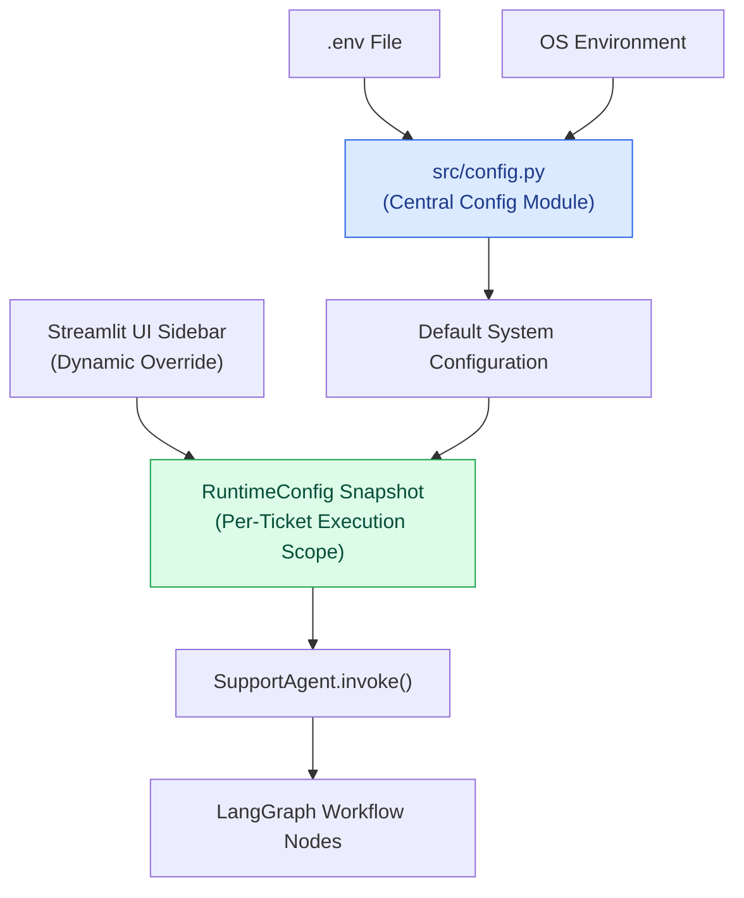

# Configuration & Environment Variables Reference — SupportSphere AI

> [!NOTE]
> **Document Header Metadata**  
> **Document Title**: SupportSphere AI Configuration & Environment Variables Reference  
> **Purpose**: Serves as the complete manual for all environment variables, dynamic runtime parameters, LLM providers, model pricing tables, chunking bounds, search strategies, vector database settings, evaluation parameters, and logging options.  
> **Audience**: DevOps Engineers, System Administrators, AI Engineers, Software Developers.  
> **Last Updated**: `2026-07-28`  
> **Related Documents**: [README](../README.md) | [Architecture](ARCHITECTURE.md) | [System Design](SYSTEM_DESIGN.md) | [Retrieval Pipeline](RETRIEVAL_PIPELINE.md) | [Decision Engine](DECISION_ENGINE.md) | [Generation Engine](GENERATION_ENGINE.md) | [Evaluation](EVALUATION.md) | [Guardrails](GUARDRAILS.md) | [Observability](OBSERVABILITY.md) | [Deployment](DEPLOYMENT.md)

---

## 1. Executive Summary & Configuration Philosophy

SupportSphere AI implements a **single-point configuration pattern**:

- **Central Environment Module** ([src/config.py](file:///c:/Users/cheru/OneDrive/Desktop/GitHub_Projects/SupportSphere-AI/src/config.py)): This is the only python file in the application authorized to read environment variables via `os.getenv`. All other modules import constants directly from `src.config`.
- **Dynamic Runtime Config** ([src/runtime_config/runtime.py](file:///c:/Users/cheru/OneDrive/Desktop/GitHub_Projects/SupportSphere-AI/src/runtime_config/runtime.py)): Generates an immutable snapshot (`RuntimeConfig`) per ticket execution, allowing live UI sidebar overrides without restarting the application server.



---

## 2. Environment Variables Master Matrix

The table below documents every environment variable parsed by `src/config.py`:

| Variable Name | Type | Required | Default Value | Description |
|---|---|:---:|---|---|
| `LLM_PROVIDER` | String | No | `"openai"` | Default fallback LLM provider (`openai`, `google`, `groq`). |
| `LLM_MODEL` | String | No | `"gpt-5.4-mini"` | Default fallback LLM model identifier. |
| `DECISION_PROVIDER` | String | No | inherits `LLM_PROVIDER` | LLM #1 provider for Decision Engine triage. |
| `DECISION_MODEL` | String | No | inherits `LLM_MODEL` | LLM #1 model identifier. |
| `GENERATION_PROVIDER` | String | No | inherits `LLM_PROVIDER` | LLM #2 provider for Generation Engine synthesis. |
| `GENERATION_MODEL` | String | No | inherits `LLM_MODEL` | LLM #2 model identifier. |
| `LLM_TEMPERATURE` | Float | No | `0.0` | Sampling temperature for all LLM calls. |
| `OPENAI_API_KEY` | String | Conditional | `""` | API key for OpenAI LLM calls. |
| `GOOGLE_API_KEY` | String | Conditional | `""` | API key for Google Gemini LLMs and Embeddings. |
| `GOOGLE_API_KEY_EMBED` | String | No | falls back to `GOOGLE_API_KEY` | Dedicated API key for Gemini embeddings. |
| `GROQ_API_KEY` | String | Conditional | `""` | API key for Groq LLM calls. |
| `HF_TOKEN` | String | No | `""` | Hugging Face token for private model weights. |
| `PINECONE_API_KEY` | String | **Yes** | `""` | Pinecone Cloud Vector Database API key. |
| `PINECONE_INDEX_NAME` | String | No | `"support-sphere-ai"` | Target Pinecone vector index name. |
| `PINECONE_NAMESPACE` | String | No | `""` | Target Pinecone namespace filter. |
| `PINECONE_CLOUD` | String | No | `"aws"` | Pinecone cloud provider infrastructure. |
| `PINECONE_REGION` | String | No | `"us-east-1"` | Pinecone cloud deployment region. |
| `EMBEDDING_PROVIDER` | String | No | `"google"` | Dense vector embedding provider. |
| `EMBEDDING_MODEL` | String | No | `"gemini-embedding-001"`| Dense embedding model identifier. |
| `EMBEDDING_DIMENSION` | Integer | No | `768` | Dense embedding vector dimension. |
| `EMBED_BATCH_SIZE` | Integer | No | `100` | Ingestion batch size for embedding generation. |
| `SEARCH_MODE` | String | No | `"hybrid"` | Retrieval strategy (`hybrid`, `vector`, `bm25`). |
| `VECTOR_TOP_K` | Integer | No | `20` | Initial candidate limit retrieved from Pinecone. |
| `BM25_TOP_K` | Integer | No | `20` | Initial candidate limit retrieved from BM25. |
| `FINAL_TOP_K` | Integer | No | `5` | Final context chunks injected into generation prompt. |
| `MAX_SECTION_SIZE` | Integer | No | `1200` | Maximum character length for header-aware chunks. |
| `SECTION_OVERLAP` | Integer | No | `150` | Character overlap between adjacent sub-chunks. |
| `MAX_CONTEXT_CHUNKS` | Integer | No | `10` | Hard ceiling on prompt context chunk count. |
| `MAX_CONTEXT_TOKENS` | Integer | No | `6000` | Hard ceiling on prompt context token count. |

---

## 3. LLM Providers & Supported Models Catalog

Models and pricing rates are defined in `src/billing/catalog.py` (Catalog Version: `2026-07-18`):

### 3.1 OpenAI
- `gpt-5.4-mini` (Input: $1.50/M, Output: $9.00/M) — **Default Production Recommendation**
- `gpt-5.4` (Input: $5.00/M, Output: $30.00/M)
- `gpt-5-mini` (Input: $0.45/M, Output: $3.60/M)
- `gpt-5` (Input: $2.50/M, Output: $20.00/M)
- `gpt-4o-mini` (Input: $0.25/M, Output: $1.00/M)
- `gpt-4o` (Input: $4.25/M, Output: $17.00/M)

### 3.2 Google Gemini
- `gemini-2.5-flash-lite` (Input: $0.10/M, Output: $0.40/M) — **Ultra-Low Cost Triage**
- `gemini-2.5-flash` (Input: $0.30/M, Output: $2.50/M)
- `gemini-2.5-pro` (Input: $1.25/M, Output: $10.00/M)
- `gemini-3.1-flash-lite` (Input: $0.25/M, Output: $1.50/M)
- `gemini-3.5-flash` (Input: $1.50/M, Output: $9.00/M)

### 3.3 Groq
- `llama-3.3-70b-versatile` (Input: $0.59/M, Output: $0.79/M) — **High-Speed Open Models**
- `openai/gpt-oss-120b` (Input: $0.15/M, Output: $0.60/M)
- `openai/gpt-oss-20b` (Input: $0.075/M, Output: $0.30/M)

---

## 4. Retrieval & Reranker Configuration

### 4.1 Search Mode Options

| Search Mode | Description | Underlying Engines Executed |
|---|---|---|
| `hybrid` | Parallel keyword + vector retrieval fused via RRF. | BM25 Lexical + Pinecone Dense Vector |
| `vector` | Dense semantic similarity search only. | Pinecone Dense Vector |
| `bm25` | Lexical keyword search only. | In-Memory Rank-BM25 Index |

### 4.2 Reranker Options (`DEFAULT_RERANKER = "none"`)

| Reranker Key | Backend Model / Implementation | Execution Scope |
|---|---|---|
| `"none"` | `NoOpReranker` | Returns RRF-ranked candidate order as-is. |
| `"flashrank"` | `ms-marco-MiniLM-L-12-v2` | Local ONNX CPU execution (~30ms). |
| `"cross_encoder"` | `ms-marco-MiniLM-L-6-v2` | PyTorch sentence-transformers cross-attention (~150ms). |
| `"llm"` | `gemini-2.5-flash` | Remote LLM relevance scoring (~1,200ms). |

---

## 5. Document Processing & Ingestion Bounds

Configured in `src/config.py` and used by `vectordb_ingestion/`:

```python
# Chunking
MAX_SECTION_SIZE = 1200   # Maximum section character size
SECTION_OVERLAP = 150     # Sliding window character overlap

# Embeddings
EMBEDDING_PROVIDER = "google"
EMBEDDING_MODEL = "gemini-embedding-001"
EMBEDDING_DIMENSION = 768
EMBED_BATCH_SIZE = 100
```

---

## 6. Configuration Precedence & Overrides

SupportSphere AI applies a 3-tier configuration hierarchy:

```text
[Highest Priority]  1. Streamlit Sidebar User Overrides (active per session)
                           │
                           ▼
[Medium Priority]   2. OS Environment Variables / .env File
                           │
                           ▼
[Lowest Priority]   3. Hardcoded System Defaults in src/config.py
```

---

## 7. Sample `.env` Configuration File

```ini
# =============================================================================
# SupportSphere AI Production Configuration File (.env)
# =============================================================================

# LLM Providers & Models
DECISION_PROVIDER=openai
DECISION_MODEL=gpt-5.4-mini

GENERATION_PROVIDER=openai
GENERATION_MODEL=gpt-5.4-mini

LLM_TEMPERATURE=0.0

# API Credentials
OPENAI_API_KEY=sk-proj-...
GOOGLE_API_KEY=AIzaSy...
GROQ_API_KEY=gsk_...

# Vector Database (Pinecone)
PINECONE_API_KEY=pcsk_...
PINECONE_INDEX_NAME=support-sphere-ai
PINECONE_CLOUD=aws
PINECONE_REGION=us-east-1

# Retrieval Pipeline Settings
SEARCH_MODE=hybrid
FINAL_TOP_K=5
VECTOR_TOP_K=20
BM25_TOP_K=20
```

---

## Related Reading

- [System Architecture Guide](ARCHITECTURE.md) — System topology & request lifecycle.
- [Retrieval Pipeline Specification](RETRIEVAL_PIPELINE.md) — BM25, Pinecone, RRF, & rerankers.
- [Observability Specification](OBSERVABILITY.md) — Log handlers & cost accounting.
- [Deployment Guide](DEPLOYMENT.md) — Docker containerization & cloud environment variables.

---

## References

1. Python `dotenv` Documentation — Environment Variable Parsing.
2. Pinecone API Reference — Index Configuration Parameters.
3. Streamlit Session State & Sidebar Widget Reference.

---

## Future Improvements

1. **Configuration Schema Validation**: Add `pydantic-settings` to enforce strict type checking and range validation on all startup environment variables.
2. **Dynamic Remote Config Server**: Support loading runtime configurations from HashiCorp Vault or AWS AppConfig.
