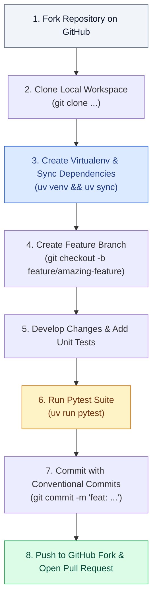
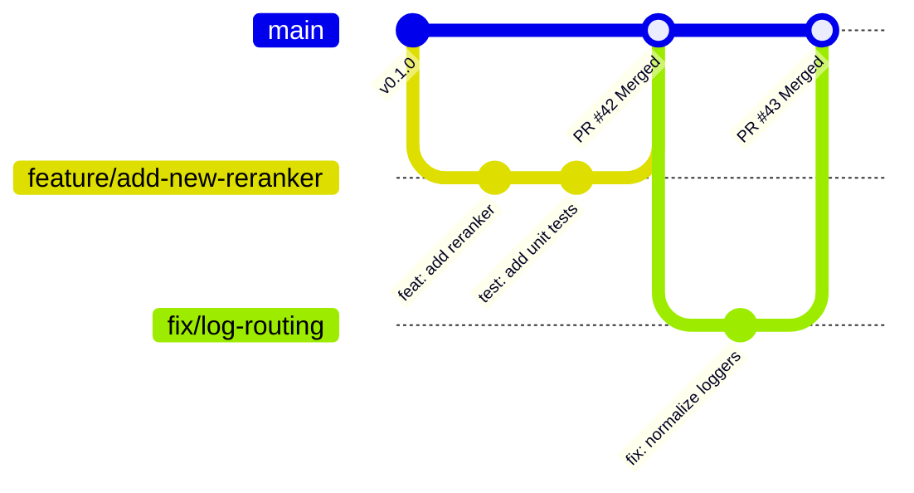
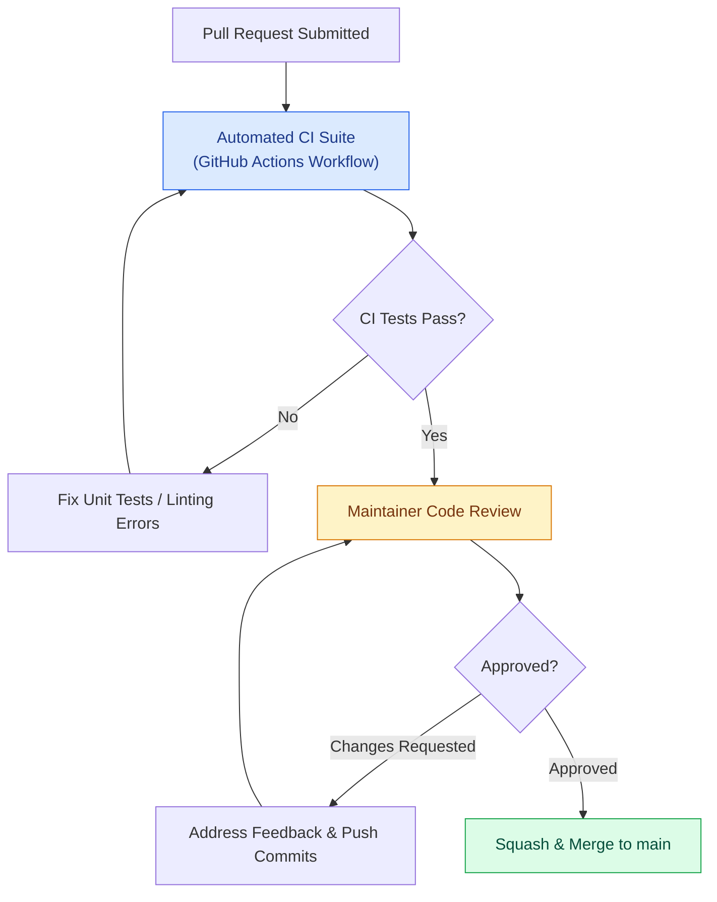

# Open Source Contribution Guidelines — SupportSphere AI

> [!NOTE]
> **Document Header Metadata**  
> **Document Title**: SupportSphere AI Open Source Contribution Guidelines  
> **Purpose**: Provides explicit guidelines for developers and open-source contributors, detailing environment setup, Python coding standards, architectural rules, testing requirements, Git branching conventions, commit standards, and PR review checklists.  
> **Audience**: Open Source Contributors, AI Engineers, Software Developers, Code Reviewers.  
> **Last Updated**: `2026-07-28`  
> **Related Documents**: [README](../README.md) | [Architecture](ARCHITECTURE.md) | [System Design](SYSTEM_DESIGN.md) | [Retrieval Pipeline](RETRIEVAL_PIPELINE.md) | [Decision Engine](DECISION_ENGINE.md) | [Generation Engine](GENERATION_ENGINE.md) | [Evaluation](EVALUATION.md) | [Guardrails](GUARDRAILS.md) | [Observability](OBSERVABILITY.md) | [Deployment](DEPLOYMENT.md) | [Configuration](CONFIGURATION.md) | [Changelog](CHANGELOG.md) | [FAQ](FAQ.md)

---

## 1. Executive Summary & Code of Conduct

Thank you for contributing to **SupportSphere AI**!

We welcome contributions from the community, including bug fixes, new retrieval strategies, LLM provider integrations, UI enhancements, and documentation updates.

### Community Code of Conduct
- **Professional Communication**: Maintain respectful, constructive, and professional communication in all issue discussions, pull requests, and code reviews.
- **Strict Verification**: Ensure all code changes are verified against the automated test suite prior to submitting a pull request.
- **No Hallucinated Features**: Do not add undocumented features or speculative code stubs.

---

## 2. Development Workflow Quickstart

Follow this step-by-step workflow to set up your local development environment:



### Setup Commands
```bash
# 1. Fork and clone the repository
git clone https://github.com/<your-username>/SupportSphere-AI.git
cd SupportSphere-AI

# 2. Create virtual environment using uv
uv venv

# 3. Activate virtual environment
# Windows:
.venv\Scripts\activate
# macOS/Linux:
source .venv/bin/activate

# 4. Sync dependencies
uv sync

# 5. Create environment file
cp .env.example .env
```

---

## 3. Python Coding Standards & Architectural Rules

All contributions must adhere to the following core architectural rules:

### Rule 1: Centralized Configuration Only
> **NEVER** call `os.getenv()` inside application submodules (`src/ai`, `src/retrieval`, `src/graph`, etc.).  
> All environment parsing must remain in `src/config.py`. Read constants directly via `import src.config as src_config`.

### Rule 2: Single Standardized Logger Name
> **NEVER** initialize module-level loggers using `logging.getLogger(__name__)`.  
> Always use `logger = logging.getLogger("SupportSphere")` so log messages route correctly through `FrameworkFilter`.

### Rule 3: Node-Attributed Telemetry Tagging
> Log lines inside LangGraph nodes must include explicit node tags:
> - `logger.info("[Node 1: Decision Engine] ...")`
> - `logger.info("[Node 2: Retrieval Engine] ...")`
> - `logger.info("[Node 3: Retrieval Validation] ...")`
> - `logger.info("[Node 4: Generation Engine] ...")`
> - `logger.info("[Node 5: Response Validation] ...")`

### Rule 4: Type Annotations & Docstrings
> All public classes, methods, and functions must include PEP 484 type annotations and Google-style Python docstrings.

---

## 4. Naming Conventions

| Code Artifact | Convention | Example |
|---|---|---|
| **Python Modules** | `snake_case` | `hybrid_search.py`, `decision_engine.py` |
| **Classes** | `PascalCase` | `SupportAgent`, `HybridSearch`, `RerankerFactory` |
| **Functions & Methods** | `snake_case` | `build_generation_prompt()`, `search()` |
| **Variables & Fields** | `snake_case` | `retrieved_chunks`, `grounding_score` |
| **Constants** | `UPPER_SNAKE_CASE` | `FINAL_TOP_K`, `DECISION_PROVIDER` |
| **Test Files** | `test_<module>.py` | `test_retrieval.py`, `test_safety_guardrails.py` |

---

## 5. Automated Testing Guidelines (`pytest`)

Every bug fix, refactor, or new feature **must include automated unit test coverage**.

### Running Tests
```bash
# Run complete test suite
uv run pytest

# Run specific test file with verbose output
uv run pytest tests/test_retrieval.py -v
```

### Test Suite Structure (`tests/`)
- `tests/test_retrieval.py`: Tests retrieval search modes (`bm25`, `vector`, `hybrid`), deduplication logic, URL capping, and Top-K bounds.
- `tests/test_company_detection.py`: Tests domain keyword parsing and company tenant verification.
- `tests/test_model_validation.py`: Tests provider configuration validation and model schemas.
- `tests/test_safety_guardrails.py`: Tests NeMo Guardrails policy triggers and refusal templates.
- `tests/test_simple_evaluator.py`: Tests classification accuracy metric calculations.

> [!IMPORTANT]
> **Mock External Network Calls**: Unit tests must execute offline using `unittest.mock` without requiring active cloud API keys or external network requests.

---

## 6. Git Branching Strategy

SupportSphere AI uses a simplified Git Flow branching strategy:



### Branch Naming Conventions
- `feature/<short-description>` — New features, provider support, or algorithms (e.g. `feature/llama-guard`).
- `fix/<short-description>` — Bug fixes or stability patches (e.g. `fix/pinecone-timeout`).
- `docs/<short-description>` — Documentation additions or edits (e.g. `docs/architecture-update`).
- `refactor/<short-description>` — Code cleanup without behavior changes (e.g. `refactor/prompt-builder`).

---

## 7. Conventional Commit Message Standards

Commits must follow the [Conventional Commits](https://www.conventionalcommits.org/) specification:

```text
<type>(<scope>): <short description>

[optional body]
```

### Approved Commit Types
- `feat`: A new feature or provider integration.
- `fix`: A bug fix or error patch.
- `docs`: Documentation changes only.
- `test`: Adding missing unit tests or refactoring existing tests.
- `refactor`: A code change that neither fixes a bug nor adds a feature.
- `style`: Formatting, missing semi-colons, whitespace fixes.
- `chore`: Updating dependencies, build scripts, or repository configs.

### Examples
```bash
git commit -m "feat(retrieval): add FlashRank local ONNX reranker option"
git commit -m "fix(logging): normalize src submodule logger names to SupportSphere"
git commit -m "docs(readme): update system architecture mermaid diagram"
```

---

## 8. Pull Request Guidelines & Review Checklist

### Submitting a Pull Request
1. Ensure your branch is rebased onto latest `main`.
2. Verify all 18 unit tests pass (`uv run pytest`).
3. Open a Pull Request on GitHub targeting `main`.
4. Provide a clear description of the problem solved and the implementation approach.



### Maintainer Code Review Checklist
- [ ] **Tests Passing**: CI run passes all unit tests cleanly.
- [ ] **Config Isolation**: No direct `os.getenv` calls outside `src/config.py`.
- [ ] **Logger Uniformity**: Uses `logging.getLogger("SupportSphere")`.
- [ ] **Node Tags**: Log lines inside nodes use `[Node X: Name]` context prefixes.
- [ ] **Type Annotations**: All new functions include explicit PEP 484 type hints.
- [ ] **No Secrets**: No hardcoded API keys or credentials present in diff.

---

## Related Reading

- [System Architecture Guide](ARCHITECTURE.md) — 5-node topology & state machine.
- [System Design Specification](SYSTEM_DESIGN.md) — Design patterns & coding principles.
- [Configuration Guide](CONFIGURATION.md) — Environment variables reference.
- [Changelog](CHANGELOG.md) — Version history and release notes.

---

## References

1. Conventional Commits 1.0.0 Specification.
2. PEP 8 — Style Guide for Python Code.
3. PEP 484 — Type Hints.
4. Google Python Style Guide — Docstring Conventions.

---

## Future Improvements

1. **Pre-Commit Hooks Integration**: Add `.pre-commit-config.yaml` to enforce `ruff`, `black`, and `mypy` automatically before Git commits.
2. **Automated PR Coverage Reports**: Integrate `codecov` to track unit test coverage on pull requests.
