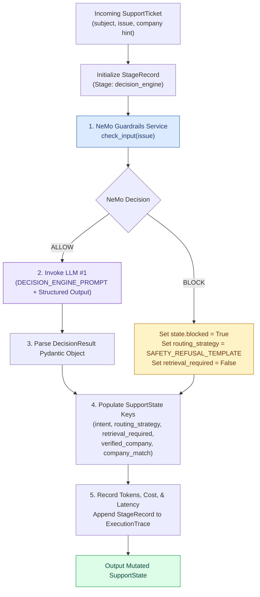
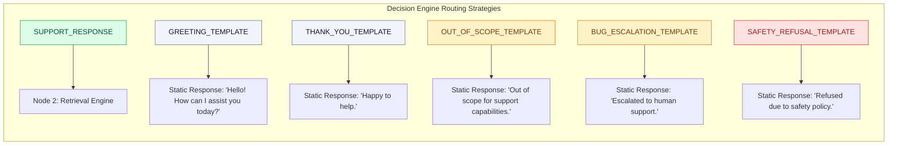

# Decision Engine Specification — SupportSphere AI

> [!NOTE]
> **Document Header Metadata**  
> **Document Title**: SupportSphere AI Decision Engine Specification  
> **Purpose**: Engineering documentation for Node 1 (Decision Engine), detailing prompt design, NVIDIA NeMo safety policy execution, 11-class intent detection, company domain reference resolution, structured Pydantic output, and routing strategy selection.  
> **Audience**: AI Engineers, Prompt Engineers, Systems Architects, Security Engineers.  
> **Last Updated**: `2026-07-28`  
> **Related Documents**: [README](../README.md) | [Architecture](ARCHITECTURE.md) | [System Design](SYSTEM_DESIGN.md) | [Retrieval Pipeline](RETRIEVAL_PIPELINE.md) | [Generation Engine](GENERATION_ENGINE.md) | [Evaluation](EVALUATION.md) | [Guardrails](GUARDRAILS.md) | [Observability](OBSERVABILITY.md) | [Deployment](DEPLOYMENT.md) | [Configuration](CONFIGURATION.md)

---

## 1. Executive Summary & Purpose

The **Decision Engine** serves as **Node 1** ([src/graph/nodes/decision_engine.py](file:///c:/Users/cheru/OneDrive/Desktop/GitHub_Projects/SupportSphere-AI/src/graph/nodes/decision_engine.py)) in SupportSphere AI's stateful 5-node LangGraph pipeline.

Its primary role is to execute **upstream triage and safety evaluation** before any vector database queries or response generation calls take place. By decoupling reasoning (LLM #1) from grounded answer synthesis (LLM #2), the Decision Engine delivers key production benefits:

1. **Inference Cost Reduction**: Simple greetings, platform outage alerts, and off-topic questions bypass vector retrieval and LLM #2 entirely, executing via zero-token static response templates ($0.00 cost).
2. **Safety Pre-Screening**: Integrates NVIDIA NeMo Guardrails to catch prompt injections, jailbreak attempts, and PII leakage before the system processes the request.
3. **Cross-Tenant Guarding**: Resolves domain keywords (HackerRank, Claude, Visa) and verifies that the ticket's requested company hint matches the customer's actual query context.

---

## 2. Decision Engine Node Architecture



---

## 3. NeMo Guardrails Pre-Screening

Before LLM #1 is called, `decision_engine_node` submits the raw ticket issue to `NeMoGuardrailsService.check_input()` ([src/guardrails/service.py](file:///c:/Users/cheru/OneDrive/Desktop/GitHub_Projects/SupportSphere-AI/src/guardrails/service.py)).

Colang 2.0 policy flows in `rails.co` screen for:
- **Prompt Injections & Jailbreaks**: "ignore previous instructions", "DAN mode enabled", "system override".
- **PII Leakage**: Passwords, API keys, SSNs, credit card numbers.
- **Roleplay Attacks**: "act as a linux terminal", "pretend you are my grandma".
- **Abuse & Spam**: Profanity, self-harm, token flooding.

If a rail triggers, NeMo returns `BLOCK`. Node 1 sets `state["blocked"] = True`, assigns `SAFETY_REFUSAL_TEMPLATE`, sets `retrieval_required = False`, and skips LLM #1 execution.

---

## 4. Intent Classification Matrix

When input safety passes, LLM #1 classifies the customer ticket into one of **11 Intent Classes** defined in `src/ai/prompts/decision_prompt.py`:

| Intent Class | Description / Example Queries | Default Routing Strategy | Retrieval Needed? |
|---|---|---|:---:|
| `GREETING` | Small talk, polite hellos ("hi", "good morning"). | `GREETING_TEMPLATE` | ❌ |
| `THANK_YOU` | Appreciation ("thanks", "thank you", "perfect"). | `THANK_YOU_TEMPLATE` | ❌ |
| `PRODUCT_SUPPORT` | Questions on platform features, usage, coding tests. | `SUPPORT_RESPONSE` | ✅ |
| `ACCOUNT` | Password reset, account verification, login issues. | `SUPPORT_RESPONSE` | ✅ |
| `BILLING` | Invoices, payment errors, pricing, refunds. | `SUPPORT_RESPONSE` | ✅ |
| `BUG` | Visual UI bugs, execution failures, error popups. | `BUG_ESCALATION_TEMPLATE` | ❌ |
| `PLATFORM_INCIDENT` | 500/502 server errors, system outages. | `BUG_ESCALATION_TEMPLATE` | ❌ |
| `FEATURE_REQUEST` | Product suggestions or tool enhancements. | `SUPPORT_RESPONSE` | ✅ |
| `OUT_OF_SCOPE` | Trivia, weather, general non-support questions. | `OUT_OF_SCOPE_TEMPLATE` | ❌ |
| `SAFETY_REFUSAL` | Harmful, dangerous, or policy-violating prompts. | `SAFETY_REFUSAL_TEMPLATE` | ❌ |
| `EMPTY_INPUT` | Blank issue description or whitespace-only text. | `SAFETY_REFUSAL_TEMPLATE` | ❌ |

---

## 5. Company Tenant Resolution

Company reference resolution executes only when `routing_strategy == "SUPPORT_RESPONSE"`. The Decision Engine checks for domain keywords to confirm tenant alignment:

```mermaid
flowchart TD
    CheckStrategy{Routing Strategy?} -->|Not SUPPORT_RESPONSE| Bypass[Verified Company = Ticket Company Hint]
    
    CheckStrategy -->|SUPPORT_RESPONSE| InspectIssue[Inspect Issue Text for Domain Signals]
    
    InspectIssue --> HackerRankSig{"Contains: assessment, candidate, test,\nquestion bank, coding test?"}
    HackerRankSig -->|Yes| SetHR[Detected Company = HackerRank]
    
    InspectIssue --> ClaudeSig{"Contains: Anthropic, Sonnet,\nHaiku, Opus, Bedrock?"}
    ClaudeSig -->|Yes| SetClaude[Detected Company = Claude]
    
    InspectIssue --> VisaSig{"Contains: Visa, Traveller Cheque,\nCommercial Card, Visa Direct, Merchant?"}
    VisaSig -->|Yes| SetVisa[Detected Company = Visa]
    
    SetHR --> MatchCheck{Detected == Ticket Hint?}
    SetClaude --> MatchCheck
    SetVisa --> MatchCheck

    MatchCheck -->|Match| VerifiedMatch[Verified Company = Detected Company | Match = True]
    MatchCheck -->|Mismatch| VerifiedMismatch[Verified Company = Ticket Hint | Match = False]

    style HackerRankSig fill:#dbeafe,stroke:#2563eb,color:#1e3a8a
    style ClaudeSig fill:#ede9fe,stroke:#7c3aed,color:#3730a3
    style VisaSig fill:#dcfce7,stroke:#16a34a,color:#064e3b
```

---

## 6. Structured Output Schema (`DecisionResult`)

LLM #1 output is coerced into a strict Pydantic model ([src/ai/models.py](file:///c:/Users/cheru/OneDrive/Desktop/GitHub_Projects/SupportSphere-AI/src/ai/models.py)):

```python
class DecisionResult(BaseModel):
    safe: bool = Field(description="False if prompt injection or safety risk detected.")
    intent: str = Field(description="One of 11 Intent Classes.")
    company: str = Field(description="Target tenant company.")
    routing_strategy: str = Field(description="Selected routing strategy template or SUPPORT_RESPONSE.")
    retrieval_required: bool = Field(description="True ONLY for SUPPORT_RESPONSE strategy.")
    reason: str = Field(description="Short evidence-based rationale.")
    company_reference_found: bool = Field(default=False)
    routing_status: str = Field(default="NO_COMPANY_REFERENCE")
    confidence: float = Field(default=1.0)
    normalized_issue: str = Field(default="")
    normalized_subject: str = Field(default="")
```

---

## 7. Routing Strategy & Template Mapping



---

## 8. Failure Recovery & Deterministic Fallbacks

If LLM #1 fails due to API timeouts, 429 rate limits, or structural JSON parsing errors:
1. `decision_engine_node` catches the exception in a `try...except` block.
2. Generates a deterministic fallback `DecisionResult`:
   - `safe = True`
   - `intent = "PRODUCT_SUPPORT"`
   - `routing_strategy = "SUPPORT_RESPONSE"`
   - `retrieval_required = True`
   - `reason = "Fallback applied due to Decision Engine API error."`
3. Appends a warning to `state["warnings"]` and logs the exception to `logs/errors.log`.
4. Execution safely continues to Node 2 without crashing the workflow pipeline.

---

## 9. Telemetry & Audit Observability

Node 1 logs step telemetry to `state["execution_trace"]` using explicit node tagging:

```text
2026-07-28 18:37:00,832 | INFO | SupportSphere | [Node 1: Decision Engine] Executing Stage: decision | Provider: openai | Model: gpt-5.4-mini
2026-07-28 18:37:00,832 | INFO | SupportSphere | [Node 1: Decision Engine] Instantiating Chat client for provider=openai model=gpt-5.4-mini
2026-07-28 18:37:03,627 | INFO | SupportSphere | [Node 1: Decision Engine] Stage 'decision' execution complete (Provider: openai, Model: gpt-5.4-mini). Latency: 2.37s, Input: 869, Output: 139.
```

---

## Related Reading

- [System Architecture Guide](ARCHITECTURE.md) — Stateful LangGraph 5-node topology.
- [Retrieval Pipeline Specification](RETRIEVAL_PIPELINE.md) — Hybrid search, RRF, and deduplication.
- [Generation Engine Specification](GENERATION_ENGINE.md) — Prompt builder v3 and citation enforcement.
- [Guardrails Specification](GUARDRAILS.md) — NeMo Guardrails Colang policies.

---

## References

1. NVIDIA NeMo Guardrails — Programmable Input Rails and Colang 2.0 Syntax.
2. LangChain Structured Output Guide — `with_structured_output(PydanticModel)`.
3. Pydantic V2 Documentation — Field Validation and Type Safety.

---

## Future Improvements

1. **Few-Shot Prompt In-Context Examples**: Add dynamic few-shot intent classification examples to `DECISION_ENGINE_PROMPT` for complex edge cases.
2. **Deterministic Regex Pre-Router**: Add a regex pre-filter to catch obvious greetings ("hi", "hello") in `< 1ms` before calling LLM #1.
