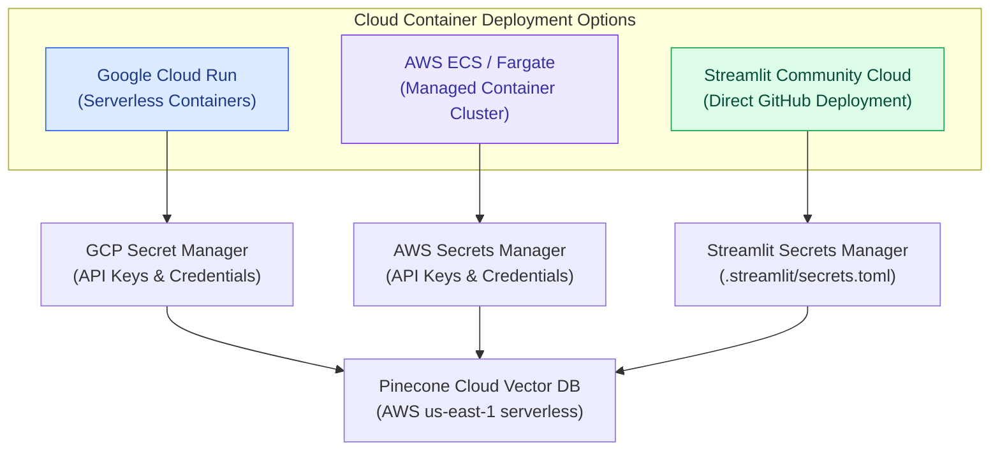

# Deployment & Operations Guide — SupportSphere AI

> [!NOTE]
> **Document Header Metadata**  
> **Document Title**: SupportSphere AI Deployment & Operations Guide  
> **Purpose**: Provides operational specifications for local development, `uv` environment management, Docker containerization, Cloud deployment models (GCP, AWS), secrets management, CI/CD automation, production checklists, scaling, and disaster recovery.  
> **Audience**: DevOps Engineers, Site Reliability Engineers (SREs), Systems Administrators, Cloud Architects.  
> **Last Updated**: `2026-07-28`  
> **Related Documents**: [README](../README.md) | [Architecture](ARCHITECTURE.md) | [System Design](SYSTEM_DESIGN.md) | [Retrieval Pipeline](RETRIEVAL_PIPELINE.md) | [Decision Engine](DECISION_ENGINE.md) | [Generation Engine](GENERATION_ENGINE.md) | [Evaluation](EVALUATION.md) | [Guardrails](GUARDRAILS.md) | [Observability](OBSERVABILITY.md) | [Configuration](CONFIGURATION.md)

---

## 1. Executive Summary & Philosophy

SupportSphere AI is architected as a **stateless modular containerized application**.

Because conversational state is managed explicitly within the LangGraph state machine object (`SupportState`) during request execution, the application tier requires no persistent session database. This stateless design permits simple horizontal scaling across cloud container runtimes behind standard HTTP load balancers.

---

## 2. Local Development Setup (`uv`)

### 2.1 Tooling & Environment Initialization
SupportSphere AI requires **Python 3.12** and uses `uv` for ultra-fast dependency resolution and virtual environment management:

```bash
# 1. Clone the repository
git clone https://github.com/ChandraCherupally/SupportSphere-AI.git
cd SupportSphere-AI

# 2. Create Python 3.12 virtual environment using uv
uv venv

# 3. Activate virtual environment
# Windows PowerShell:
.venv\Scripts\activate
# macOS/Linux:
source .venv/bin/activate

# 4. Sync dependencies from pyproject.toml
uv sync
```

### 2.2 Local Environment Variables Configuration
Copy `.env.example` to `.env` and fill in active provider credentials:

```ini
# Primary API Keys
OPENAI_API_KEY=sk-proj-...
GOOGLE_API_KEY=AIzaSy...
GROQ_API_KEY=gsk_...

# Vector DB Configuration
PINECONE_API_KEY=pcsk_...
PINECONE_INDEX_NAME=support-sphere-ai
```

### 2.3 Local Execution Command
Launch the Streamlit web application:

```bash
uv run streamlit run src/app.py
```

---

## 3. Containerization Strategy (Dockerfile)

A production-grade multi-stage `Dockerfile` packages SupportSphere AI into a minimal, secure container image:

```dockerfile
# =============================================================================
# Stage 1: Build & Dependency Resolution
# =============================================================================
FROM python:3.12-slim AS builder

WORKDIR /app

# Install uv package manager
RUN pip install --no-cache-dir uv

# Copy dependency manifests
COPY pyproject.toml uv.lock ./

# Install dependencies into project virtual environment
RUN uv venv && uv sync --frozen --no-dev

# =============================================================================
# Stage 2: Production Execution Runtime
# =============================================================================
FROM python:3.12-slim AS runner

WORKDIR /app

# Create non-root user for security
RUN useradd -m -u 1000 appuser && \
    mkdir -p /app/data/artifacts /app/logs && \
    chown -R appuser:appuser /app

# Copy virtual environment and source code
COPY --from=builder /app/.venv /app/.venv
COPY --chown=appuser:appuser src/ /app/src/
COPY --chown=appuser:appuser vectordb_ingestion/ /app/vectordb_ingestion/
COPY --chown=appuser:appuser data/artifacts/ /app/data/artifacts/

USER appuser

# Environment setup
ENV PATH="/app/.venv/bin:$PATH" \
    PYTHONUNBUFFERED=1 \
    PORT=8501

EXPOSE 8501

HEALTHCHECK --interval=30s --timeout=5s --start-period=10s --retries=3 \
  CMD curl --fail http://localhost:8501/_stcore/health || exit 1

CMD ["streamlit", "run", "src/app.py", "--server.port=8501", "--server.address=0.0.0.0"]
```

---

## 4. Multi-Container Orchestration (Docker Compose)

For local integration testing or single-host server deployments, use `docker-compose.yml`:

```yaml
version: '3.8'

services:
  supportsphere-app:
    build:
      context: .
      dockerfile: Dockerfile
    ports:
      - "8501:8501"
    env_file:
      - .env
    volumes:
      - ./logs:/app/logs
      - ./data/artifacts:/app/data/artifacts
    restart: unless-stopped
    healthcheck:
      test: ["CMD", "curl", "-f", "http://localhost:8501/_stcore/health"]
      interval: 30s
      timeout: 5s
      retries: 3
```

Launch with:
```bash
docker compose up -d --build
```

---

## 5. Cloud Deployment Architectures



### 5.1 Google Cloud Run Deployment
Cloud Run provides automatic scaling from 0 to $N$ instances based on incoming HTTP traffic:

```bash
# 1. Build and push container to Google Artifact Registry
gcloud builds submit --tag gcr.io/$PROJECT_ID/supportsphere-ai:latest

# 2. Deploy container to Cloud Run with Secret Manager binding
gcloud run deploy supportsphere-ai \
  --image gcr.io/$PROJECT_ID/supportsphere-ai:latest \
  --platform managed \
  --region us-central1 \
  --allow-unauthenticated \
  --set-env-vars SEARCH_MODE=hybrid,FINAL_TOP_K=5 \
  --set-secrets OPENAI_API_KEY=OPENAI_API_KEY:latest,PINECONE_API_KEY=PINECONE_API_KEY:latest
```

---

## 6. Secrets Management & Environment Security

> [!CAUTION]
> Never commit API keys or `.env` files to git. Ensure `.env` and `.streamlit/secrets.toml` remain listed in `.gitignore`.

### Secrets Resolution Hierarchy
1. **Streamlit Session Input**: Credentials entered dynamically in the UI sidebar expander override environment settings for the active session.
2. **Environment Variables**: Loaded from `.env` or container environment at process startup.
3. **Default Fallbacks**: Hardcoded fallbacks in `src/config.py` (for non-sensitive configuration parameters only).

---

## 7. Production Readiness Checklist

| Category | Item | Verification Command / Check | Status |
|---|---|---|---|
| **Security** | Non-root user in Dockerfile | Verify `USER appuser` in `Dockerfile` | ✅ Verified |
| **Security** | `.env` listed in `.gitignore` | Check `.gitignore` contains `.env` | ✅ Verified |
| **Testing** | Automated unit test suite passing | Run `uv run pytest` | ✅ 18/18 Passed |
| **Storage** | BM25 Pickle artifact pre-built | Check file `data/artifacts/bm25_index.pkl` exists | ✅ Verified |
| **Logging** | Log rotation directory writable | Verify directory `logs/` exists and has write access | ✅ Verified |
| **Warmup** | Startup initialization configured | Preloads NeMo & Pinecone in `src/app.py` startup block | ✅ Verified |

---

## 8. CI/CD Pipeline Specification (GitHub Actions)

Create `.github/workflows/ci.yml` to automate testing on pull requests:

```yaml
name: CI Suite

on:
  push:
    branches: [ main ]
  pull_request:
    branches: [ main ]

jobs:
  test:
    runs-on: ubuntu-latest
    steps:
      - uses: actions/checkout@v4

      - name: Install uv
        uses: astral-sh/setup-uv@v2
        with:
          version: "latest"

      - name: Set up Python 3.12
        uses: actions/setup-python@v5
        with:
          python-version: "3.12"

      - name: Install dependencies
        run: uv sync

      - name: Run Pytest Unit Test Suite
        env:
          PINECONE_API_KEY: "mock_key_for_unit_tests"
        run: uv run pytest
```

---

## 9. Monitoring, Health Checks & Log Maintenance

### 9.1 Health Checks
Streamlit containers expose built-in health endpoint:
- **Endpoint**: `http://<host>:8501/_stcore/health`
- **Expected HTTP Code**: `200 OK`

### 9.2 Log Rotation & Cleanup
Log files (`logs/application.log`, `logs/pipeline.log`, `logs/errors.log`) rotate automatically via `RotatingFileHandler` at 10 MB with 5 backups. For production Linux servers, add `logrotate` rule:

```text
/app/logs/*.log {
    daily
    missingok
    rotate 14
    compress
    notifempty
    copytruncate
}
```

---

## 10. Backup, Ingestion & Disaster Recovery

### 10.1 Vector Index Disaster Recovery
If the Pinecone vector index is deleted or corrupted:
1. Re-run document ingestion to re-embed and upsert all documents from `data/raw/`:
   ```bash
   uv run python -m vectordb_ingestion.ingestion.ingest
   ```
2. Ingestion pipeline automatically:
   - Reparses raw markdown files in `data/raw/`
   - Re-embeds document chunks via Gemini embeddings
   - Upserts dense vectors to Pinecone
   - Rebuilds and serializes `data/artifacts/bm25_index.pkl`

---

## Related Reading

- [System Architecture Guide](ARCHITECTURE.md) — Topology & request lifecycle.
- [Observability Architecture Specification](OBSERVABILITY.md) — Log routing & execution trace inspection.
- [Configuration Guide](CONFIGURATION.md) — Full specification of environment variables.

---

## References

1. Docker Best Practices for Python Applications.
2. Google Cloud Run Documentation — Containerized Serverless Execution.
3. GitHub Actions Manual — Python CI/CD Workflow Setup.

---

## Future Improvements

1. **Terraform IaC**: Add Infrastructure-as-Code scripts to provision Cloud Run services and Secret Manager resources automatically.
2. **Helm Chart**: Create Helm package for Kubernetes cluster deployments.
