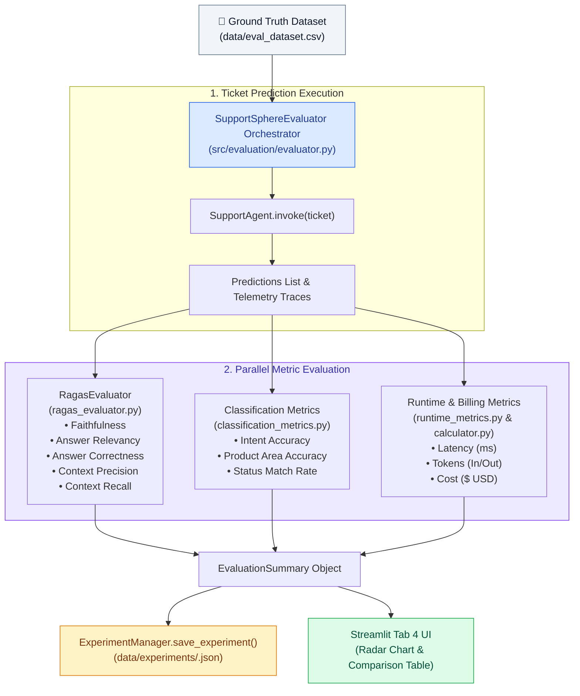
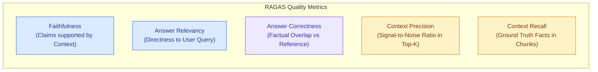

# Evaluation & Benchmark Framework Specification — SupportSphere AI

> [!NOTE]
> **Document Header Metadata**  
> **Document Title**: SupportSphere AI Evaluation & Benchmark Framework Specification  
> **Purpose**: Engineering reference for SupportSphere AI's evaluation architecture, detailing RAGAS generation metrics, intent classification accuracy, operational cost and token tracking, experiment management, pricing snapshots, and LangSmith tracing.  
> **Audience**: AI Engineers, Data Scientists, RAG Evaluation Engineers, Technical Product Managers.  
> **Last Updated**: `2026-07-28`  
> **Related Documents**: [README](../README.md) | [Architecture](ARCHITECTURE.md) | [System Design](SYSTEM_DESIGN.md) | [Retrieval Pipeline](RETRIEVAL_PIPELINE.md) | [Decision Engine](DECISION_ENGINE.md) | [Generation Engine](GENERATION_ENGINE.md) | [Guardrails](GUARDRAILS.md) | [Observability](OBSERVABILITY.md) | [Deployment](DEPLOYMENT.md) | [Configuration](CONFIGURATION.md)

---

## 1. Executive Summary & Philosophy

Continuous evaluation is essential for production RAG systems. Subtle changes in retrieval parameters, prompt wording, or embedding models can lead to regressions in faithfulness, context recall, or unexpected cost inflation.

**SupportSphere AI** integrates an automated, multi-dimensional evaluation framework ([src/evaluation/](file:///c:/Users/cheru/OneDrive/Desktop/GitHub_Projects/SupportSphere-AI/src/evaluation/)) that evaluates three distinct performance vectors:

1. **Generation Quality**: Evaluated via native RAGAS metrics (Faithfulness, Answer Relevancy, Answer Correctness, Context Precision, Context Recall).
2. **Decision & Routing Accuracy**: Evaluated via intent classification accuracy, tenant routing precision, and product area mapping.
3. **Operational Telemetry**: Evaluated via millisecond latency tracking, input/output token counts, and USD cost aggregation using versioned pricing snapshots.

---

## 2. Evaluation Subsystem Architecture



---

## 3. Ground Truth Dataset Format

Evaluations execute against `data/eval_dataset.csv`. Each record represents a verified support ticket scenario:

| Column Name | Type | Description / Sample Value |
|---|---|---|
| `subject` | String | Ticket subject ("Cannot reset password"). |
| `issue` | String | Full issue text ("I am trying to reset my password on HackerRank..."). |
| `company` | String | Target company tenant (`HackerRank`, `Claude`, `Visa`). |
| `expected_request_type` | String | Ground truth intent class (`ACCOUNT`, `BILLING`, `PRODUCT_SUPPORT`). |
| `expected_product_area` | String | Ground truth product area (`Account_Management`, `Coding_Tests`). |
| `expected_status` | String | Expected response status (`Replied`, `Escalated`, `Template`). |
| `expected_response` | String | Authoritative reference answer for RAGAS correctness scoring. |

---

## 4. Metric Specifications

### 4.1 RAGAS Generation Metrics (`ragas_evaluator.py`)

SupportSphere AI uses native RAGAS 0.4+ metrics configured with an explicit LLM judge:



- **Faithfulness ($0.0 - 1.0$)**: Evaluates whether statements in the generated response are mathematically grounded in the retrieved context chunks. Prevents hallucinations.
- **Answer Relevancy ($0.0 - 1.0$)**: Measures how directly the response addresses the user's question without introductory fluff or tangential information.
- **Answer Correctness ($0.0 - 1.0$)**: Measures semantic and factual agreement between the predicted answer and the ground truth `expected_response`.
- **Context Precision ($0.0 - 1.0$)**: Measures whether the most relevant evidence chunks were ranked at the top of the retrieved context list.
- **Context Recall ($0.0 - 1.0$)**: Evaluates whether all necessary facts from the ground truth answer were present in the retrieved chunks.

### 4.2 Classification Accuracy Metrics (`classification_metrics.py`)

- **Intent Accuracy**: Percentage of predictions where `predicted_request_type == expected_request_type`.
- **Product Area Accuracy**: Percentage of predictions matching expected product module.
- **Status Match Rate**: Accuracy of `Replied` vs `Escalated` status prediction.

### 4.3 Operational Telemetry & Cost Accounting (`runtime_metrics.py`)

- **Stage Latencies**: Millisecond latency tracked separately for Node 1 (Decision), Node 2 (Retrieval), Node 3 (Retrieval Validation), Node 4 (Generation), and Node 5 (Response Validation).
- **Token Accounting**: Tracks `decision_input_tokens`, `decision_output_tokens`, `generation_input_tokens`, `generation_output_tokens`.
- **Cost Calculation ($ USD)**: Sums stage costs using provider rates from `src/billing/catalog.py` plus Pinecone query costs (`$0.00002` per query).

---

## 5. Experiment Manager & Pricing Snapshots

When an evaluation completes, `ExperimentManager.save_experiment()` ([src/evaluation/experiment_manager.py](file:///c:/Users/cheru/OneDrive/Desktop/GitHub_Projects/SupportSphere-AI/src/evaluation/experiment_manager.py)) serializes the run into `data/experiments/experiment_<timestamp>.json`.

### Reproducibility via Pricing Snapshots
To ensure historical cost calculations remain accurate even if cloud providers change API prices:
- `get_catalog_snapshot()` generates a versioned snapshot of model rates at run time (`PRICING_VERSION = "2026-07-18"`).
- The snapshot is embedded directly inside the experiment JSON file under `pricing_snapshot`.

```json
{
  "experiment_id": "exp_20260728_184512",
  "timestamp": "2026-07-28 18:45:12",
  "config": {
    "decision_provider": "openai",
    "decision_model": "gpt-5.4-mini",
    "generation_provider": "openai",
    "generation_model": "gpt-5.4-mini",
    "search_mode": "hybrid",
    "top_k": 5
  },
  "metrics": {
    "faithfulness": 0.94,
    "answer_relevancy": 0.92,
    "answer_correctness": 0.89,
    "context_precision": 0.91,
    "context_recall": 0.88,
    "intent_accuracy": 0.965,
    "avg_latency_ms": 4250.4,
    "total_cost_usd": 0.1425
  },
  "pricing_snapshot": {
    "pricing_version": "2026-07-18",
    "pinecone_query_cost_usd": 0.00002
  }
}
```

---

## 6. LangSmith Tracing & Telemetry

SupportSphere AI supports native **LangSmith tracing** via standard LangChain environment integration.

### Enabling LangSmith Tracing
Add the following to `.env`:

```ini
LANGCHAIN_TRACING_V2=true
LANGCHAIN_ENDPOINT="https://api.smith.langchain.com"
LANGCHAIN_API_KEY="ls__..."
LANGCHAIN_PROJECT="supportsphere-ai"
```

When enabled, LangGraph automatically streams node execution traces, prompt inputs, model outputs, latency breakdowns, and token counts to the LangSmith dashboard.

---

## 7. Interactive Experiment Comparison (Streamlit UI)

Streamlit Tab 4 ([src/streamlit/evaluation.py](file:///c:/Users/cheru/OneDrive/Desktop/GitHub_Projects/SupportSphere-AI/src/streamlit/evaluation.py)) renders an interactive evaluation suite:

- **Benchmark Dataset Trigger**: Run evaluations directly from uploaded CSV files.
- **Radar Chart Visualization**: Plots multi-axis metric visualisations (Faithfulness, Relevance, Precision, Recall, Accuracy) comparing multiple saved runs.
- **Cost & Latency Breakdown**: Displays side-by-side cost vs. latency performance tables across different provider/model configurations.

---

## 8. Recommended Production Configuration Profile & Lessons Learned

Based on experimental runs across `data/eval_dataset.csv`:

### Recommended Profile
- **Decision Engine (LLM #1)**: `openai` / `gpt-5.4-mini` (Fast triage & low cost).
- **Generation Engine (LLM #2)**: `openai` / `gpt-5.4-mini` or `google` / `gemini-2.5-flash`.
- **Search Mode**: `hybrid` (BM25 + Pinecone Vector RRF Fusion).
- **Top-K**: `5` chunks.
- **Reranker**: `flashrank` (Local ONNX `ms-marco-MiniLM-L-12-v2`).

### Lessons Learned
1. **Reranking Boosts Precision**: Adding FlashRank reranking improves Context Precision from `0.82` to `0.91` with only ~40ms added latency.
2. **Top-K > 5 Degrades Faithfulness**: Setting `Top-K = 10` increases context noise, dropping Faithfulness scores by ~8%.
3. **Template Routing Saves ~70% Cost**: Directing non-retrieval tickets (greetings, outages) to static templates eliminates LLM #2 calls on routine tickets.

---

## Related Reading

- [System Architecture Guide](ARCHITECTURE.md) — Stateful LangGraph 5-node topology.
- [Retrieval Pipeline Specification](RETRIEVAL_PIPELINE.md) — Hybrid search, RRF, and deduplication.
- [Decision Engine Specification](DECISION_ENGINE.md) — Intent classification & tenant routing.
- [Generation Engine Specification](GENERATION_ENGINE.md) — Grounded prompt builder v3.

---

## References

1. Shahul Esmail et al. (2023) — *RAGAS: Automated Evaluation of Retrieval Augmented Generation*.
2. LangSmith Documentation — Tracing and Observability for LangGraph Applications.
3. Deepspeed / Evaluation Benchmark Best Practices.

---

## Future Improvements

1. **Synthetic Test Dataset Generation**: Use LLMs to automatically generate synthetic support tickets from raw markdown documentation.
2. **Automated Prompt Optimization**: Integrate DSPy or automated prompt tuning to optimize LLM #1 system prompts based on evaluation failure patterns.
