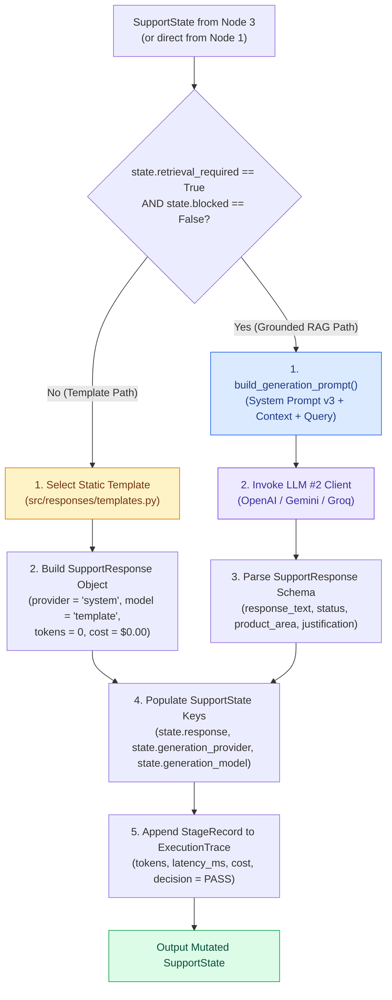
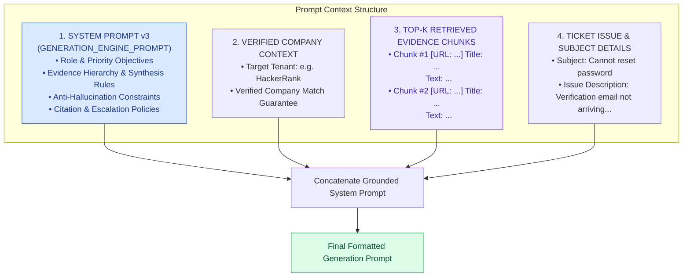

# Generation Engine Specification — SupportSphere AI

> [!NOTE]
> **Document Header Metadata**  
> **Document Title**: SupportSphere AI Generation Engine Specification  
> **Purpose**: Engineering specification for Node 4 (Generation Engine), detailing Prompt Builder v3 architecture, context assembly, grounded response synthesis rules, citation enforcement, anti-hallucination constraints, escalation logic, and structured Pydantic formatting.  
> **Audience**: AI Engineers, Prompt Engineers, AI System Architects, Quality Assurance Engineers.  
> **Last Updated**: `2026-07-28`  
> **Related Documents**: [README](../README.md) | [Architecture](ARCHITECTURE.md) | [System Design](SYSTEM_DESIGN.md) | [Retrieval Pipeline](RETRIEVAL_PIPELINE.md) | [Decision Engine](DECISION_ENGINE.md) | [Evaluation](EVALUATION.md) | [Guardrails](GUARDRAILS.md) | [Observability](OBSERVABILITY.md) | [Deployment](DEPLOYMENT.md) | [Configuration](CONFIGURATION.md)

---

## 1. Executive Summary & Purpose

The **Generation Engine** serves as **Node 4** ([src/graph/nodes/generation.py](file:///c:/Users/cheru/OneDrive/Desktop/GitHub_Projects/SupportSphere-AI/src/graph/nodes/generation.py)) in SupportSphere AI's stateful 5-node LangGraph pipeline.

Operating as **LLM #2**, its core responsibility is to synthesize precise, customer-facing support responses. It executes under two distinct operational modes determined by Node 1:

1. **Grounded RAG Mode (`retrieval_required == True`)**: Formats system instructions, verified company documentation chunks, ticket subject/issue details, and prompts LLM #2 to produce a grounded response with source documentation URL citations.
2. **Deterministic Template Mode (`retrieval_required == False` or `blocked == True`)**: Bypasses LLM #2 entirely, selecting a static response template from `src/responses/templates.py` at `$0.00` token cost.

---

## 2. Generation Engine Architecture



---

## 3. Prompt Builder Architecture & Context Assembly

Prompt context assembly is implemented in `src/ai/prompt_builder.py` via `build_generation_prompt()`:



### Context Injection Function
```python
def build_generation_prompt(
    issue: str,
    subject: str,
    company: str,
    retrieved_context: List[str],
    retrieved_chunks: Optional[List[Dict[str, Any]]] = None,
) -> str:
    # Formats evidence chunks with URL and Title metadata tags
    formatted_evidence = []
    if retrieved_chunks:
        for idx, chunk in enumerate(retrieved_chunks, 1):
            url = chunk.get("metadata", {}).get("url", "")
            title = chunk.get("metadata", {}).get("title", "")
            text = chunk.get("text", "").strip()
            formatted_evidence.append(
                f"### Evidence Chunk #{idx}\n"
                f"**Title**: {title}\n"
                f"**URL**: {url}\n"
                f"**Content**: {text}\n"
            )
    context_str = "\n".join(formatted_evidence)

    return (
        f"{GENERATION_ENGINE_PROMPT}\n\n"
        f"VERIFIED COMPANY: {company}\n\n"
        f"RETRIEVED DOCUMENTATION CONTEXT:\n{context_str}\n\n"
        f"CUSTOMER SUPPORT TICKET:\n"
        f"Subject: {subject}\n"
        f"Issue Description: {issue}\n"
    )
```

---

## 4. Prompt Evolution & Version 3 Rules

The generation system prompt ([src/ai/prompts/generation_prompt.py](file:///c:/Users/cheru/OneDrive/Desktop/GitHub_Projects/SupportSphere-AI/src/ai/prompts/generation_prompt.py)) represents a v3 iteration optimized specifically for RAGAS evaluation metrics:

### 4.1 Priority Objectives
1. **Primary Intent Focus**: Answer the explicit user question first; ignore adjacent unrequested information.
2. **Grounded Evidence Hierarchy**: Evaluate retrieved chunks by strict priority:
   - Priority 1: Exact feature match
   - Priority 2: Exact workflow match
   - Priority 3: Same product area
   - Priority 4: Supporting background context
3. **Multi-Document Synthesis**: Merge multiple chunks ONLY when they describe the exact same workflow. Never synthesize across unrelated product features.

### 4.2 Anti-Hallucination Directives
- *"You are a deterministic retrieval-augmented support engine. Never answer from memory. Never invent information."*
- Every factual statement must be supported directly by a retrieved evidence chunk.
- If retrieved documentation is partial, explain the supported portion and explicitly state that remaining details are unavailable.

### 4.3 Citation & URL Strategy
- Every procedural or conceptual answer must include the authoritative source URL extracted from chunk metadata.
- Contact information priority: If retrieved chunks contain documented phone numbers or support emails, always include them rather than general contact instructions.

### 4.4 Escalation Logic
If retrieved documentation is **missing**, **contradictory**, or requires **backend database investigation**, LLM #2 must escalate:
- Set `status = "Escalated"`.
- Output an escalation explanation directing the ticket to human support.

---

## 5. Structured Response Schema (`SupportResponse`)

LLM #2 responses are constrained to a typed Pydantic object ([src/ai/models.py](file:///c:/Users/cheru/OneDrive/Desktop/GitHub_Projects/SupportSphere-AI/src/ai/models.py)):

```python
class SupportResponse(BaseModel):
    response_text: str = Field(description="Markdown-formatted support response.")
    status: str = Field(description="'Replied' if solved by docs; 'Escalated' if human intervention needed; 'Template' if static template.")
    request_type: str = Field(description="Resolved intent category.")
    product_area: str = Field(description="Product area derived from evidence chunk metadata.")
    justification: str = Field(description="Max 25 words evidence-based rationale.")
```

---

## 6. Static Template Bypass Matrix

For tickets routed to static templates by Node 1, Node 4 executes zero-token instantiation:

| Routing Strategy | Template File Constant | Output Response Text | Status |
|---|---|---|---|
| `GREETING_TEMPLATE` | `GREETING_TEMPLATE` | *"Hello! How can I assist you today?"* | `Template` |
| `THANK_YOU_TEMPLATE` | `THANK_YOU_TEMPLATE` | *"Happy to help."* | `Template` |
| `OUT_OF_SCOPE_TEMPLATE` | `OUT_OF_SCOPE_TEMPLATE` | *"I'm sorry, this is out of scope for my capabilities."* | `Template` |
| `BUG_ESCALATION_TEMPLATE` | `BUG_ESCALATION_TEMPLATE` | *"This appears to describe a platform-wide issue. Escalated to human support."* | `Escalated` |
| `SAFETY_REFUSAL_TEMPLATE` | `SAFETY_REFUSAL_TEMPLATE` | *"I am sorry, but I cannot fulfill this request due to safety policies."* | `Template` |

---

## 7. Prompt Optimization & RAGAS Alignment

| RAGAS Metric | System Prompt v3 Directive | Engineering Impact |
|---|---|---|
| **Faithfulness** | *"Never answer from memory. Never invent information."* | Minimizes non-context facts; forces grounding in retrieved evidence. |
| **Answer Relevancy** | *"Answer the user's explicit question first. Ignore unrelated wording."* | Prevents prompt drift and tangential introductory fluff. |
| **Context Precision** | *"Priority: 1. Exact feature 2. Exact workflow. Ignore loose chunks."* | Directs LLM #2 to focus attention on top-ranked evidence chunks. |
| **Context Recall** | *"If documentation partially answers, explain supported portion."* | Ensures all available context facts are captured in response. |

---

## Related Reading

- [System Architecture Guide](ARCHITECTURE.md) — 5-node state machine topology.
- [Retrieval Pipeline Specification](RETRIEVAL_PIPELINE.md) — Hybrid search, RRF fusion, and deduplication.
- [Decision Engine Specification](DECISION_ENGINE.md) — Node 1 triage rules and intent detection.
- [Evaluation Specification](EVALUATION.md) — RAGAS metrics & benchmark experiments.

---

## References

1. RAGAS Evaluation Framework — Metric definitions for Faithfulness, Relevancy, Precision, and Recall.
2. LangChain Pydantic Output Parsers — Structured JSON schema extraction.
3. Liu et al. (2023) — *Lost in the Middle: How Language Models Use Long Contexts*.

---

## Future Improvements

1. **Streaming Output Tokens**: Implement chunk-by-chunk token streaming from LLM #2 into Streamlit UI.
2. **Dynamic Language Translation**: Add auto-translation for non-English ticket descriptions prior to prompt construction.
