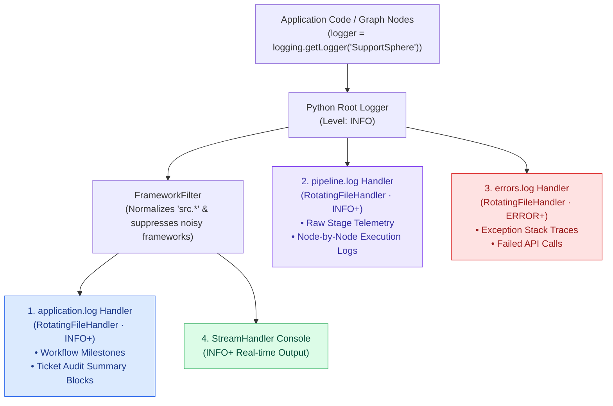
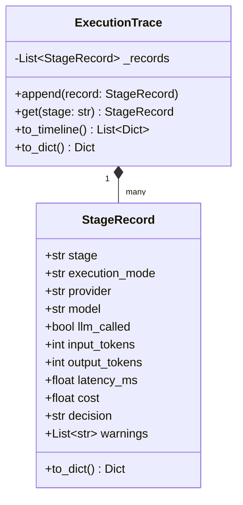

# Observability & Logging Architecture Specification — SupportSphere AI

> [!NOTE]
> **Document Header Metadata**  
> **Document Title**: SupportSphere AI Observability & Logging Architecture Specification  
> **Purpose**: Engineering documentation for SupportSphere AI's observability subsystem, detailing multi-handler log routing, node context tagging, FrameworkFilter log normalization, StageRecord state telemetry, token/cost calculation, formatted audit summaries, and tracing integration.  
> **Audience**: DevOps Engineers, Site Reliability Engineers (SREs), Systems Architects, Software Engineers.  
> **Last Updated**: `2026-07-28`  
> **Related Documents**: [README](../README.md) | [Architecture](ARCHITECTURE.md) | [System Design](SYSTEM_DESIGN.md) | [Retrieval Pipeline](RETRIEVAL_PIPELINE.md) | [Decision Engine](DECISION_ENGINE.md) | [Generation Engine](GENERATION_ENGINE.md) | [Evaluation](EVALUATION.md) | [Guardrails](GUARDRAILS.md) | [Deployment](DEPLOYMENT.md) | [Configuration](CONFIGURATION.md)

---

## 1. Executive Summary & Philosophy

In production multi-tenant AI systems, opaque execution logs lead to critical operational bottlenecks:
- **Cost Invisibility**: Inability to identify which specific ticket node consumed excessive inference tokens.
- **Latency Blindspots**: Difficulty isolating whether delays stem from vector search network calls, LLM inference, or local reranking.
- **Audit Deficits**: Lack of immutable records showing exact intent decisions, company verification outcomes, and safety guardrail blocks.

**SupportSphere AI solves these challenges through a 3-Layer Observability Architecture** ([src/logging/](file:///c:/Users/cheru/OneDrive/Desktop/GitHub_Projects/SupportSphere-AI/src/logging/)):

1. **Structured Log File Routing**: Dedicated handlers for application workflow milestones, full pipeline telemetry, and error stack traces.
2. **Node Context Attribution**: Log lines explicitly tagged by graph node context (`[Node 1: Decision Engine]`, `[Node 2: Retrieval Engine]`, etc.).
3. **Immutable ExecutionTrace**: Stage-by-stage token count, latency, USD cost, and decision outcome recorded in memory and rendered directly in the Streamlit UI timeline.

---

## 2. Multi-File Log Routing Architecture

Log setup is initialized via `setup_logging()` in `src/logging/config.py`. The root logger routes records across three dedicated file handlers and console output:



### Handler Configuration Table

| Log File | Level Filter | Filter Applied | Max Size / Backups | Purpose |
|---|---|---|---|---|
| `logs/application.log` | `INFO` | `FrameworkFilter` | 10 MB / 5 files | High-level business milestones & 55-line Ticket Summary Blocks. |
| `logs/pipeline.log` | `INFO` | None | 10 MB / 5 files | Unfiltered step-by-step telemetry across all pipeline stages. |
| `logs/errors.log` | `ERROR` | None | 10 MB / 5 files | Exception stack traces and critical component failures. |
| **Console (Stdout)** | `INFO` | `FrameworkFilter` | Stream | Real-time terminal progress during Streamlit or CLI execution. |

---

## 3. Framework Filtering & Logger Normalization

Third-party AI frameworks (`nemoguardrails`, `pinecone`, `urllib3`, `httpx`, `google`, `langchain`, `openai`) emit high-volume internal debug messages.

`FrameworkFilter` ([src/logging/filters.py](file:///c:/Users/cheru/OneDrive/Desktop/GitHub_Projects/SupportSphere-AI/src/logging/filters.py)) enforces clean log outputs:
1. **Suppression**: Sets noisy third-party frameworks to `WARNING` level.
2. **Normalization**: Rewrites log record names starting with `src.` or `vectordb_ingestion.` to `"SupportSphere"`, producing clean, uniform log output:

```text
2026-07-28 18:42:11,407 | INFO     | SupportSphere | [Node 1: Decision Engine] Executing Stage: decision
2026-07-28 18:42:11,407 | INFO     | SupportSphere | [Node 2: Retrieval Engine] Executing retrieval for query: 'Cannot reset password...'
2026-07-28 18:42:11,407 | INFO     | SupportSphere | [Node 3: Retrieval Validation] Executing custom action: verify_company
2026-07-28 18:42:11,412 | INFO     | SupportSphere | [Node 4: Generation Engine] Executing Stage: generation
2026-07-28 18:42:11,412 | INFO     | SupportSphere | [Node 5: Response Validation] Executing custom action: calculate_grounding_score
```

---

## 4. ExecutionTrace & StageRecord Data Model

Stage observability is managed in-memory via `ExecutionTrace` ([src/graph/trace.py](file:///c:/Users/cheru/OneDrive/Desktop/GitHub_Projects/SupportSphere-AI/src/graph/trace.py)). Each node appends a `StageRecord` after execution:



---

## 5. Token Accounting & Billing Calculation

The billing subsystem ([src/billing/calculator.py](file:///c:/Users/cheru/OneDrive/Desktop/GitHub_Projects/SupportSphere-AI/src/billing/calculator.py)) aggregates token counts from LLM API responses and computes exact costs using versioned pricing tables ([src/billing/catalog.py](file:///c:/Users/cheru/OneDrive/Desktop/GitHub_Projects/SupportSphere-AI/src/billing/catalog.py)):

$$Cost_{Stage} = \left(\frac{Tokens_{In}}{1,000,000} \times Price_{In}\right) + \left(\frac{Tokens_{Out}}{1,000,000} \times Price_{Out}\right) + Cost_{Pinecone}$$

Where $Cost_{Pinecone} = \$0.00002$ per vector query.

---

## 6. Formatted Ticket Execution Summary Block

Upon ticket completion, `log_ticket_summary(res)` ([src/logging/logger.py](file:///c:/Users/cheru/OneDrive/Desktop/GitHub_Projects/SupportSphere-AI/src/logging/logger.py)) formats an audit block printed to `application.log`:

```text
================================================================================
SupportSphere AI | Ticket ID: TKT-E2A19381 | Execution Started: 2026-07-28 18:48:41
================================================================================
Subject: Cannot reset password
Issue: I am trying to reset my password on HackerRank but verification email is not arriving.
Selected Company: HackerRank
Decision Model: gpt-5.4-mini | Generation Model: gpt-5.4-mini
Search Mode: hybrid | Reranker: flashrank
------------------------------------------------------------
1. DECISION ENGINE (LLM #1)
   Execution Mode: LLM | Intent: ACCOUNT | Strategy: SUPPORT_RESPONSE
   Company Reference Found: True | Routing Status: COMPANY_VERIFIED
   Tokens (In/Out): 869 / 118 | Cost: $0.002365 | Latency: 2128.1ms
------------------------------------------------------------
2. RETRIEVAL
   Collection: HackerRank | Search Mode: hybrid | Candidates Retrieved: 32
   Cost: $0.000023 | Latency: 2398.9ms
------------------------------------------------------------
3. RETRIEVAL VALIDATION (Rules-Only)
   Decision: ALLOW | Cost: $0.000000 | Latency: 1.0ms
------------------------------------------------------------
4. GENERATION ENGINE (LLM #2)
   Tokens (In/Out): 1934 / 244 | Cost: $0.005097 | Latency: 1920.1ms
------------------------------------------------------------
5. RESPONSE VALIDATION (Rules-Only)
   Decision: PASS | Cost: $0.000000 | Latency: 0.7ms
------------------------------------------------------------
SUMMARY
   Request Type: retrieval_based | Status: resolved
   Total Tokens: 3165 | Total Cost: $0.007486 | Total Latency: 6448.8ms
================================================================================
```

---

## 7. Streamlit Execution Timeline Inspector

Streamlit Tab 2 ([src/streamlit/single_ticket.py](file:///c:/Users/cheru/OneDrive/Desktop/GitHub_Projects/SupportSphere-AI/src/streamlit/single_ticket.py)) converts `ExecutionTrace.to_timeline()` directly into an interactive step-by-step inspector UI:

- **Stage Badges**: Color-coded decisions (`ALLOW` green, `BLOCK` red, `PASS` blue).
- **Latency & Token Pills**: Visual metric chips showing millisecond latency, input/output tokens, and USD cost per stage.
- **Expandable Raw Records**: Expander containers showing full raw JSON metadata per node.

---

## 8. OpenTelemetry (OTel) Future Integration Strategy

SupportSphere AI is architected for seamless transition to **OpenTelemetry (OTel)** tracing:

- **Span Mapping**: Each `StageRecord` maps directly to an OTel Span (`span.set_attribute("llm.provider", record.provider)`).
- **Exporter Integration**: OTel collector exporters can be attached to the root logger in `src/logging/config.py` to stream spans directly to Datadog, Honeycomb, or Grafana Tempo.

---

## Related Reading

- [System Architecture Guide](ARCHITECTURE.md) — Stateful LangGraph 5-node topology.
- [System Design Specification](SYSTEM_DESIGN.md) — Software design patterns & state management.
- [Evaluation Specification](EVALUATION.md) — RAGAS metrics & benchmark experiments.
- [Configuration Guide](CONFIGURATION.md) — Logging & provider environment settings.

---

## References

1. Python Standard Library — `logging.handlers.RotatingFileHandler`.
2. OpenTelemetry Semantic Conventions — Generative AI Spans Specification.
3. LangSmith Tracing Specification — LangChain Execution Telemetry.

---

## Future Improvements

1. **OpenTelemetry Collector Export**: Add native OTel exporter setup to `src/logging/config.py`.
2. **Prometheus Metrics Endpoint**: Expose operational counters (`supportsphere_tickets_processed_total`, `supportsphere_token_cost_usd_total`) via Prometheus client HTTP exporter.
