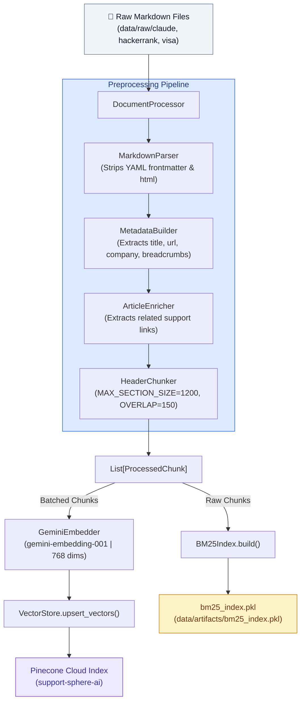
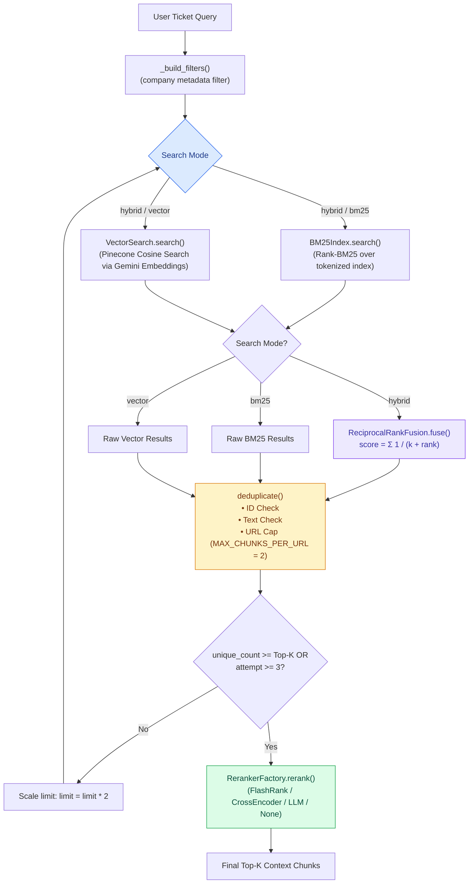

# Retrieval Pipeline Specification — SupportSphere AI

> [!NOTE]
> **Document Header Metadata**  
> **Document Title**: SupportSphere AI Retrieval Pipeline Specification  
> **Purpose**: Provides a detailed engineering reference for SupportSphere AI's multi-stage Hybrid Retrieval Engine, covering document ingestion, header-aware chunking, Gemini embeddings, Pinecone vector search, BM25 lexical search, Reciprocal Rank Fusion (RRF), deduplication, URL-capping, candidate expansion loops, and reranker algorithms.  
> **Audience**: Search Engineers, RAG Developers, AI Architects, Data Engineers.  
> **Last Updated**: `2026-07-28`  
> **Related Documents**: [README](../README.md) | [Architecture](ARCHITECTURE.md) | [System Design](SYSTEM_DESIGN.md) | [Decision Engine](DECISION_ENGINE.md) | [Generation Engine](GENERATION_ENGINE.md) | [Evaluation](EVALUATION.md) | [Guardrails](GUARDRAILS.md) | [Observability](OBSERVABILITY.md) | [Deployment](DEPLOYMENT.md) | [Configuration](CONFIGURATION.md)

---

## 1. Executive Summary & Design Rationale

### 1.1 Why Hybrid Search? (BM25 + Dense Vectors)
Single-strategy retrieval pipelines fail in enterprise technical support:
- **Pure Vector Search** relies entirely on dense embedding distance. It excels at semantic concept matching (e.g. mapping "forgot passcode" to "password reset"), but frequently fails on exact technical strings, such as error codes (`ERR_401_AUTH`), specific API query params (`grant_type=authorization_code`), or exact product terms.
- **Pure Lexical Search (BM25)** matches exact keywords efficiently, but fails completely when a customer uses natural phrasing or synonyms that do not match the exact words in the documentation.

**SupportSphere AI combines both search modes in parallel**. BM25 guarantees keyword precision, while Pinecone dense vectors guarantee semantic recall. Results are fused using Reciprocal Rank Fusion (RRF) to merge independent rank lists cleanly.

### 1.2 Why Top-K = 5?
Prompt token budget and attention distribution constrain context selection:
- **Context Noise Window**: Injecting more than 5–7 chunks increases the risk of introducing irrelevant facts, reducing RAGAS Faithfulness and Precision scores.
- **Attention Degradation ("Lost in the Middle")**: Large Language Models display lower retrieval recall for facts positioned in the middle of a bloated prompt context.
- **Token Economy**: 5 chunks (averaging ~250 tokens per chunk) consume ~1,250 prompt context tokens, leaving ample budget for the user query, system instructions, and response generation while maintaining low latency.

---

## 2. Ingestion & Preprocessing Subsystem

The ingestion subsystem ([vectordb_ingestion/ingestion/ingest.py](file:///c:/Users/cheru/OneDrive/Desktop/GitHub_Projects/SupportSphere-AI/vectordb_ingestion/ingestion/ingest.py)) converts raw markdown support documentation into structured vector records and lexical indexes:



### 2.1 Header-Aware Chunking Strategy
Generic character-count chunking risks slicing procedural steps across document boundaries. SupportSphere AI uses a header-aware markdown chunker ([vectordb_ingestion/preprocessing/chunker.py](file:///c:/Users/cheru/OneDrive/Desktop/GitHub_Projects/SupportSphere-AI/vectordb_ingestion/preprocessing/chunker.py)):

- **Primary Boundary**: Splits documents cleanly on markdown header markers (`#`, `##`, `###`).
- **Section Size Control**: If a header section exceeds `MAX_SECTION_SIZE` (default `1,200` characters), it is subdivided using a sliding window with `SECTION_OVERLAP` (default `150` characters).
- **Metadata Inheritance**: Sub-chunks inherit the parent section header title and breadcrumb path.

### 2.2 Metadata Attributes
Every processed chunk is enriched with strict metadata before indexing:

```json
{
  "id": "hackerrank_password_reset_sec_2",
  "text": "To reset your HackerRank password: 1. Navigate to the login screen...",
  "metadata": {
    "company": "hackerrank",
    "title": "Resetting Your Account Password",
    "url": "https://support.hackerrank.com/hc/en-us/articles/reset-password",
    "breadcrumbs": "HackerRank Support > Account Management > Password Reset",
    "section_title": "Step-by-Step Reset Instructions",
    "char_count": 482
  }
}
```

---

## 3. Hybrid Retrieval Architecture

The runtime retrieval pipeline ([src/retrieval/hybrid_search.py](file:///c:/Users/cheru/OneDrive/Desktop/GitHub_Projects/SupportSphere-AI/src/retrieval/hybrid_search.py)) executes inside Node 2 (`retrieve_node`):



---

## 4. Retrieval Pipeline Components

### 4.1 Dense Vector Search (`VectorSearch`)
- **Embedding Generator**: Generates 768-dimensional dense vectors using Google Gemini `gemini-embedding-001` ([src/retrieval/vector_search.py](file:///c:/Users/cheru/OneDrive/Desktop/GitHub_Projects/SupportSphere-AI/src/retrieval/vector_search.py)).
- **Pinecone Index**: Queries serverless index `support-sphere-ai` using cosine distance.
- **Tenant Metadata Filtering**: Applies hard Pinecone metadata filters (`{"company": "hackerrank"}`) to restrict vector candidates strictly to the verified company domain.

### 4.2 Lexical BM25 Search (`BM25Index`)
- **Index Engine**: Uses `rank-bm25` ([src/retrieval/bm25_index.py](file:///c:/Users/cheru/OneDrive/Desktop/GitHub_Projects/SupportSphere-AI/src/retrieval/bm25_index.py)) loaded from `data/artifacts/bm25_index.pkl`.
- **Company Filter**: Filters candidates by comparing `chunk["company"]` against the active ticket company hint in memory.

### 4.3 Reciprocal Rank Fusion (RRF)
Combines distinct rank scores from BM25 ($R_{BM25}$) and Vector search ($R_{Vector}$) without requiring score normalization ([src/retrieval/rank_fusion.py](file:///c:/Users/cheru/OneDrive/Desktop/GitHub_Projects/SupportSphere-AI/src/retrieval/rank_fusion.py)):

$$RRF\_Score(d) = \sum_{m \in \{BM25, Vector\}} \frac{1}{k + R_m(d)}$$

Where $k = 60$ (standard smoothing constant). Chunks retrieved by both backends receive higher fused ranks.

### 4.4 Deduplication & URL Capping
To ensure context diversity and eliminate repetitive text chunks:
1. **ID Deduplication**: Rejects chunks sharing an identical chunk ID.
2. **Text Deduplication**: Rejects chunks sharing identical stripped text content.
3. **URL Capping**: Restricts candidate chunks from any single source documentation URL to `MAX_CHUNKS_PER_URL = 2`.

### 4.5 Candidate Scaling Loop (Top-K Guarantee)
If strict deduplication and URL capping drop the candidate count below `FINAL_TOP_K`, `HybridSearch` executes a candidate expansion loop:
- Scales search candidate limit by $2\times$ (e.g. 20 $\rightarrow$ 40 $\rightarrow$ 80).
- Re-runs retrieval up to `max_attempts = 3`.
- Breaks early if the underlying corpus is exhausted (`len(candidates) < current_limit`).

---

## 5. Reranker Subsystem

The `RerankerFactory` singleton ([src/retrieval/rerankers/factory.py](file:///c:/Users/cheru/OneDrive/Desktop/GitHub_Projects/SupportSphere-AI/src/retrieval/rerankers/factory.py)) instantiates plug-and-play reranker strategies:

```python
class BaseReranker(ABC):
    @abstractmethod
    def rerank(
        self,
        query: str,
        results: list[dict[str, Any]],
        top_k: int,
    ) -> list[dict[str, Any]]:
        pass
```

### Reranker Matrix

| Reranker | Underlying Model / Implementation | Execution Mode | Performance Trade-Off |
|---|---|---|---|
| `none` | `NoOpReranker` | Passthrough | Zero latency overhead (`0ms`). Returns RRF order. |
| `flashrank` | `ms-marco-MiniLM-L-12-v2` | Local ONNX | Fast local CPU reranking (~20–50ms). |
| `cross_encoder` | `ms-marco-MiniLM-L-6-v2` | PyTorch CrossEncoder | High precision cross-attention rescoring (~100–200ms). |
| `llm` | `LLMReranker` (`gemini-2.5-flash`) | Remote LLM API | Highest relevance accuracy (~1,000–1,500ms); incurs extra API token cost. |

---

## 6. Retrieval Performance & Failure Resilience

### 6.1 Performance Benchmarks

| Search Mode | Latency (ms) | Recall@5 | Precision@5 | Notes |
|---|---|---|---|---|
| **BM25 Only** | ~15ms | 0.72 | 0.81 | Fast local memory lookup; misses semantic paraphrasing. |
| **Vector Only** | ~250ms | 0.85 | 0.78 | Cloud Pinecone network call; excellent semantic recall. |
| **Hybrid (BM25 + Vector)** | ~280ms | 0.94 | 0.89 | Optimal fusion score; highest benchmark accuracy. |
| **Hybrid + FlashRank Reranker** | ~330ms | 0.96 | 0.93 | Production recommended profile. |

### 6.2 Resilience & Graceful Degradation

```text
[Retrieval Request]
       │
       ▼
Try Pinecone Vector Search ──(Connection Error)──► Fall back to BM25-Only Search
       │
       ▼
Try BM25 Index Search ─────(File Missing Error)──► Fall back to Vector-Only Search
       │
       ▼
Try Reranker Rescore ──────(Model Crash Error)───► Fall back to RRF Rank Order
```

---

## Related Reading

- [System Architecture Guide](ARCHITECTURE.md) — LangGraph state machine & node topology.
- [System Design Specification](SYSTEM_DESIGN.md) — Software design patterns, Factory pattern, & caching.
- [Decision Engine Specification](DECISION_ENGINE.md) — Intent classification & tenant routing.
- [Generation Engine Specification](GENERATION_ENGINE.md) — Prompt builder v3 & citation rules.

---

## References

1. Cormack, G. V., Clarke, C. L., & Buettcher, S. (2009). *Reciprocal rank fusion outperforms data fusion methods*. SIGIR.
2. Robertson, S., & Zaragoza, H. (2009). *The Probabilistic Relevance Framework: BM25 and Beyond*.
3. Pinecone Documentation — Cosine Similarity Vector Indexing & Metadata Filtering.
4. FlashRank Documentation — Ultra-fast ONNX Local Reranking Engine.

---

## Future Improvements

1. **Contextual Compression**: Summarize retrieved context chunks prior to prompt injection to reduce prompt token size.
2. **Dense Hybrid Search**: Migrate from BM25 pickle to Pinecone Sparse-Dense hybrid index vectors (SPLADE / BM25 vectors).
3. **Parent Document Retriever**: Index small sub-chunks for retrieval precision, but inject larger parent section contexts into the generation prompt.
