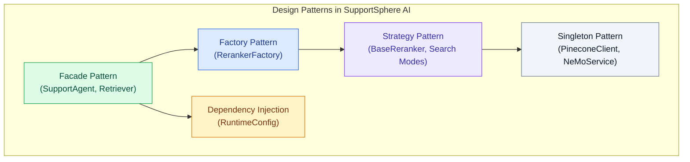
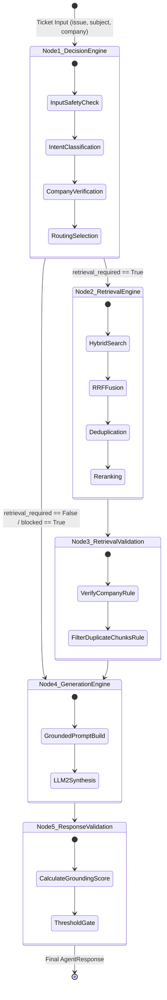
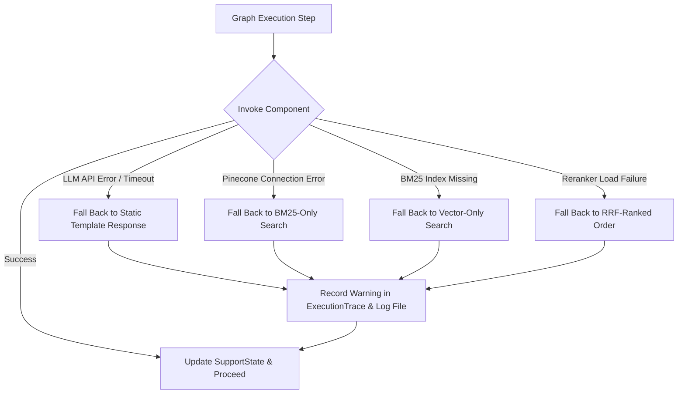

# System Design Specification — SupportSphere AI

> [!NOTE]
> **Document Header Metadata**  
> **Document Title**: SupportSphere AI System Design Specification  
> **Purpose**: Documents the software engineering design philosophy, software design patterns (Factory, Strategy, Facade, Dependency Injection), state management, caching strategies, error handling mechanisms, performance optimizations, and trade-offs governing the codebase.  
> **Audience**: Principal Software Engineers, System Architects, Technical Leads, AI Application Engineers.  
> **Last Updated**: `2026-07-28`  
> **Related Documents**: [README](../README.md) | [Architecture](ARCHITECTURE.md) | [Retrieval Pipeline](RETRIEVAL_PIPELINE.md) | [Decision Engine](DECISION_ENGINE.md) | [Generation Engine](GENERATION_ENGINE.md) | [Evaluation](EVALUATION.md) | [Guardrails](GUARDRAILS.md) | [Observability](OBSERVABILITY.md) | [Deployment](DEPLOYMENT.md) | [Configuration](CONFIGURATION.md)

---

## 1. Design Philosophy & Core Principles

The design of SupportSphere AI prioritizes software maintainability, strict component boundaries, deterministic execution safety, and cost transparency. The architecture applies foundational software engineering principles across all layers:

### 1.1 KISS (Keep It Simple, Stupid)
- **Rules-Only Validation**: Nodes 3 (`retrieval_validation`) and 5 (`response_validation`) use pure Python helper functions (`verify_company`, `calculate_grounding_score`) rather than nested LLM evaluators. This eliminates unnecessary prompt engineering complexity and reduces node latency to `< 5ms`.
- **Single Entry Point**: The web application initialises via `src/app.py`, which delegates all UI rendering to dedicated tab functions without embedding business logic.

### 1.2 SOLID Principles Application

| Principle | Codebase Implementation | Example / File Location |
|---|---|---|
| **Single Responsibility (SRP)** | Each LangGraph node performs exactly one task: Node 1 handles triage, Node 2 handles retrieval, Node 3 validates context, Node 4 generates text, Node 5 validates grounding. | `src/graph/nodes/decision_engine.py`, `src/graph/nodes/retrieval.py` |
| **Open/Closed (OCP)** | Rerankers inherit from `BaseReranker`. Adding a new reranker requires adding a new class without modifying existing reranker code. | `src/retrieval/rerankers/factory.py` |
| **Liskov Substitution (LSP)** | All rerankers (`FlashRankReranker`, `CrossEncoderReranker`, `LLMReranker`, `NoOpReranker`) expose an identical `.rerank(query, results, top_k)` interface. | `src/retrieval/rerankers/noop_reranker.py` |
| **Interface Segregation (ISP)** | `LLMClient` exposes explicit methods (`generate()`) tailored to application needs rather than exposing raw third-party SDK objects. | `src/ai/client.py` |
| **Dependency Inversion (DIP)** | Graph nodes depend on the `RuntimeConfig` abstraction rather than reading environment variables directly from `os.getenv`. | `src/runtime_config/runtime.py` |

### 1.3 DRY (Don't Repeat Yourself)
- **Centralized Configuration**: All environment variable parsing, default fallbacks, and validation rules are contained in `src/config.py`. Submodules import constants directly from `src/config.py`.
- **Unified SupportSphere Logger**: Log formatting, file handlers, and framework filters are configured once in `src/logging/config.py` and reused across the workspace.

### 1.4 YAGNI (You Aren't Gonna Need It)
- **No Premature Microservices**: The system is packaged as a modular monolith running in a single Python runtime, avoiding distributed RPC overhead until scale demands it.
- **In-Memory Pickle BM25**: Uses a lightweight serialized pickle (`bm25_index.pkl`) for lexical search rather than deploying a separate Elasticsearch cluster.

---

## 2. Design Patterns Implemented



### 2.1 Factory Pattern (`RerankerFactory`)
The `RerankerFactory` singleton ([src/retrieval/rerankers/factory.py](file:///c:/Users/cheru/OneDrive/Desktop/GitHub_Projects/SupportSphere-AI/src/retrieval/rerankers/factory.py)) instantiates and caches reranking strategies:

```python
class RerankerFactory:
    _instances: dict[str, BaseReranker] = {}

    @classmethod
    def create(cls, reranker: str) -> BaseReranker:
        reranker_name = reranker.strip().lower()

        if reranker_name in cls._instances:
            return cls._instances[reranker_name]

        if reranker_name == "cross_encoder":
            instance = CrossEncoderReranker()
        elif reranker_name == "llm":
            instance = LLMReranker()
        elif reranker_name == "flashrank":
            instance = FlashRankReranker()
        else:
            instance = NoOpReranker()

        cls._instances[reranker_name] = instance
        return instance
```

### 2.2 Strategy Pattern (Retrieval & Reranking Strategies)
The retrieval engine ([src/retrieval/hybrid_search.py](file:///c:/Users/cheru/OneDrive/Desktop/GitHub_Projects/SupportSphere-AI/src/retrieval/hybrid_search.py)) implements the Strategy pattern to select the retrieval backend dynamically at runtime:
- `hybrid`: Executes BM25 keyword search and Pinecone vector search in parallel, fusing scores via RRF.
- `vector`: Queries Pinecone dense vector index exclusively.
- `bm25`: Queries local Rank-BM25 lexical index exclusively.

### 2.3 Dependency Injection (`RuntimeConfig`)
Instead of reading global variables during graph execution, `SupportAgent.invoke()` constructs a immutable `RuntimeConfig` instance containing provider selections, model names, API keys, search mode, and reranker choice:

```python
runtime_config = RuntimeConfig(
    decision_provider=getattr(src_cfg, "DECISION_PROVIDER", "openai"),
    decision_model=getattr(src_cfg, "DECISION_MODEL", "gpt-5.4-mini"),
    generation_provider=getattr(src_cfg, "GENERATION_PROVIDER", "openai"),
    generation_model=getattr(src_cfg, "GENERATION_MODEL", "gpt-5.4-mini"),
    top_k=getattr(src_cfg, "FINAL_TOP_K", 5),
    search_mode=ticket.search_mode or "hybrid",
    reranker=ticket.reranker or "none",
)
```

### 2.4 Singleton Pattern
To prevent redundant connections and heavy model reloads:
- `PineconeClient`: Manages a single persistent index connection.
- `NeMoGuardrailsService`: Initializes NeMo Colang rails once during application warmup.
- `RerankerFactory._instances`: Caches loaded ONNX / CrossEncoder models in memory.

---

## 3. State Management Architecture

State management in SupportSphere AI relies on the `SupportState` object passed across LangGraph nodes.



### Immutable Stage Telemetry (`ExecutionTrace`)
Each node appends an immutable `StageRecord` to the ticket's `ExecutionTrace`:

```python
@dataclass
class StageRecord:
    stage: str             # e.g., "decision_engine", "retrieval", "generation"
    execution_mode: str    # e.g., "LLM", "Hybrid Search", "Rules-Only"
    provider: str         # "openai", "google", "groq", "N/A"
    model: str            # "gpt-5.4-mini", "gemini-2.5-flash", "N/A"
    llm_called: bool       # True / False
    input_tokens: int
    output_tokens: int
    latency_ms: float
    cost: float
    decision: str          # "ALLOW", "BLOCK", "PASS", "REGENERATE"
    warnings: List[str]
```

---

## 4. Error Handling & Fallback Strategy

The application implements a multi-tier error handling policy to ensure system availability even during external API disruptions:



### Error Mitigation Table

| Subsystem | Potential Failure | Handling Strategy | User Experience |
|---|---|---|---|
| **LLM Client** | API 429 / 500 Error | Catch exception in `LLMClient.generate()`, log error, return static fallback response. | User receives polite service fallback message. |
| **Pinecone DB** | Connection Timeout | Catch exception in `VectorSearch.search()`, issue log warning, return empty vector list. | Retrieval degrades gracefully to BM25 keyword search. |
| **BM25 Index** | Index file unreadable | Catch `FileNotFoundError` in `BM25Index.load()`, issue log warning. | Retrieval degrades gracefully to Vector-only search. |
| **Reranker** | Model memory failure | Catch exception in `RerankerFactory.create()`, fall back to `NoOpReranker`. | Results returned in RRF fusion order. |
| **NeMo Rails** | Syntax / Parsing error | Catch exception in `NeMoGuardrailsService`, permit safe passthrough. | Request passes to Node 1 LLM safety evaluation. |

---

## 5. Caching & Performance Optimizations

1. **Reranker Instance Caching**: `RerankerFactory` maintains an in-memory `_instances` dict. Cross-encoder models (`ms-marco-MiniLM-L-6-v2`) and FlashRank ONNX models are loaded into RAM once upon first use.
2. **Startup Application Warmup**: `src/app.py` triggers background initialization of `NeMoGuardrailsService`, `PineconeClient`, `VectorSearch`, and `HybridSearch` during Streamlit server boot, eliminating cold-start latency for the first ticket.
3. **BM25 In-Memory Search**: `BM25Index` loads `data/artifacts/bm25_index.pkl` into RAM as a tokenized matrix, allowing sub-10ms keyword retrieval without external network calls.
4. **URL-Cap Deduplication**: `HybridSearch.search()` enforces `MAX_CHUNKS_PER_URL = 2`, restricting over-retrieval from long documentation pages and saving prompt tokens.

---

## 6. Scalability & Extensibility Analysis

### 6.1 Horizontal Scaling
- **Stateless Agent Execution**: `SupportAgent` stores no in-memory conversational session state. Graph execution is pure input-to-output transformation, allowing application instances to scale horizontally behind a load balancer.
- **Serverless Retrieval Tier**: Pinecone vector search handles scaling automatically across serverless compute units.

### 6.2 Modular Extensibility
- **Adding a Reranker**: Implement `BaseReranker` interface and register key in `RerankerFactory`.
- **Adding an LLM Provider**: Add model pricing to `src/billing/catalog.py` and implement provider branch in `LLMClient._create_client()`.
- **Adding a Custom Guardrail Rule**: Add Colang policy to `src/guardrails/config/rails.co` and Python action to `src/guardrails/config/actions.py`.

---

## 7. Design Trade-Offs Matrix

| Decision | Chosen Approach | Alternative | Rationale & Trade-Off |
|---|---|---|---|
| **Graph Engine** | LangGraph Stateful Machine | Sequential Python Script | LangGraph provides formal state management, conditional edges, and step-level tracing at the cost of a slight learning curve. |
| **Validation Rules** | Pure Python Actions ($0.00) | LLM-as-a-Judge | Pure Python rules execute in `< 5ms` at `$0.00` token cost versus 3s latency and `$0.005` cost for LLM judges. |
| **Vector DB** | Pinecone Serverless | Local ChromaDB | Pinecone provides managed cloud scaling and metadata filtering without local disk overhead, requiring an API key. |
| **Retrieval Strategy** | BM25 + Vector Hybrid | Pure Vector Search | Hybrid search guarantees keyword precision for exact error codes and feature titles that vector embeddings miss. |

---

## Related Reading

- [System Architecture Guide](ARCHITECTURE.md) — High-level 5-node topology and request lifecycle.
- [Retrieval Pipeline Specification](RETRIEVAL_PIPELINE.md) — Hybrid search, BM25, Pinecone, and rerankers.
- [Decision Engine Specification](DECISION_ENGINE.md) — Triage rules, intent classification, and NeMo policy integration.
- [Guardrails Specification](GUARDRAILS.md) — Colang policies and zero-token Python actions.

---

## References

1. Gamma et al., *Design Patterns: Elements of Reusable Object-Oriented Software* (Addison-Wesley).
2. Martin, Robert C., *Clean Architecture: A Craftsman's Guide to Software Structure and Design* (Prentice Hall).
3. LangGraph Framework Guide — Stateful Execution and Conditional Routing.
4. NVIDIA NeMo Guardrails Developer Manual — Colang 2.0 Syntax & Custom Actions.

---

## Future Improvements

1. **Async Batch Processing**: Replace synchronous batch loop in Streamlit Tab 3 with an async worker pool.
2. **Semantic Cache Layer**: Implement Redis-based semantic query caching for identical support questions.
3. **Dynamic Prompt Versioning**: Store generation system prompts in an external repository with live runtime loading.
